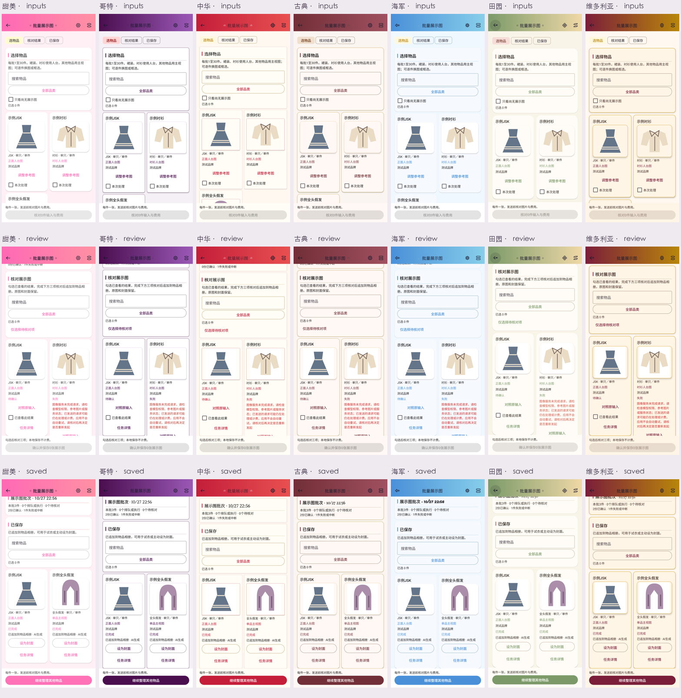
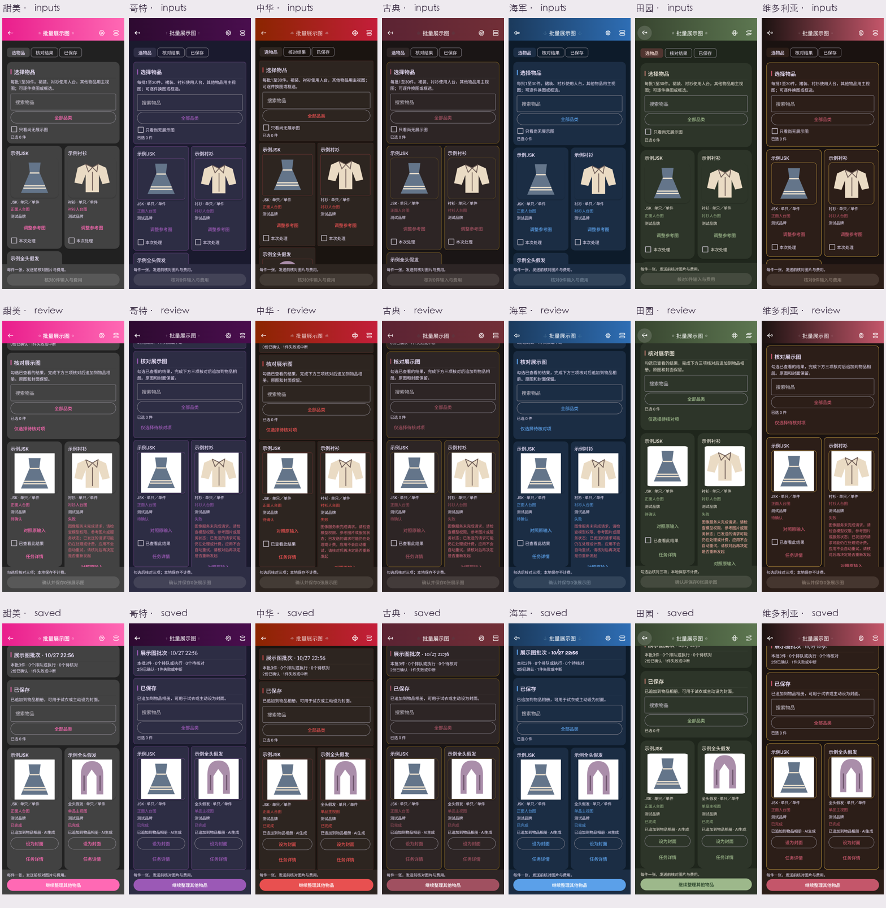

# 批量主视与人台实施

2026-10-27，2.71.0 / 146。按用户选择自动依据稳定物品类型生成人台或主视图；每件一张，跳过透明分层。

## 最终行为

- 裙装与衬衫使用既有固定无杆正面人台；其他类型使用浅灰底主视图。全头假发在批次内独立展示，原选头模入口保留。
- 每批1—30件已拥有／心愿物品，保留搜索、品类、隐藏选择、换图、框选及补充要求。发送前查看逐件实际商品图和所需模板，确认服务及费用。
- 新批次只含选物品、核对结果、已保存三阶段。三项核对后原子追加相册并写AI来源，封面不变；已保存卡片可主动设封面。部分失败不阻塞其他项，失败项在选物品阶段独立重发并重新确认费用。
- “尚无展示图”使用相册与AI来源记录，删除已完成任务不把仍在相册的展示图误认为缺失；旧确认素材亦算已有展示图。筛选保留隐藏选择。
- MANNEQUIN v4请求冻结类型、组合、模板、实际图片SHA、提示词、服务及批次位置；提交和保存重读业务状态。批次入队、保存均为单事务，任何一件异常则整批回滚。旧SINGLE_ITEM_MATERIAL v5/v6批次和透明素材沿原协议操作。

## 数据和费用边界

Room34、45实体及备份15结构不变，无结构迁移或历史数据刷新。JSON/ZIP复用既有任务／相册／来源和图片映射；旧1—14兼容不改。相册追加、来源和任务完成状态同时提交，图片沿ImageFileHelper保护共享引用。未更改订单、价格、付款、拥有状态、位置、个人模特或付费配置。

本轮真实付费调用0次；仪器化测试使用独立内存Room、独立文件目录及受控返回。示例插画与回显只验证输入、排布和保存，不证明正式模型生成质量、商品保真或搭配融合改善。

## 前置设计与原生对照

[采用方案与前置图稿](plans/2026-10-27-batch-display.md)先于UI实现归档。真实界面复用皮肤组件及图标，图片完整Fit并支持放大。原生表单比概念稿保留了完整品类／缺失筛选及原批次管理，队列管理置于商品卡片之后，使结果优先；小屏／两倍字改一列、自然增高，底部操作在真实键盘上方可达。

实际输入与模板：[费用确认](visuals/2026-10-27-batch-display/native-fee-display.png)。[320dp两倍字体及真实IME](visuals/2026-10-27-batch-display/native-small-ime.png)。完整原生证据保留在本机`artifacts/releases/2.71.0/native/`，不将受控商品插画加入正式主包。

## 定向验证

共31项去重设备方法通过，含真实320dp两倍字及IME方法。验证仅覆盖改变的批次、相关入口、任务／图片保护及备份；未跑全量应用测试。

| 范围 | 方法数 | 结果 |
| --- | ---: | --- |
| DisplayBatchWorkflowTest | 4 | 混合类型实际模板、幂等、提交输入变化／数据库回滚、保存变化回滚、相册／封面保全、ZIP往返通过 |
| MaterialBatchViewModelTest | 4 | 多于30候选与隐藏选择、服务变化撤销确认、旧图层确认、任务删除后的来源筛选通过 |
| MaterialBatchWorkflowTest / MaterialCoverWorkflowTest | 7 / 4 | 旧透明批次、单项失败、取消、陈旧重试、共享封面／图片及ZIP保护通过 |
| MaterialBatchScreenTest | 2 | 新流程七皮肤浅暗、部分失败及重试；320dp两倍字／真实IME通过 |
| MaterialBatchNavigationTest / LaboratoryNavigationTest | 1 / 1 | 真实NavHost批次、单件任务核对返回批次、顶栏新建和实验室入口通过 |
| ImageTaskQueueControlTest | 5 | 冻结范围停止／舍弃及原图／已保存结果保护通过 |
| MaterialCategoriesWorkflowTest / MaterialCategoriesScreenTest | 1 / 2 | 10类型、搜索／隐藏选择、重入正确阶段、原生浅暗及小屏IME通过 |

初次UI验证的两处失败来自测试旧假设（顶栏新建仍按列表文字查找，旧深色像素阈值不适用新浅色样本）；修正为当前语义入口及实际样本辨认后，相关方法通过。正常字体运行按条件跳过的小屏方法，随后在真实320dp／fontScale2.0设置下单独执行通过，未计为已验证后省略。

Debug应用及仪器化APK构建通过。正式包构建、覆盖启动、素材核对及双渠道分发结果另记发布回执。
