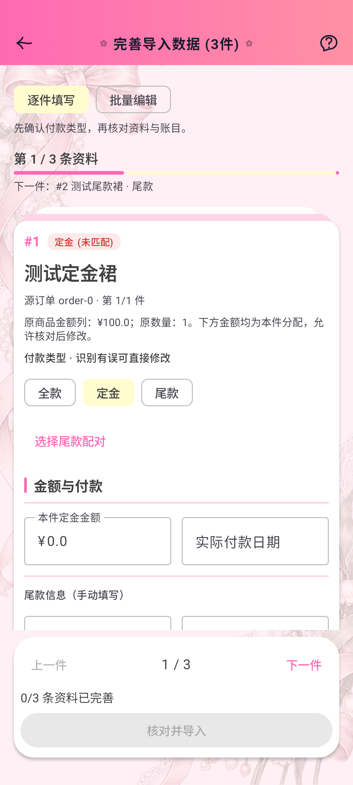
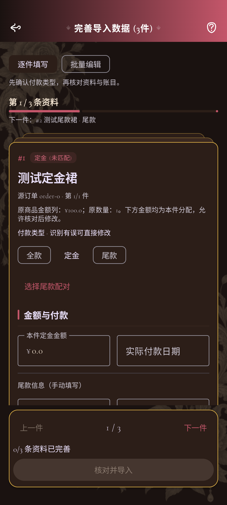
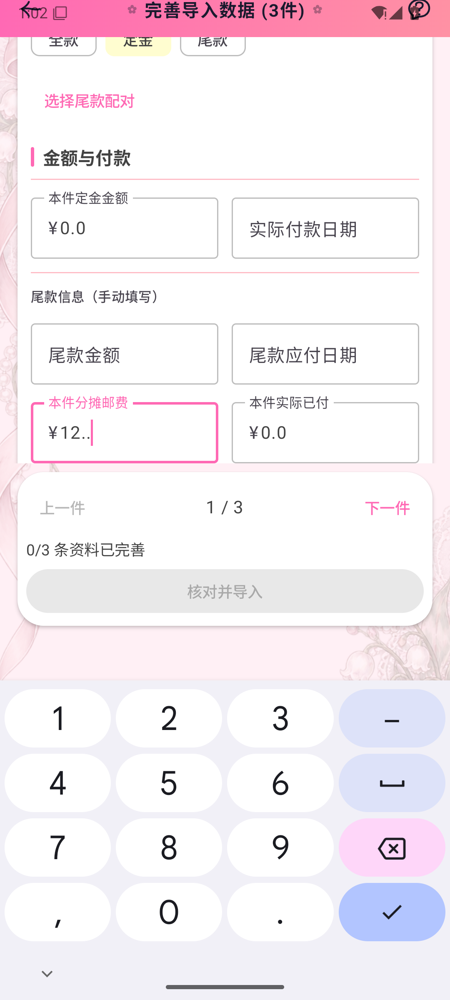
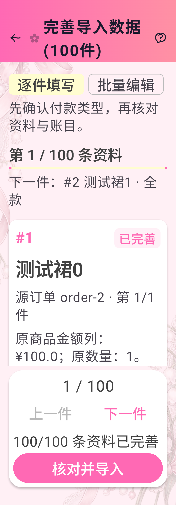

# 逐件订单导入叠层浮卡（2.46.2 / 101）

采用用户选定的叠层浮卡方案：当前商品用精选卡片突出，下一件从卡缘露出，并显示其名称与付款类型。底部独立悬浮的上一件、下一件和导入操作随键盘抬起；切换商品使用皮肤弹簧轻微平移/缩放。

金额与付款优先展示，服饰资料允许展开/收起，缺失名称、品牌或分类时自动展开。批量编辑仍可切换，所有编辑回调使用原始商品索引，金额未完成文本仍由 ViewModel 保管，配对尾款继续继承定金资料。来源订单摘要移到当前卡片后方，仍按该订单全部已选商品合计。

实现使用 `ImportFloatingComponents.kt` 中的 `ImportStackCard`、`ImportSingleProgress`、`ImportActionDock`，复用 LolitaCard 和皮肤间距、圆角、弹簧，未新增数据库/备份字段或图标。动画进度只在 graphicsLayer 中读取；装饰卡缘没有隐藏编辑器、点击或重复朗读。最后一件、批量编辑、键盘打开以及大字体时隐藏卡缘。底部应用导航栏和 IME Insets，列表消费 Scaffold padding。

## 验证

- Debug 编译、170 项 JVM 测试通过。
- 独立 AVD `Lolita_Order_Import_Test` / emulator-5560 的 13 项真实 Compose 测试通过，使用独立内存 Room。
- 覆盖逐件/批量和草稿、配对继承/核对重置、来源合计、折叠及缺失身份、320dp/两倍字体、真实数字键盘打开与导航关闭、七套皮肤浅暗渲染。
- 暗色实拍发现进度标题沿用黑字，补充真实文字像素亮度回归后改为 `onSurface`。新增回归先复现失败，再验证修复。
- 独立代码复核未发现运行问题；要求补齐 AGENTS.md 的组件及测试约定，已同步。

定向命令：

```bash
ANDROID_SERIAL=emulator-5560 ./gradlew assembleDebug testDebugUnitTest connectedDebugAndroidTest \
  -Pandroid.testInstrumentationRunnerArguments.class=com.lolita.app.ui.screen.import.OrderImportInteractionTest \
  -Pandroid.injected.androidTest.leaveApksInstalledAfterRun=true
```

## 实拍

图片来自上述 Android 测试实际渲染，测试商品不写入用户数据库。键盘图来自 UiAutomation 系统截图，包含真实 IME；测试宿主顶栏的状态栏配置与正式应用不同。









正式构建、覆盖升级、双平台附件与更新入口验收记录另见 `docs/release-2.46.2.md`。
