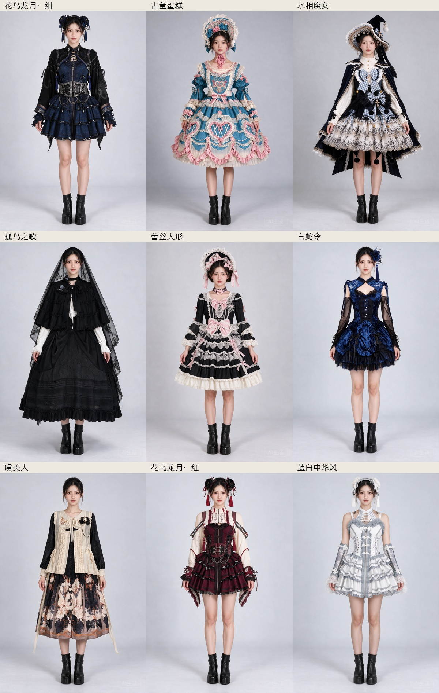

# 生成任务息屏诊断与复杂搭配评估

2026-10-16。针对 vivo 息屏后任务显示“生成未完成”的反馈，保留现有异步任务结构，补齐可信错误原因和后台设置帮助；同时使用用户授权额度实测 Seedream 5.0 Pro 的复杂服饰与小物组合。

## 息屏问题：已确认与尚未确认

代码和真实受控 socket 已复现：API 层能够区分网络断连和等待超时，但 `ImageTaskCoordinator` 的兜底捕获把两者都改成了“生成未完成”。这会让用户无法判断网络、账户、额度还是返回图片出了问题。这是已确认并修复的应用问题。

目前没有连接 vivo 真机，不能确认用户那一次失败究竟来自厂商后台耗电管理、Doze、网络切换还是服务端错误。Android 官方说明 [Doze 会限制网络与唤醒锁](https://developer.android.com/training/monitoring-device-state/doze-standby)，vivo 官方说明 [后台耗电管理可能影响联网](https://kefu.vivo.com.cn/robot/imgmsgData/4ec81ca5ab19401687347b14173c9608/index_1.html?t=1)。前台服务和有限时 CPU 锁不能保证绕过这些系统策略。

本次改动：

- 两家官方 API 只用本地 `ImageGenerationFailureKind` 传递网络、超时、鉴权、余额、限流、方舟用量上限、无效 PNG 与服务错误分类。持久化文案来自本地固定枚举，不接受任意异常消息或服务端正文，不保存 cause、URL、Key。
- 已发送任务失败时，明确说明服务端可能继续处理或计费、应用不会自动重试。沿用 `requestSent`，不新增付费重发、重启重放或网络恢复重试。
- 任务中心、虚拟试衣和人台生成页共用“后台与息屏”入口，展示当前电池优化、后台限制和网络状态，返回前台刷新；只在点击时打开标准电池优化列表和应用详情，不直接更改系统设置。
- vivo 指引：电池 → 后台耗电管理 → 允许高后台耗电；不同系统版本入口可能有差异。仍反复失败时，可暂时保持前台、亮屏和稳定网络完成当前任务。
- 前台服务、有限时 CPU 锁、任务串行化、会话归属、取消/恢复屏障和图片引用保护保持原实现。Room 28、备份 8 和原有保存确认流程不变。

## 实际网络与设备验证

受控 loopback HTTP 在完整上传后断连接、等待超时，验证两家 API 的分类、单次发送，以及实际 coordinator/独立 Room 的 `requestSent=true`、可信原因保留与不自动重试。任意伪装成“网络…”的异常仍使用固定兜底文案。

独立 AVD `emulator-5564 / Lolita_TryOn_20261015` 的零费用受控探针观察到了 `mScreenOn=false`、`mForceIdle=true`、`mState=IDLE`，响应仍能完成；结束后恢复亮屏和正常 idle 状态。这个环境没有复现网络被拦截，不能说明 vivo 没有该问题。

另外使用本地临时测试驱动，通过正式 `AppModule`、加密 Key、真实 `ImageTaskCoordinator`、`ImageTaskService`、官方 HTTPS API、PNG 保存和 Room 完成了实际生成：

| 实际请求 | 环境与结果 |
|---|---|
| 25 | 亮屏，古董蛋糕三件搭配，完成并保存，57.148 秒 |
| 26 | 已发送后发出息屏指令、观察到前台服务，41.338 秒完成；首次瞬时屏幕状态采样未确认关闭，因此不作为确认息屏证据 |
| 31 | 已发送后观察到 `mScreenOn=false`、`mWakefulness=Asleep` 和 `isForeground=true`，37.839 秒完成并保存 |

实际调用使用原始提示词和同一固定成年虚构模特，不经过本机模拟响应。该 AVD 有 instrumentation，不能代表厂商真机的省电策略；实际请求 31 没有强制 Doze，不能混同前面的免费受控探针。测试创建的临时服饰、结果、Key 配置已清理/恢复，临时驱动已移出源码，未进入正式 APK。

## 提示词与参考图实验

用户在原 20 次之外追加 50 次，本轮采用最多 70 次的保守上限，没有另加中间提到的 10 次。每次请求前先写持久预算记录，唯一运行标识拒绝重复，所有传输均无自动重试。

最终预算记录 54 次：**52 次实际 API 请求，51 张成功结果，1 次 HTTP 400；2 次本地测试驱动因配置提前清理而跳过，未发送 API。** 这两个未发送的记录仍占用保守预算计数。没有为了用满额度继续生成；临时 Key 已删除，剩余额度保留。失败请求也计入次数，不推断实际计费金额。

模型固定 `doubao-seedream-5-0-pro-260628`，同一官方 `/api/v3/images/generations`，1024×1536、PNG、`b64_json`、非流式、官方水印开启。使用原备份中的真实产品图，不是 UI 压力测试服饰；只上传所选图片、名称和穿戴角色，不上传价格或私人备注。图 1 始终是应用内固定成年虚构模特。

九套原始搭配包含花鸟龙月·绀、古董蛋糕、水相魔女、孤鸟之歌、蕾丝人形、言蛇令、虞美人、花鸟龙月·红、蓝白中华风，涵盖三至五件服饰/小物、两件头饰、长手袖、腰饰、披肩、颈饰和胸针。言蛇令的小物套装说明卡没有当作实物图发送；其上衣/手袖原参考图字节相同，保留作为真实歧义样本。无法解码的原参考没有上传，也没有用替代图片冒充同一件服饰。

测试了五版提示词：原版；长篇逐角色提取；加强结构保留的长篇版本；简短中文版本；原版上只追加完整袖子、配饰连接和装饰叠加的最小修改。另有古董蛋糕、言蛇令的明确研究用裁图，原文件不改、不自动应用到用户衣橱。对困难样本做了重复生成，对三套补充搭配做了扩展验证。

八套原版/中文版本做了随机 A/B 独立视觉复核，复核者未读取提示词或映射表，结果冻结后才解盲：原版 6 套较优、中文 1 套弱优势、1 套持平。原版主要优势是完整外搭袖长、Bonnet 帽带、披肩层次、胸针不替换原胸花，以及长手袖覆盖。长篇版本反而稳定出现古董蛋糕漏袖；中文版本虽恢复袖子，却漏掉帽带等细节。最小追加也没有显示普遍优势，裁图不能稳定消除结构误读。

**结论：保留生产原提示词，不把局部看起来更好、整体有退步的候选上线。** 小图片无法提供精确蕾丝纹样、印花和小胸针细节；模特面孔和姿势只能评估大致一致，不能宣称像素级身份或服装复制。每组只有一张或少量重复，不把这批视觉结果当成统计成功率。

调用清单、输入/输出和提示词 SHA256、用量、时长、冻结复核与预算见 [结构化评估](image-generation-evaluation-2026-10-16.json)。全部 51 张原始 PNG、逐次提示词、输入图、裁选坐标、受控/真实设备记录保留于本机 `artifacts/image-evaluation/2026-10-16-screen-off/`；不进入 APK，也不自动追加进用户服饰图片。

## 回归与发布边界

新增的回归覆盖实际 socket 断连/超时、本地错误分类到 Room、未知异常防泄露、可打开的标准设置目标和真实 Compose 帮助入口。完整 JVM 254 项通过；Debug 与全部 Android 测试源码编译通过。最终独立 AVD 回归 39 项通过、1 项需要显式本地服务器的探针按条件跳过（该探针已在此前单独运行）。正式发布仍执行 clean、原正式签名、2.51.0 同签名覆盖升级和原表/图片/设置保全核对；发布回执另外保存，不能以受控传输替代真机或真实 API 联调。
