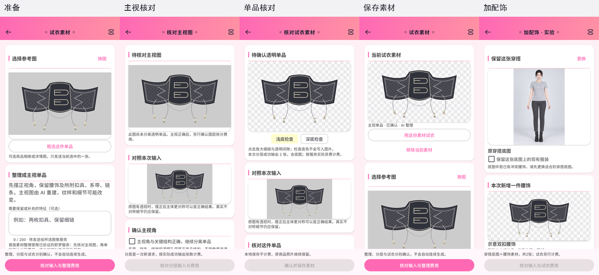
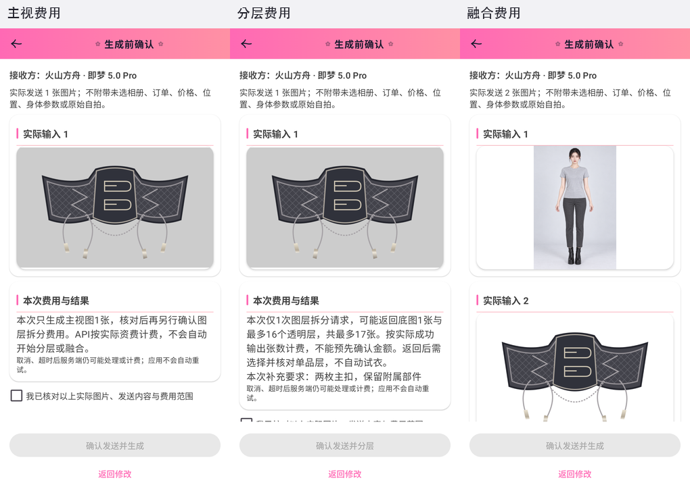
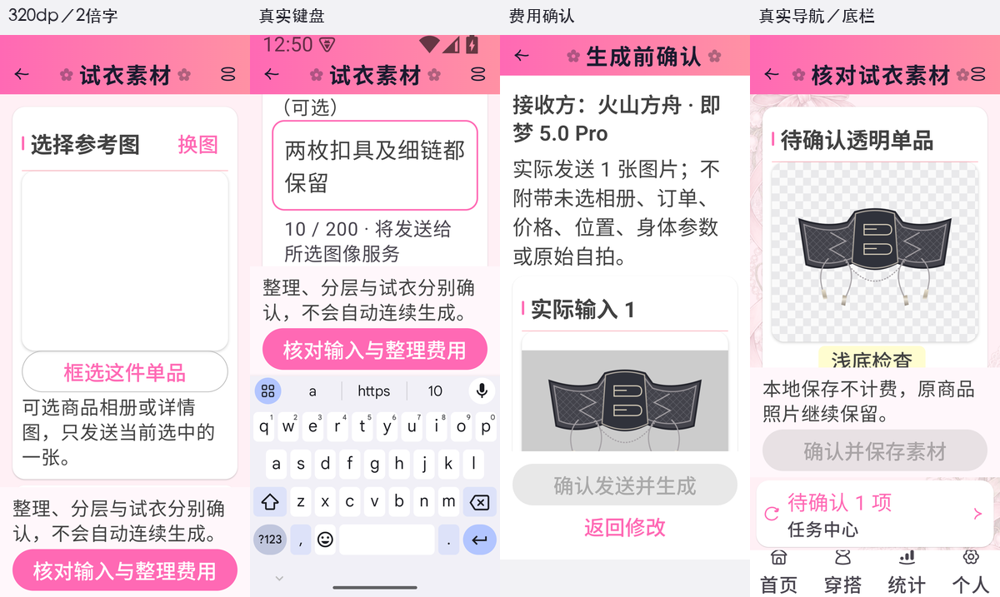

# 主视单品素材与加配饰实施记录

2026-10-21。应用版本2.62.0／133，Room31／36实体，备份11。设计图先于实现归档于[设计方案](plans/2026-10-20-item-tryon-material-app-design.md)；正式包与渠道验证以发布回执为准。

## 最终体验

腰饰详情新增独立“试衣素材”。选择商品图／详情图或框选区域后，先预览实际输入和费用，再使用即梦摆正主视图。用户确认主视角正确后，另行预览并确认图层拆分费用；拆分返回底图及前景层，多候选可选一层。检查完整单品、关键结构和残留内容三项后才保存。更换候选会清除核对；替换／移除有明确确认，原商品相册、封面、价格、位置、拥有状态和穿搭次数保持。

保存的素材可用于原完整换装，或选择“加配饰”，明确使用一张已有穿搭／已穿衣个人模特底图，只增加一件腰饰。完整换装继续要求基础服装。结果自动保存到试衣历史，独立底图副本支持放大对照；不登记为实际穿过。图片始终完整Fit，可放大；透明检查浅／深底仅存在于显示层。

## 服务、实际输入和费用

真实验证采用现有Seedream 5.0 Pro共享适配器，无需增加OpenAI密钥。官方[图像API](https://docs.volcengine.com/docs/ark/image-generation-api?lang=en)的`layer_decomposition=true`可返回底图和最多16个透明PNG层；按实际成功输出张数计费，1次拆分请求不等于1张图。费用页写明最多17张、金额取决于服务资费，不自动串联下一步。

首版素材创建只开放Seedream。OpenAI透明编辑适配器按[官方参数](https://developers.openai.com/api/reference/resources/images/methods/edit)实现，因缺少真实凭据未实测，创建入口未开放它；已保存素材的融合仍沿用两家服务选择。切换服务／图片／底图／素材或修改要求后旧费用确认失效；接收方与最终执行服务一致。费用确认需滚动到末尾核对实际输入与费用，再主动勾选发送。

新任务v5冻结实际PNG文件、SHA256、完整提示词、型号和用途。即梦融合从透明素材制作铺白发送副本，预览文件就是发送字节；透明原文件不改。OpenAI融合副本保留alpha。新路径超4MiB仅等比缩小PNG，无JPEG回退。原始自拍、未选相册、账本、位置、身体参数不随新任务发送。

失败、取消、超时和重启均不自动付费重发。分层失败可在看过冻结主视图后重新确认费用，无需再次生成主视图；请求是否发送及可能计费说明继续保留。图片格式／透明性／哈希失败拒绝保存；不以连通块数判断语义件数。

## 数据与生命周期

- 新`ItemTryOnMaterial`独立于商品相册，每物品一份当前确认素材，保留原始实际输入、分层输入、结果哈希和来源请求；删除Item级联移除记录。DAO／薄Repository／AppModule均已接线。
- 30→31只追加实体、任务material/layers/generated count及结果base snapshot列。迁移设备测试向全部35张旧表插入哨兵，逐旧列、关系、完整性和图片字节比较，新增列默认及空素材表验证通过。
- 备份11导出／预览／CSV／ZIP／路径恢复同步更新。旧1～10缺失新表／字段补默认；原v1～4任务语义不变。透明层、素材及结果底图进行完整文件校验；待确认／确认素材、删任务后的结果与对照图、个人模特身份均已往返验证。
- 待确认候选、素材三张文件、冻结输入、结果底图和导出过程进入统一引用保护。提交接受前同步固定引用，页面销毁不取消已接受任务。素材替换核对当前身份；分类改变后禁止保存旧语义素材，完整试衣拒绝复用过期类型。删原物品不能新建／改绑素材；已接受的融合依赖冻结输入继续执行。
- 删除任务保留已确认素材／历史；删历史清理其结果与独立对照图，仍被他处引用的文件不误删。恢复取消旧运输后替换数据，导入活动任务中断且不自动重发。

## 真实页面与定向验证

专用AVD `Lolita_Material_Test_20261021`，独立内存Room、文件目录和受控服务。测试不使用用户设备／私有照片／真实凭据。原生页面截图78份的SHA及尺寸见[图像验证清单](visuals/2026-10-21-item-material-native/verification.json)，公开归档13张拼图。主体常规390×844dp；真实小屏320×720dp、两倍字体。输入框标题改为独立说明，避免浮动标题多行重叠；真实键盘可见性断言与整机截图已验证，底部操作保持可达。NavHost进入待确认素材并返回时任务仍保留。

七套浅暗的五种真实页面分别归档：`prepare`、`front`、`layers`、`saved`、`accessory`的`light/dark.png`。复用现有皮肤、分区、画框、图片、滚动注册与图标，无新增普通Material风格页面或主导航。新素材区域不引入金额，既有金额隐私继续生效。

验证范围为新增协议／分层适配器／旧备份／现有两家图片API、迁移、原生图片准备、素材保存和替换／失败／删除／哈希、待确认与确认ZIP、融合历史对照、费用失效、基础服装与旧任务执行／取消／恢复／清理、七皮肤和导航。`assembleDebug`及相应定向JVM／设备测试通过。旧受控socket测试因其显式前提未满足跳过，其他运输受控测试及真实Seedream调用分别提供证据；不宣称全量回归。

初次测试出现过测试截图选错Dialog根节点、导航等待／持续背景动画导致测试不同步，均修正测试宿主并重新执行；最终图稿基于明确费用页根节点。并发现融合底图名误写为仅名称的个人模特身份导致备份拒绝，已修正生产字段及对应备份匹配，补充两类底图往返测试。日志保留在本机`artifacts/image-evaluation/2026-10-20-tryon-material-app/`。

## 真实服务样本与限制

独立新100张额度已发4次请求，成功输出6张（两次拆分均包含底图），按保守输出计数余94张，无自动重试。不是把前轮20次或旧100次额度混用。每次输入／提示词／输出SHA和结果摘要见[服务评估](item-material-service-evaluation-2026-10-21.json)。照片与派生图保留本机私有目录，未进入公开文档、app资产或测试APK。

原灰黑腰封偏侧视角，摆正后的主体对称合理。样本透明层保留两枚主扣、链条和四个绳端，融合能够包裹腰部；人物、裙纹和部分材质仍重画，结果还存在淡角落文字瑕疵。单样本只能证明接口闭环和当前示例效果，不能证明普遍保真、原像素保护、其他品类或尺码合身。人工核对是正式流程的一部分。

## 完成检查

- 已先图稿和七皮肤概念效果，再实现并对照真实页面。
- 已核对实际图片完整预览、放大、透明底及原资料保全。
- 已覆盖本次迁移／旧备份／新ZIP／引用与失败边界。
- 已分开受控运输、真实接口、人工质量和未实测服务。
- 已同步AGENTS与产品规范；源码、正式签名和渠道交付另记发布回执。
