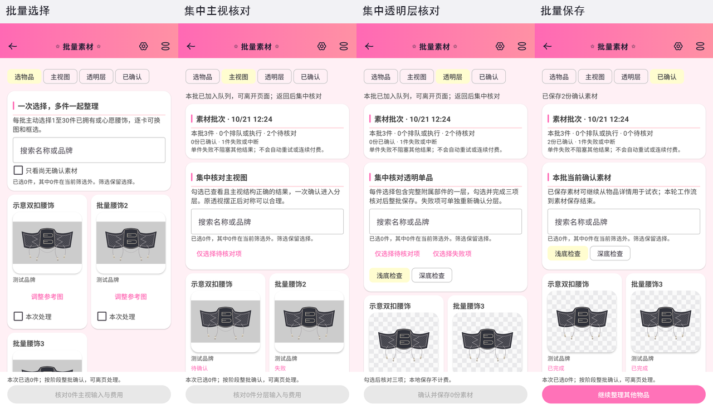
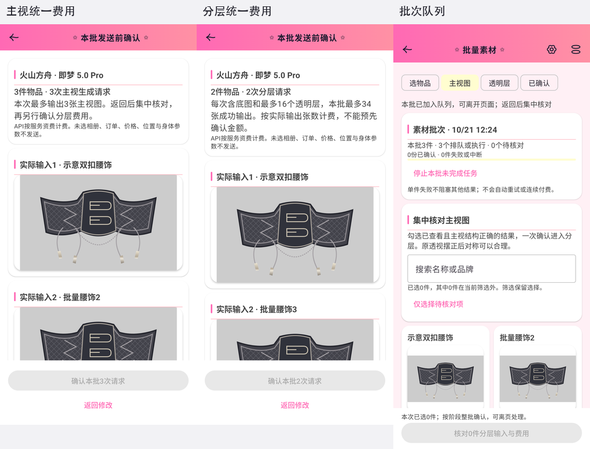
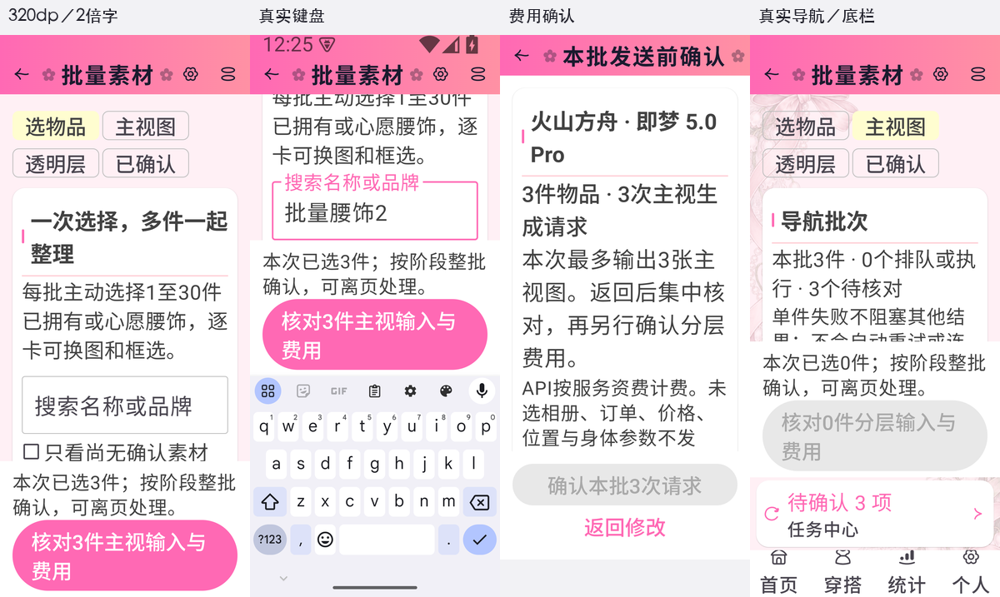
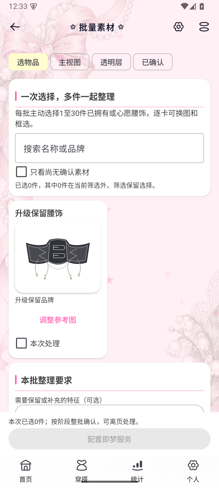

# 批量整理素材实施记录

2026-10-21。2.63.0／134，Room32／36实体，备份12。用户已明确本轮只做批量整理素材，既有单件试衣与加配饰继续可用。先完成[流程及七皮肤图稿](plans/2026-10-21-material-batch-flow.md)，再实现真实Android页面。

## 最终流程

任务中心 → 新建素材批次 → 主动选择1～30件腰饰 → 统一核对主视输入和费用 → 后台逐项处理 → 集中勾选正确主视图 → 统一确认分层费用 → 集中选层和人工核对 → 批量保存素材。一次确认的是同一阶段的多次请求；不会自动跳到下一次付费。离页、返回和任务中心分组都沿用同一批次，每件有独立来源与状态。单件失败不阻塞其他结果，失败项主动重新核对费用后再发起。

批量入口零预选；无素材的详情只预选当前件，支持继续添加。搜索与“尚无素材”筛选保留隐藏选择并显示数量。每件可更换商品／详情图或框选，完整Fit、放大、原输入对照及浅／深透明底复用原组件。常规屏两列，窄屏／大字一列；底部只有当前阶段主操作，消耗Scaffold Insets后适配IME。

## 付费与数据保护

N件主视图为N次请求、最多N张输出；分层N次请求、最多17N张成功输出，含底图。费用页列出全部实际图片、接收方、用途与补充要求，滚动到末尾主动勾选后才发送。当前创建仍限已真实验证的即梦，选择或配置变化使旧确认失效；无新服务接入。API密钥不进入任务、SavedState、备份或日志，不发送未选相册、账本、位置及身体参数。

协调器在统一准入锁下固定图片引用，核对全部输入哈希、物品和当前素材，单事务插入整批后才启动服务。稳定操作ID防止同一提交重复接受；已出现更新任务时拒绝陈旧失败项再次重发。执行仍沿用既有串行队列和共享生成互斥，批次不承诺远端并发。保存整体核对已确认素材身份及候选图片，任何一项冲突都回退整批；原商品、价格、状态、位置和穿搭记录保持。已保存素材依然独立于商品相册。

Room31→32只追加三个可空批次列，不新建实体；旧任务保持空批次。备份12保留分组，兼容旧1～11。ZIP完整保存冻结输入、待确认层及进入分层后仍可回看的主视预览，恢复时重新映射路径；活动任务转中断，不付费重发。CSV追加三列，预览继续统计实际任务。删除与取消沿用UUID图片及统一引用保护，已确认资料和其他批次不会随本批取消而删除。

## 验证证据

使用独立AVD `Lolita_Material_Test_20261021`、独立Room／文件夹和受控图像运输，不使用私有照片或真实密钥。设备测试覆盖`MaterialBatchWorkflowTest`（7项）、`MaterialBatchViewModelTest`（3项）、`MaterialBatchMigrationTest`、`MaterialBatchScreenTest`和`MaterialBatchNavigationTest`；共用协调器重构同时定向回归`MaterialWorkflowTest`、`ImageTaskExecutionTest`及`ImageTaskAdmissionCleanupTest`。既有受控socket用例因显式opt-in前提未满足跳过，其余选例通过，不称全量回归。

JVM定向覆盖`MaterialBatchBackupFormatTest`、`MaterialBackupFormatTest`及`ImageTaskBackupFormatTest`（共10项）；验证旧备份空批次、不完整元数据拒绝和原任务协议。迁移设备测试对36张旧表写入哨兵，逐原字段及图片比较，三个新增列保持空。批量设备场景包括中途失败、整批输入失效、SQL插入回退、同操作重放、陈旧素材保存回退、独立批次取消、恢复不重发、已接受主视图ZIP保全及旧失败项陈旧重试拦截。

七皮肤浅暗覆盖选择／主视／透明层／已保存四阶段。常规390×844dp；真实320×720dp、两倍字体及真实键盘验证底部操作可达，搜索后仍选中全部原选择。真实NavHost验证任务中心仅显示一个批次、打开本批工作台、返回和新建零预选。截图与SHA见[清单](visuals/2026-10-21-material-batch-native/verification.json)。早期截图等待误将被滚动裁切的第三张图视作完整可见，导致测试超时；修正测试判断后重跑通过，最终图片不再遗漏第二张异步加载图。没有用截图等待失败冒充生产缺陷或视觉通过。

`assembleDebug`通过，最终代码定向测试通过；正式构建、升级和双平台发布结果另记回执。本轮新增真实付费生成0次；独立100张额度沿用前轮4次请求／6张输出，余94张，未混用更早试验额度。受控运输只证明批量流程，不增加对模型商品保真、其他品类、融合或合身的质量承诺。首版仍只开放已拥有／心愿腰饰。

## 完成检查

已先图稿、七皮肤效果，再实现并对照真实页面；已检查Fit／放大／原图和透明底；已覆盖迁移、旧备份、ZIP、事务和引用保护；已控制陈旧确认、重复提交、失败及独立付费；无账本／统计／提醒语义变化。AGENTS与产品规范同步维护，提交推送和正式发布依仓库流程执行。

## 正式交付

源码`f43762d2`与`v2.63.0`标签已推送，提交源码归档执行clean原签名Release通过。独立AVD从2.62.0覆盖并两次启动，36张旧表原列及11张原图片SHA全部保全，新增批次列保持空；正式App从个人页进入任务中心新建批次，零预选且原心愿腰饰可见，安装包字节与发布APK一致。36份项目assets、7张背景alpha／可见RGB、依赖素材及生成profile均核验，未跟踪图片和测试插画未进入主包。

[GitHub发布](https://github.com/aalm1233/lolita/releases/tag/v2.63.0)与[Gitee发布](https://gitee.com/aalm1233/lolita/releases/tag/v2.63.0)使用同一APK和SHA256SUMS，两边匿名完整下载、SHA及HEAD通过，公开Gitee版本查询选中2.63.0。未重跑用户已接受限制的应用内网络检查，不把公开查询当作应用内成功，未删除旧附件。详细[发布回执](material-batch-release-2.63.0-verification.json)。

