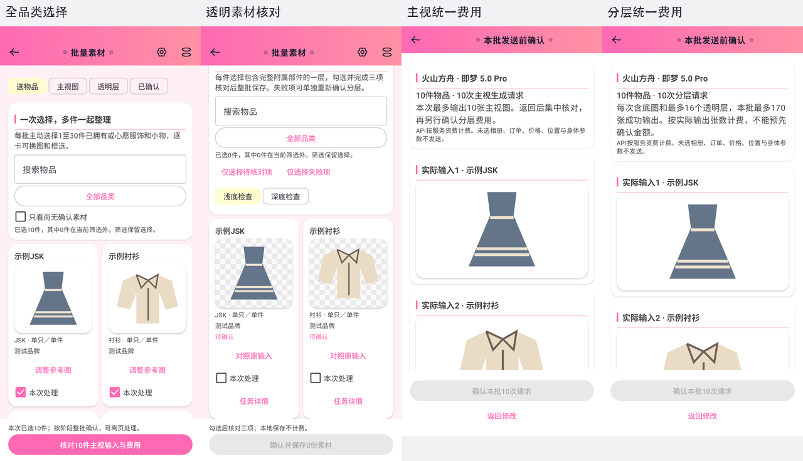
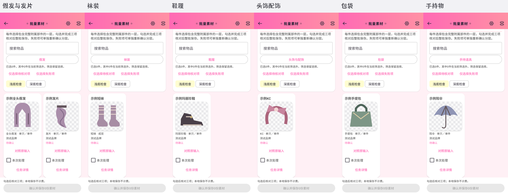
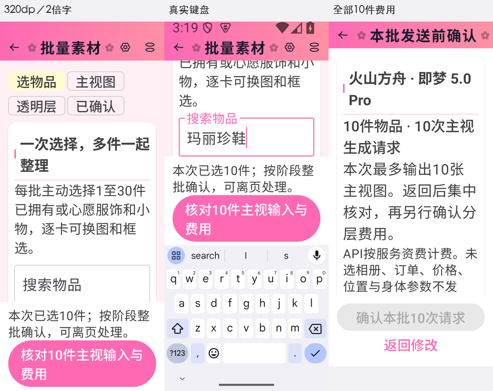
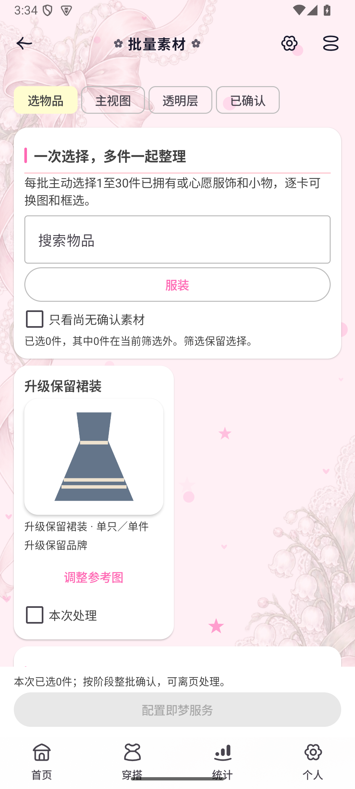

# 服饰与小物批量素材实施记录

2026-10-21，2.64.0／135，Room32／36实体，备份13。用户明确要求其他服饰与小物都支持批量整理。保留原批量流程，先完成[混合品类与七皮肤图稿](plans/2026-10-21-material-all-categories.md)，再实现原生页面及受影响回归。

## 使用体验

任务中心新建素材批次可混选服装、假发／发片、袜装、鞋履、头饰配饰、包袋与手持物，仍一次1～30件，默认零选择。类型使用稳定语义，已拥有／心愿范围保留；类型待确认时在既有编辑中明确，不猜类别。搜索名称／品牌／类型，并可筛选七大类，筛选不清除隐藏选择；卡片显示真实类型和单件／双／组，详情与已有素材管理同步开放。

主视、分层费用各自统一核对全部实际输入后才整批排队，结果集中放大、选层和人工核对后批量保存。服装保留领袖、长度和下摆；裙撑不补主裙；全头假发不带头模，发片不变整顶；鞋具保留必要侧向；单只不补双，明确成组及附属部件同层。完整Fit、透明检查底和原输入对照保留。小屏和大字单列，搜索采用短浮动标题，键盘上方主操作可达。

## 协议、备份与业务

新增素材专用v6，冻结稳定品类、默认角色、组合、提示词修订2、服务和PNG输入哈希。v6不能变为试衣、人台或模特任务；旧v1～5保持原约束与冻结字段，旧及新腰饰整理继续沿用v5提示词。后续分层和保存验证最新类型，v6同时验证组合；一项失效仍整体拒绝或回退，不留下部分付费提交／部分覆盖。已确认的服装和鞋履素材可沿用完整试衣，仍要求基础服装；加腰饰不扩展到其他用途，也没有新增批量融合。

Room32及36实体、图片字段不变，无迁移和历史资料改写。备份13用于新增请求用途，旧1～12仍可读，旧12的v5批次原样保留；拒绝在旧格式夹入v6。JSON／ZIP、预览、CSV与各图片归属沿用，真实混合批次经完整ZIP恢复后逐素材哈希和分组一致。原照片、素材、账本、拥有状态、位置及穿搭历史不被素材整理改写。

服务仍为即梦，准备和筛选不调用模型，密钥仍仅在本机加密配置。每阶段N件为N次请求；分层每次最多17张输出含底图，按服务实际输出计费。失败不阻塞其余物品，不自动重试或发起下一阶段；重进已有分层队列时打开实际分层阶段。

## 定向验证与真实页面

`MaterialCategoriesTest`覆盖全部已确认语义及四种组合的v6序列化、角色、限制、关键品类指引、旧12批次与新13；另回归原素材协议与相关备份。`MaterialCategoriesWorkflowTest`覆盖十件七类混合的准入／执行／保存／ZIP、类型和组合变化拦截、隐藏选择和重入分层、已确认服装＋鞋履在完整试衣中的复用及组合变化后拒绝。受控运输使用原创矢量夹具，只证明流程与图片归属；不证明模型保真。

独立AVD回归原`MaterialBatchWorkflowTest`、`MaterialWorkflowTest`、`MaterialBatchViewModelTest`、`MaterialWorkspaceViewModelTest`、`MaterialBatchNavigationTest`、`ImageTaskExecutionTest`和`ImageTaskAdmissionCleanupTest`，以及受影响的原素材管理／费用／试衣选择界面。既有受控socket用例因明确opt-in前提缺失跳过，其他选例通过；不是全量回归。

新增真实页面包括选择及透明核对的七皮肤浅暗、六类筛选结果、统一费用与保存，以及320dp两倍字／真实IME。原列表预加载的未放置图片曾被截图等待当作可见图，造成测试超时；改为仅检查实际显示节点后重跑通过。小屏搜索长浮动标题折行已改短并再次验证。41份截图及SHA见[清单](visuals/2026-10-21-material-categories-native/verification.json)，七张公开拼图均为真实Compose。

Debug及定向验证通过。正式源码、clean原签名构建、2.63.0覆盖及双平台分发验证以正式回执为准。

## 真实接口与范围

从编译后的生产方法导出提示词，使用原即梦适配器测试已有衬衫和短靴参考。主视均成功，去除了人台／腿部和页面文字；衬衫蕾丝、排扣及鞋履五金纹理仍有重绘。靴子分层成功，一层包含原图可见的两只靴子并具有真实透明通道；衬衫分层超时，没有结果，也没有重试。独立鞋履请求继续完成，不以衬衫超时自动重发。

本轮4次请求、4张已知成功输出（含分层底图），沿用本次独立100张额度；累计8请求／10张成功，超时按最多17张保守预留，合计27、保守余73，实际服务端处理及账单未知。主机接口测试发送已有参考原字节，JPEG／PNG自动封装；本机Android的PNG准备和冻结传输由独立设备验证，不宣称主机字节与Android编码相同。私有输入输出不进入源码、测试APK或公开图稿。[完整评估摘要](material-categories-service-evaluation-2026-10-21.json)。

其他品类有流程和品类规则覆盖，尚未逐类实测真实模型。不承诺完全保真、补全不可见部分、尺码或合身；人工核对仍是保存条件。

## 完成检查

图稿先于实现，七皮肤与原生对照、小屏大字／IME、完整Fit和放大、隐私和独立计费均已按本轮范围核对；旧协议、备份与图片引用、类型／组合变化、批量事务及完整试衣复用已验证。账本／统计／提醒无新增写入。AGENTS及产品规范同步更新，正式交付另记回执。

## 正式交付

源码`94721aa5`和`v2.64.0`标签已推送；提交归档执行clean原签名Release通过，36份主包项目assets、7张背景alpha／可见RGB、依赖素材与生成profile核验。十张新增测试插画及私有照片未进入主包。独立AVD从2.63.0覆盖并两次启动，36张旧表原列、已有v5批次及14张基准图片SHA保全，Room仍32。正式App的服装／鞋履筛选、隐藏选择保留、裙装详情进入批次预选当前件均实测，安装包与发布APK字节一致。

[GitHub](https://github.com/aalm1233/lolita/releases/tag/v2.64.0)及[Gitee](https://gitee.com/aalm1233/lolita/releases/tag/v2.64.0)正式发布同一APK和校验文件，双平台匿名完整下载、SHA及HEAD通过，公开版本查询选中2.64.0。未重跑应用内网络检查，不把公开查询当作应用内成功；未删除旧附件。详细[发布回执](material-categories-release-2.64.0-verification.json)。

