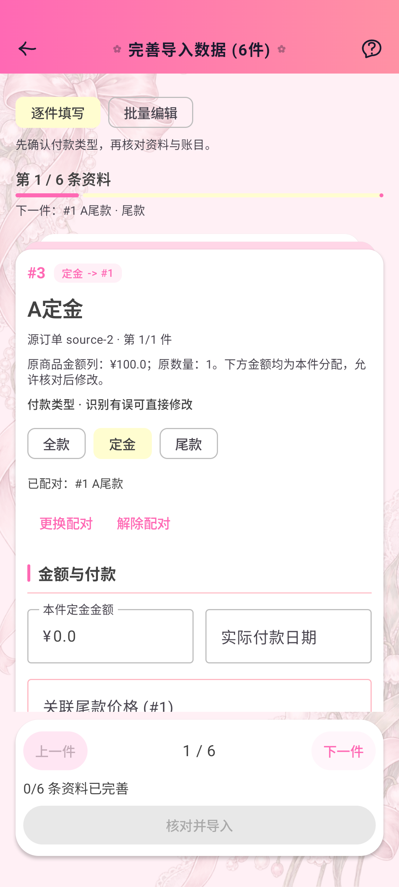

# 订单导入定金尾款相邻展示（2.46.3 / 102）

原实现已经识别并保存定金尾款配对，但逐件上一件/下一件、批量列表和下一件说明仍直接遍历原表顺序。原表尾款早于定金或两者间有其他商品时，核对会来回跳转。

`importDisplayOrder` 单次扫描原队列，产生展示用原索引序列。合法双向配对按定金、尾款成组，组位置取两者最早原位置；其他记录保持原相对顺序。越界、自指、单向、同角色或全款配对均按普通原记录展示，不由排序建立新的配对。

例如原顺序为「A尾款、全款服饰、A定金、B尾款、未配对定金、B定金」，展示顺序变为「A定金、A尾款、全款服饰、B定金、B尾款、未配对定金」。原数组不变，配对、金额草稿、图片选择和导入回调继续使用原始索引。卡片和配对提示中的 # 编号仍为原资料编号，进度计数为展示位置。

逐件和批量/筛选使用同一序列。当前商品保存为原索引，配对更换、解除、角色修改后只更新展示位置，不突然切换正在编辑的商品。上一件、下一件、进度、下一件提示及装饰剩余数量使用展示位置，动画方向由导航按钮明确提供。

## 验证

Debug 构建、177项JVM和16项设备交互测试全部通过，独立代码复核未发现问题。

- 新增 `ImportDisplayOrderTest` 7项：空/无配对、尾款在前、多组交错、非法配对、动态更换/解除、金额与身份草稿不变、2000条完整且不重复。
- `OrderImportInteractionTest` 新增3项真实Compose回归：倒序配对默认首件与双向导航/草稿、批量相邻及筛选纠错、动态重排保持当前项。使用独立内存 Room 和独立 AVD。
- 新导航回归在修复前复现首件显示尾款的失败；批量测试通过非编辑语义限定标题，避免同名输入框干扰可见性检查。
- 保留原有13项交互回归，覆盖七皮肤浅暗、IME、320dp两倍字体、来源订单合计、金额草稿及配对核对重置。

定向验证：

```bash
ANDROID_SERIAL=emulator-5560 ./gradlew assembleDebug testDebugUnitTest connectedDebugAndroidTest \
  -Pandroid.testInstrumentationRunnerArguments.class=com.lolita.app.ui.screen.import.OrderImportInteractionTest \
  -Pandroid.injected.androidTest.leaveApksInstalledAfterRun=true
```



正式构建、同签名升级和双平台附件验收见 `release-2.46.3.md`。
