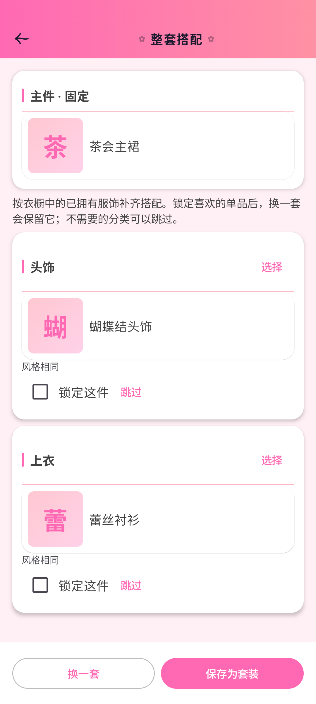
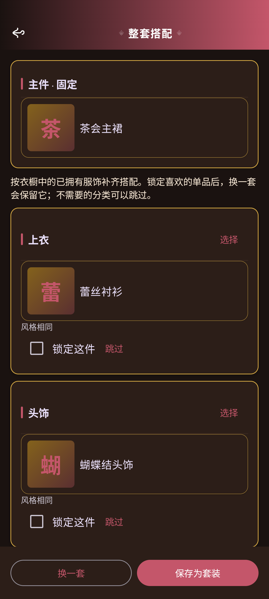
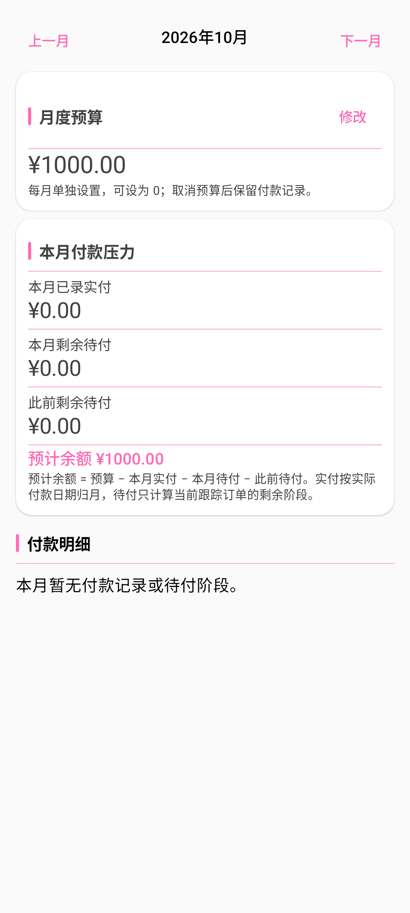
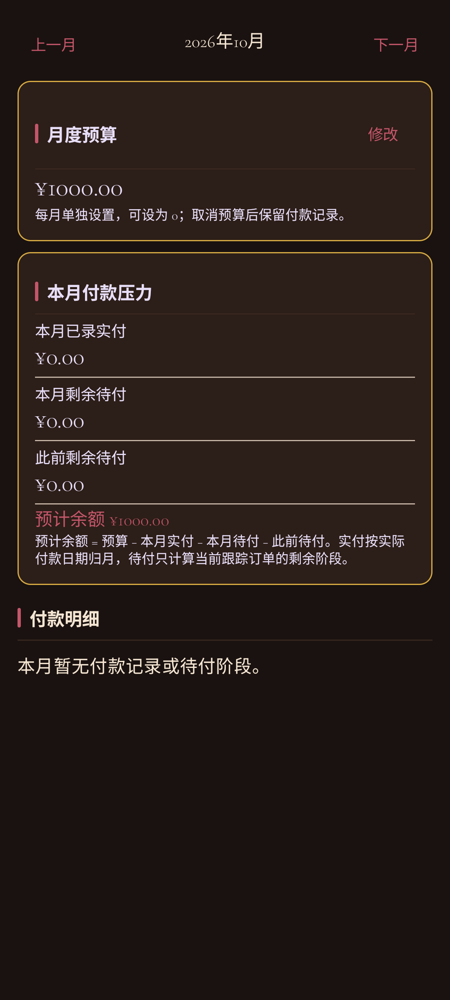
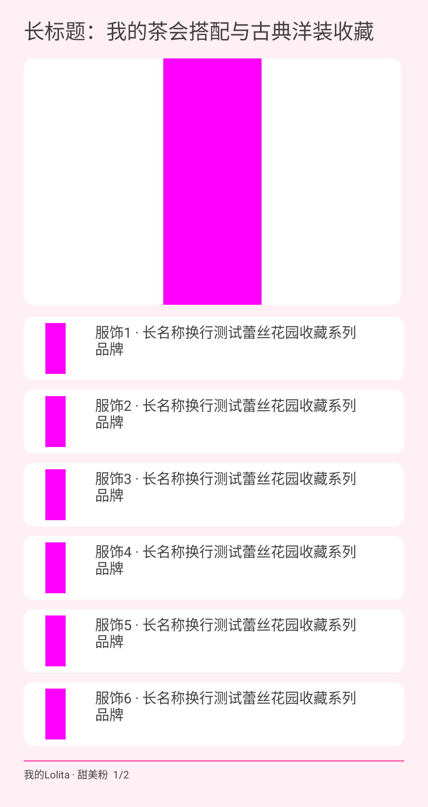
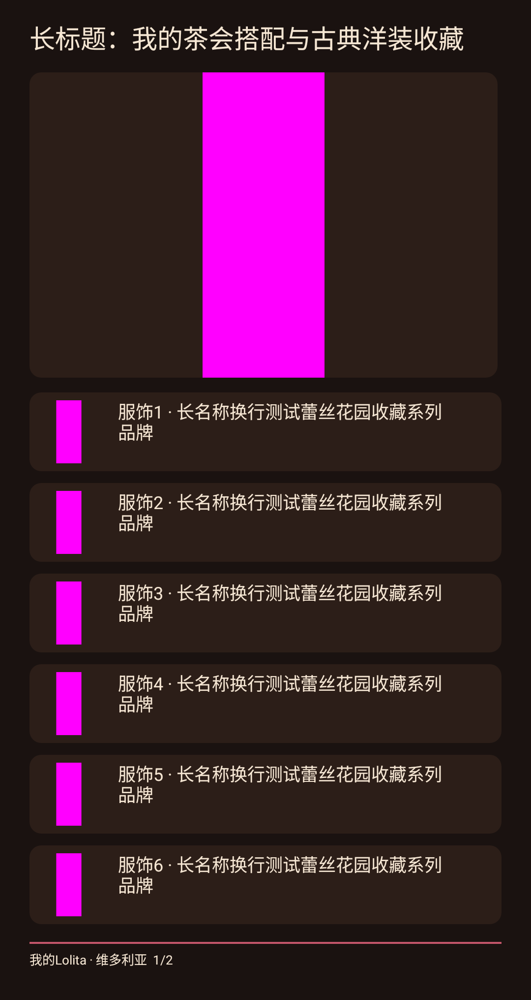

# 搭配、分享与月度预算（2.43.0 / 93）

- 服饰详情的搭配入口：固定主件，按角色挑选已拥有服饰，支持手动替换、跳过、锁定和换一套。保存为套装前明确确认从其他套装移入的服饰；事务检查记录与归属快照，失败可刷新。
- 套装、穿搭日记详情的分享入口：先预览，再经系统分享 PNG；品牌可隐藏。仅包含标题、照片与服饰/品牌名称，不包含价格、备注、来源或位置。多页分享提供所有图片的只读 URI 权限。
- 统计页新增“预算”：按月份设置预算，以分计算实际付款与当前订单剩余阶段款，区分以前到期和无日期款项；金额隐私实时生效。
- Room 23→24 新增月预算表，保留旧表和数据。备份格式 6 纳入预算导出、导入、预览及 CSV，兼容旧格式缺失预算。

## 验证

`assembleDebug assembleDebugAndroidTest testDebugUnitTest` 构建成功，完整 JVM 套件 122 项通过。独立 AVD `Lolita_Business_Fix_Test`（emulator-5556）定向仪器化测试 32 项通过，包含新功能 12 项及订单业务/数据完整性 20 项。同签名覆盖安装，不卸载、不清用户数据。

真实内存 Room 验证迁移、部分实付与历史付款、保存并发归属检查、JSON/ZIP/CSV 备份往返；真实 Compose 验证预算设置与删除、实时隐私、搭配选择保留、错误重试、分享预览重生成。分享 URI 检查单页/多页只读权限与可读取性。七套皮肤均导出浅暗预算与搭配截图，分享渲染覆盖七套浅暗皮肤、长文本、缺图与多页。

独立代码审阅发现的搭配返回丢选择、旧数据保存失败缺刷新、预算异常中止订阅三项已修复并补回归，再审无重要遗留项。

## 页面样例

截图使用独立测试资料，颜色块为测试照片。

| 功能 | 默认浅色 | 维多利亚暗色 |
|---|---|---|
| 搭配 |  |  |
| 预算 |  |  |
| 分享 |  |  |

2026-10-13 已正式发布 2.43.0 / 93。已提交源码 clean Release 构建和 122 项 JVM 测试通过；独立 AVD 从 2.42.0 同签名覆盖升级，原表记录、14 张图片及设置保全，Room 23→24 迁移和完整性检查通过。

GitHub 与 Gitee 两边匿名完整下载 APK 和 SHA256SUMS 一致；正式包检查更新识别最新发布 2.43.0。详见 [发布验证](release-2.43.0-verification.json) 与 [更新实拍](visuals/2026-10-13-release-2.43.0-update.png)。

[Gitee 国内下载](https://gitee.com/aalm1233/lolita/releases/download/v2.43.0/lolita-2.43.0.apk) · [GitHub Release](https://github.com/aalm1233/lolita/releases/tag/v2.43.0)
