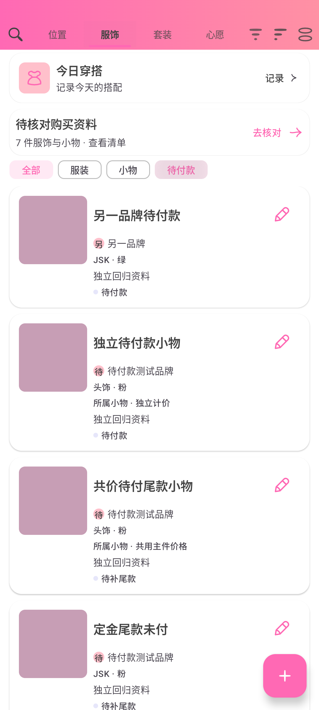

# 服饰待付款筛选修复（2.46.4 / 103）

根因是服饰顶部“待补尾款”入口启用后，`ItemListViewModel.applyFilters`只匹配PENDING_BALANCE，漏掉普通全款/多阶段订单的PENDING_PAYMENT。旧实现真实回归期望5件（主件、独立及共价小物），仅得到2件尾款记录。

入口改为“待付款”，开关及谓词参数统一为Payment命名，两类未付清状态均纳入。已拥有、心愿和购买资料待核对不纳入；主件及小物、分类组、品牌、季节、风格、颜色、搜索、排序和视图模式继续沿用原组合行为。没有修改实体细分状态、DAO状态投影、账本、备份或数据库版本。

新增 `PendingPaymentFilterTest` 的4项真实VM/Compose测试使用独立内存Room、UUID设置及测试图片，坐标及首页ViewModel共用测试Store和仓库，避免访问AppModule默认资料。覆盖包含/取消及原行不变，属性/搜索/排序/列表网格画廊，真实账本付款/撤销及共价小物实时移除/恢复，实际首页顶部文案与选中状态。

Debug构建、177项JVM和18项设备测试通过；设备组合包含新4项、OrderBusinessTest及PurchaseReviewConsistencyTest。独立代码复核未发现问题。定向设备为Lolita_Order_Import_Test / emulator-5560。

```bash
ANDROID_SERIAL=emulator-5560 ./gradlew assembleDebug testDebugUnitTest connectedDebugAndroidTest \
  -Pandroid.testInstrumentationRunnerArguments.class=com.lolita.app.ui.screen.item.PendingPaymentFilterTest,com.lolita.app.data.OrderBusinessTest,com.lolita.app.ui.screen.item.PurchaseReviewConsistencyTest \
  -Pandroid.injected.androidTest.leaveApksInstalledAfterRun=true
```



正式构建、同签名覆盖升级与双平台附件验收见 `release-2.46.4.md`。
