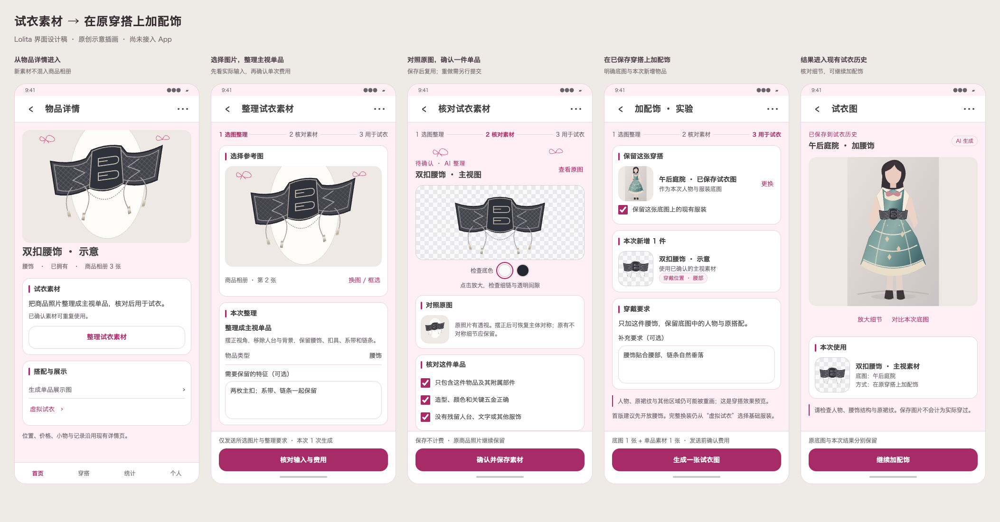

# 主视单品素材与加配饰：App 接入设计

日期：2026-10-20。状态：**界面与实施方案，尚未实现**。用户认可“视角摆正 → 抽出单品 → 核对 → 生图融合”，本轮要求设计如何进入 App。

建议把它做成物品可复用的“试衣素材”，接入既有虚拟试衣和任务中心；再增加明确的“在原穿搭上加配饰”方式，让本次单腰封实验能在已有穿搭底图上使用。无需新增首页 Tab、底栏或三维查看器。

本轮只修改设计文档、图稿与本地交互演示，没有修改 Android 源码、Room、正式接口、版本号或 APK。没有调用图像服务，前一轮独立试验仍为 5／20 次。图稿中的商品和人物是本轮编写的原创矢量示意插画，没有复制私人样本像素，也不证明生成质量。

## 1. 依据、现状和首版边界

已阅读 [AGENTS.md](../../AGENTS.md) 与[产品和界面规范](../design-guidelines.md)，查看物品详情、展示图选图、试衣、任务详情、任务执行、图片准备与备份验证的数据流。基础版本是 2.61.1／132，数据库 30、备份 10；实施前再次核对，以下升级号均为设计提案。

| 当前实现 | 对本设计的影响 |
| --- | --- |
| 物品详情已有生成展示图与虚拟试衣入口 | 新增紧凑“试衣素材”区，展示图继续承担展示用途，不把生成素材塞入商品相册 |
| 展示图支持从相册／详情图选择并框选 | 复用选图、裁切和实际输入预览；只发送本次选区 |
| 完整试衣选择 1～8 件，必须含基础服装 | 继续保留；单腰饰加穿走明确的新方式，不能全局删除基础服装校验 |
| 试衣结果自动进入独立历史 | 融合沿用此行为，界面写“已保存到试衣历史”；不另造一次“保存”动作 |
| 待确认展示图／个人模特走任务中心 | 新素材也进入待确认任务，完成核对才成为可用素材 |
| 任务请求 v4 冻结输入、哈希、服务模型与提示词 | 为新类型设计 v5；旧请求继续按原语义解码和处理 |
| 图片准备优先 PNG、超限 JPEG，透明图先铺白 | 不能直接当作保留透明的素材管线；需要单独的 PNG 输出验证与输入适配 |
| ImageProvenance 的现有备份校验要求图片属于物品相册／详情 | 独立素材不硬塞入这个集合；来源链存于新素材记录和任务快照，原校验继续成立 |

现有代码入口：[物品详情](../../app/src/main/java/com/lolita/app/ui/screen/item/ItemDetailScreen.kt)、[试衣页](../../app/src/main/java/com/lolita/app/ui/screen/tryon/TryOnScreen.kt)、[试衣约束](../../app/src/main/java/com/lolita/app/domain/model/TryOn.kt)、[任务协议](../../app/src/main/java/com/lolita/app/domain/model/ImageTask.kt)、[图片准备](../../app/src/main/java/com/lolita/app/data/tryon/TryOnImages.kt)、[备份关系校验](../../app/src/main/java/com/lolita/app/data/file/WardrobeBackupValidation.kt)。

首版建议以 **WAIST_ACCESSORY 腰饰** 跑通真实服务闭环：一张源图生成一份素材；一次在底图上增加一件腰饰。品类使用稳定语义，不按名称包含“腰”判断。未确认类型先核对类别，不借修改穿戴角色绕过准入。已拥有、心愿沿用现有试衣资格。

这是基于单个腰封样本提出的发布范围建议，不代表其他品类不能设计，也不代表腰饰已经普遍可靠。头饰、假发、成对鞋袜、多件加穿和整套商品的独立抽层，须补该品类样本与规则后开放。完整试衣仍能使用原商品图片；新流程不是所有试衣的强制前置步骤。

## 2. 图稿与视觉方案

图稿先于 Android 实现绘制。页面以 390×844 为常规设计尺寸，归档另有 320 宽大字和键盘情境；属于概念界面，不能当作真实 Compose 截图。

| 图稿 | 覆盖内容 |
| --- | --- |
| [主流程](../visuals/2026-10-20-item-tryon-material/flow-light.png) | 物品详情、实际输入、素材核对、加配饰、试衣历史结果 |
| [保存后的入口和参考图选择](../visuals/2026-10-20-item-tryon-material/saved-and-picker.png) | 当前确认素材、查看／重新整理／移除、原图与确认素材选择 |
| [七套浅色](../visuals/2026-10-20-item-tryon-material/skins-light.png) | 同一核对页，完整商品、原输入、三项核对与保存操作 |
| [七套暗色](../visuals/2026-10-20-item-tryon-material/skins-dark.png) | 深色表面、边框、文字与透明图片检查底色 |
| [关键状态](../visuals/2026-10-20-item-tryon-material/states-light.png) | 空白、处理中、非透明返回、原物品已删除、费用确认、键盘 |
| [320 宽与大字](../visuals/2026-10-20-item-tryon-material/small-large-keyboard.png) | 自然换行、内容滚动、保存固定可达、键盘上方主操作 |
| [交互演示源文件](../visuals/2026-10-20-item-tryon-material/prototype.html) | 可选皮肤／外观／页面，勾选核对、费用确认、主流程跳转；不连接任何 API |

视觉上用大面积完整图片、紧凑分区和一个底部主按钮。素材核对是视觉中心；原输入保留一张缩略图，可完整放大；透明底提供浅／深切换，不能让深色五金在暗色皮肤中消失。棋盘格和装饰仅存在于展示层，不写入素材图片。

七套效果参考现有 SkinConfigs 的色相、圆角、边框与字体体系：甜美用柔和缎带曲线，哥特用尖拱结构，中华用飞檐／交领线，古典用对称收束，海军用舷窗与水平构件，田园用围裙与自然曲线，维多利亚用双层拱线与金边。预览装饰位于素材图之外，避免被误认为商品部件。概念图为可读性调整了操作色对比，不是现有皮肤的逐像素复刻；落地时消费主题／皮肤令牌并验证对比度，不把本设计扩大为全局皮肤重做。

实现复用 GradientTopAppBar、LolitaSection／SectionHeader、LolitaCard、ImageFrame、LolitaShimmerImage 和现有按钮。复用现有查看、图片、确认、删除等 IconKey；本方案无需新增图标键。图稿的简化返回与文字导航不代替真实七套 provider。内容容器注册 ObserveSkinScroll，遵守既有 Insets、Haze 与图片动画规则。

## 3. 入口和完整流程

### 物品详情：试衣素材

放在现有搭配／展示操作附近，不挤入顶栏和封面。无素材时一段短说明和“整理试衣素材”；已有素材时呈现完整 Fit 缩略图、“主视单品 · 已确认”、确认时间、“用这份素材试衣”，次级操作是查看、重新整理和移除。

每件保留一份当前确认素材。重新整理只产生待核对候选，原确认素材继续可用；核对并明确替换后才切换当前素材。移除素材需普通删除确认，不触发新请求，不改变原相册、封面、订单、价格、位置、拥有状态、商品父子关系或穿搭次数。现有金额隐私设置继续生效，新区不新增金额。

### 选图与整理

从当前物品商品相册／详情图分组选择一张，长图可放大并框选目标。切组保留选择；没有图片先引导补图，不上传同商品的全部相册。本次实际输入预览必须可见，并提供原图／选区关系。无裁切时使用完整选中图。

默认操作“整理成主视单品”：校正相机透视，移除背景、人台和其他服饰，保留该件及所附扣具、系带、链条。可写最多 200 字的保留特征，不把备注、订单、尺寸或用户身体参数自动拼入。名称与用户文本按数据处理，不执行其中的嵌入指令。

输入不清楚时更换或框选；不承诺模型能从完全遮挡区域还原真实商品。物品本来不对称时保留其结构，不统一强制镜像。生成前显示“主视图经过 AI 重建，纹样和细节可能改变，生成后需要核对”。

底部“核对输入与费用”打开一次提交确认，显示实际图片、接收方、服务模型与一次生成范围。确认后进入既有任务详情；这个动作只整理素材，不继续自动融合。

### 待确认：核对单品

返回结果先完成本地文件、尺寸和透明性校验，合格后进入待确认；语义正确性由用户核对，不能仅靠 PNG 格式或 alpha 连通块数判断。

核对页大图完整 Fit，允许放大细节、浅／深检查底色，对照本次输入。原照片有透视时，摆正后的主体更对称可以是正确结果；保留真实不对称构件。对本次腰封，重点是两枚主扣、主片、系带、链条和绳端关系，不要求悬挂坐标复刻原照片。

用户确认三项后开放“确认并保存素材”：只包含这件物品与附属部件；造型、颜色和关键五金正确；没有残留人台、文字或其他服饰。附属细链、透明孔洞和不相连的绳端仍属于同一件物品；不把像素连通块数量当作件数。

保存仅做本地事务，不产生费用。可选择换图重做或舍弃；重做回到输入和费用核对，不立即付费。核对页返回、旋转、锁屏不丢预览，任务中心和全局待确认提示均能再次进入。

若原物品已删除，禁止保存或静默新建／改绑，仍可查看任务和舍弃预览。若另一任务先确认了新素材，先显示当前素材与本候选的替换确认，不能用陈旧结果直接覆盖。

### 两个使用去向

**完整换装**沿用“虚拟试衣”，维持基础服装和 1～8 件限制。每件“更换参考图片”中增加已确认素材选项，与原商品图片明确区分；首次保存素材不会悄悄重写其他已选参考。用户主动切换或从“用这份素材试衣”进入时才带入它。切换不计费，不自动启动整理。

**在原穿搭上加配饰**用于本轮样本：选一张已保存试衣图，或一张已确认个人模特底图，再选当前腰饰素材。用户完整查看并确认“保留这张底图上的现有服装”；没有要保留的服装时先走完整换装，不通过 AI 识别猜测“已穿好”。个人模特仅发送确认底图，不再附带原始自拍和身体参数。

入口位于“用这份素材试衣”的方式选择，以及试衣历史单张结果的“加配饰”。底图选择器分“已保存试衣图／个人模特”，有名称、完整预览和返回；不把旧试衣图自动变成新的 PersonalModel。首次建议只允许一件稳定类型为腰饰的确认素材，穿戴位置固定为腰部，不支持同次多件串行或后台自动拆批。

页面同时呈现底图、素材、位置、补充要求和实际发送范围。底图本身已有冲突腰饰时，提示先核对并换合适底图；首版不承诺自动识别或精确移除旧配饰。这里只请求新增当前一件，不能提示模型重新搭配整套。

更换底图后清除“保留现有服装”的确认；底图、素材、补充要求、服务或密钥版本改变时，原费用确认失效，重新预览实际输入后才能提交。

融合前再次确认接收方、两张实际输入与一次生成费用；不夹带原商品照片。若服务不能接受 alpha，明确显示本次实际将发送的中性底副本，不静默追加第三张参考图。结果自动进入现有试衣历史，展示“AI 生成”、底图快照名称、素材来源和加穿方式，支持完整放大、与本次底图对比、重命名和删除。

结果页“继续加配饰”只把这张已保存结果选为下一次底图，不直接调用。每次都保留本次底图和结果；提示连续生成可能累积重画，不将历史链当作真实穿着或自动建立日记。不能承诺人物或裙纹逐像素不变。

## 4. 状态、图片与小屏适配

| 状态 | 界面与行为 |
| --- | --- |
| 无图／未配置服务／服务不支持透明素材 | 本地检查后给出补图、配置或能力说明；不先计费再发现客户端已知限制 |
| 排队／准备／等待返回／保存 | 沿用真实阶段与全局任务栏，不编百分比；可离页、锁屏，输入已冻结 |
| 返回图片损坏、全透明或无透明背景 | 失败并保留记录，不能确认成可用素材；说明已发送可能计费，主动重发另确认 |
| 多件、人台、细节错误 | 用户不勾选相应核对项；换图、重新整理或舍弃，不自动加一次识别／修图请求 |
| 超时、取消等待、进程终止 | 保留记录与必要输入；不自动重新发起付费请求，不能承诺服务端取消收费 |
| 源照片被删／素材已替换／底图被删 | 提交前阻止使用缺失引用；已接收任务继续使用冻结副本，历史标签不改写 |
| 原物品已删除／确认时冲突 | 不新增物品、不静默覆盖；保留预览，明确舍弃或替换 |
| 图片加载失败／保存失败 | 失败态有返回和主动重试；保存重试只做本地保存，不能重发生图请求 |

| 图片位置 | 展示规则 |
| --- | --- |
| 物品详情素材缩略图、试衣选图、任务摘要 | Fit 等比，浅中性检查底；不 Crop 掉长绳端和扣具，标记不盖主体 |
| 核对页主图 | 完整 Fit，受屏高约束，浅／深棋盘切换只是显示；点击全屏查看原分辨率 |
| 源图／长详情选区 | 复用已有裁切，明确最终输入；原图保全。原图已删时只展示保留的“本次输入”副本，不冒充完整原图 |
| 人物底图／融合结果 | 全身 Fit，保留头发、鞋履和裙摆，不用缩略图代替细节；比较的是本次底图，不误用最初人物 |
| 全屏与编辑 | 复用 ImageGalleryPager／FullScreenImageViewer，关闭 circularReveal，不拉伸、不写回源文件 |

320 宽与大字时，图片高度适度压缩、核对行自然增高，内容整体滚动，所有核对项都可到达。未勾全时主按钮禁用，大字模式不靠缩字强塞。底部唯一主操作在键盘上方；先消费 Scaffold Insets，再应用 IME padding，焦点输入框滚入可视区。照片不和长正文挤在同一窄列；底图名称过长时全量换行。图稿的键盘是布局示意，真实 IME 与 Compose 字体缩放仍须设备验收。

## 5. 数据、任务和来源链

### 新增当前素材实体，避免污染 Item 图片

拟新增 `ItemTryOnMaterial`（确认后才写入，暂定 Room 30→31）。`itemId` 外键 CASCADE 且唯一，每件一个当前素材；`id` 使用 UUID 标记具体版本，结果文件不可原地覆盖。

| 字段组 | 拟保存内容 |
| --- | --- |
| 身份与归属 | id、itemId、sourceTaskId（唯一，历史标识不强外键绑定任务）、createdAt、confirmedAt |
| 素材文件 | imagePath、resultSha256、mime／宽高、透明校验版本；只接受验证通过的 PNG |
| 输入来源 | sourceSnapshotPath（本次实际输入，不是整本相册）、sourceSha256、相册／详情分组、源图 SHA、可空源引用、裁切／方向快照 |
| 生成和核对 | provider、serviceModel、promptVersion、冻结 requestSnapshot、semantic／composition 快照、确认规则版本 |

本次实际输入留作对照与备份，不无条件复制整张长详情。源图只是可选本地追溯，绝不因此额外上传。新实体自身持有素材的 AI 来源链；现有 ImageProvenance 仍描述相册图片，不放宽其“属于相册”的约束，也不往 Item.imageUrls 追加素材。

替换事务检查原物品、任务状态和预期当前素材 id，写入新行／替换当前引用，同时将任务标为完成并记录 materialId。重复确认幂等；旧任务再次进入显示已保存／当前素材已更新，不恢复旧版。事务失败只重试本地保存。旧素材文件待引用保护检查后清理；已提交任务持有独立快照，不受替换影响。

DAO 接入 LolitaDatabase、薄 Repository、AppModule 三处。状态用 StateFlow，协调流程置于 usecase／现有 coordinator，图片处理在 IO。新增实体不产生订单、账本、统计、提醒或共享目录记录，也不改变旧 Item 数据。

### 扩展既有任务协议与执行器

增加素材任务类型（拟 `SINGLE_ITEM_MATERIAL`），允许它进入 AWAITING_CONFIRMATION；ImageTask 增加可空 materialId。新请求版本拟 v5，明确区分素材整理、完整换装与加配饰；旧 v1～v4 默认保持旧语义，不能为“兼容”默默绕过校验。

现有多处以 `version == 4` 判断输入冻结、来源保留、路径映射或结果约束；实施时逐处升级为明确的协议能力判断，同时覆盖严格 JSON 字段校验、类型转换、枚举解码与恢复，不能只扩展版本范围。

加配饰仍归试衣历史，使用显式 mode 与 `baseSnapshot`：底图类型、原记录 id、名称、文件哈希；每件参考携带 ORIGINAL／CONFIRMED_MATERIAL 来源与素材 id。任务类型、用途和底图来源分别建模，不能把底图假装成基础服装。

现有 TryOnRequest 的协议版本与 ImageTaskRequest 版本目前存在联动。新实现必须解耦：完整换装保留原服装准入；加配饰使用独立请求校验与提示词分支，要求有效底图、明确确认服装、一个腰饰素材。不能只把任务版本改成 5 直接透传旧构造器，也不能全局移除 garment 检查。

新增 promptSnapshot 冻结正视整理规则、单件附属部件语义、原有不对称细节、加穿位置和保持底图的要求；不复用旧 MANNEQUIN 展示图提示词。服务名、模型、实际输入字节与 SHA 在用户费用确认后冻结。提交前验证资格和引用，进入队列后不重新读取当前相册来替换任务图片。

ImageTaskRunner／Coordinator、前台服务、任务列表统计、待确认栏、详情、重发入口、类型文案、删除与重启恢复均增加新类型。仍使用既有全局门闩与队列，不为预处理另开第二个付费执行队列。重启不重发；已经落盘的有效结果可恢复核对状态。取消与远端返回竞争通过任务状态 CAS 处理，晚到结果不能覆盖取消或重复保存。

试衣结果的 `requestSnapshotJson` 保留加穿方式、底图／素材标签、哈希和任务标识，不依赖原物品永远存在。现有历史快照会剥离任务持有路径，单靠它无法实现“对比本次底图”：拟在 TryOnResult 增加可空 `baseSnapshotImagePath`，完成加穿时保存独立底图副本并纳入图片保护与备份，旧记录保持 null。删除结果才释放其底图副本；删除任务不使结果的对比入口失效。不保存整套历史引用链的重复相册。

### 文件生命周期

所有新图片走 ImageFileHelper 的内部 UUID 路径。扩展其引用查询：当前素材及本次输入、任务冻结文件／待确认结果、试衣历史及其底图副本、草稿和备份屏障均保护文件。删除 Item 时先收集新实体路径再事务级联，事务后只清理无引用文件。

任务删除不删除已确认素材和试衣历史；移除素材不清理在途任务；任务舍弃只清理未被接收的预览。裁切返回过期、提交失败、保存失败、取消与备份并发沿用现有串行／引用保护，不能根据文件名猜归属。输入与输出不得同路径、同一覆盖目标。

## 6. 真实服务接入与透明能力

[前一轮样片](2026-10-20-rectified-single-item-fusion.md)来自 builtin image_gen，不能据此宣称当前 App 的两家正式接口支持同样的透明输出。此项是实施前必须验证的接入条件，不是已实现事实。

为每个适配器明确 `canGenerateTransparentMaterial` 与输入 alpha 策略。只有经实际能力验证的服务／模型才开放整理入口；未知能力视为未支持，界面明确说明，可继续现有完整试衣。禁止付费结果不合格后自动换服务、自动抠图或隐式再花一次请求。

整理结果必须完整解码并确认 PNG、合理尺寸、有可见前景和真实透明背景；全透明、全不透明、损坏、超限均失败。带 alpha 通道或扩展名为 PNG 不是充分条件。有效透明性不代表没有残留人台，也不证明一件商品，仍需人工核对。校验阈值以真实接口样本制定，不能用连通块过滤细链和成对构件。

保留原始透明素材文件。融合输入若支持 alpha，使用无损 PNG；透明 PNG 超预算时只作明确的等比缩小与无损压缩，仍超限则阻止提交，不能回退 JPEG 丢失透明。若正式服务明确只支持不透明输入，可从素材制作中性底发送副本，预览并冻结实际副本和哈希，原透明文件不变。费用确认看到的图片、MIME 和实际发送字节必须一致。

正式服务至少验证两步：真实透明素材返回与核对；确认素材和指定底图的两图融合。先限定腰饰样本，增加本来不对称、细链、遮挡、深色材质和极端视角样本。效果评审分物品结构、残留背景、人物／裙纹重画与自然贴合，不用请求成功或仅扣具数量正确代替质量结论。没有像素保护管线时始终保留重画说明。

## 7. 升级、备份、隐私与费用

实施时如当前基线仍为 Room30／备份10，拟增量到 Room31／备份11：新素材表、ImageTask.materialId、TryOnResult.baseSnapshotImagePath；其他历史表不重建。迁移必须导出 schema，并按届时实际版本编写 Migration，不在本轮先修改版本常量。

备份导出／导入／预览／完整性校验同步增加素材记录和数量；ZIP 图片清单包含素材、本次输入、任务快照、加穿结果和底图副本。嵌套 v5 请求路径统一映射，SHA 对应图片字节验证，不把旧设备绝对路径原样当新路径。当前素材与物品唯一关系、任务引用及来源冲突在导入前完整校验。

导入旧格式缺少集合时补空列表，新可空字段补 null；旧请求按原版本解码，旧试衣记录不编造底图或素材。历史 Item、订单、图片顺序和来源记录保持原值，不启动历史批量生成。新格式恢复在途任务按现有规则成为中断／待确认，不重发远端。恢复失败回滚并保全原文件；支持已保存素材在原任务被删后完整备份往返。

CSV 只在图片索引／素材专用文件中增加“物品标识、已确认素材、生成来源与确认时间”，不把二进制图、完整提示词、绝对路径或任务隐藏元数据塞入物品业务列；JSON／ZIP 是完整恢复出口。旧版 App 拒绝较新备份，不能宣称可降级恢复。

| 用户动作 | 发送及费用边界 |
| --- | --- |
| 选图、框选、看原图、换皮肤、核对、保存素材 | 本地操作，0 次生成 |
| 首次整理／用户主动重新整理 | 确认接收方与实际选区，1 次生成；若金额无法准确获得，显示按 API 实际资费，不编报价 |
| 复用素材到试衣选择 | 本地操作，0 次生成 |
| 完整换装／在原穿搭上加配饰 | 另一次明确费用确认；加配饰只发底图＋当前单品参考，共 2 张，1 次生成 |
| 保存失败重试、进程恢复、离页重入 | 不重新生成；无法确认远端状态时标明中断，用户决定是否新发 |
| 服务不支持／输入本地超限／引用已失效 | 在发送前阻止，不发生付费请求 |

一件物品首次从整理到融合一般为两次分别确认的生成；后续复用仅融合一次。不承诺一定成功或固定金额，不把两步包装成一次无额外说明的按钮。

只发送本次实际输入和必要名称／位置／整理要求，剥离 EXIF、设备路径和框外像素。人物底图使用已确认文件，不自动读取自拍、身体参数、订单、价格、位置和私密备注。密钥沿用加密配置，不进入任务、Room、日志、备份或本设计。照片仍可随用户主动 ZIP 备份保存；图稿与公开源码不得混入私人样本。分享沿用已有字段选择，不增加自动公开或云同步。

## 8. 实施顺序与验收

1. 先验证正式服务透明输出／融合输入策略和费用边界；未通过不开放整理功能，不以白底输出伪装完成。
2. 增量实体与备份、图片引用、v5 请求和新任务类型，加入受控服务回归；确保没有隐式付费与旧协议变化。
3. 实现详情素材区、选图整理、任务核对、当前素材替换，再接完整试衣参考选择。
4. 实现显式加配饰请求、底图选择与独立快照、两图融合和现有历史展示。
5. 独立 AVD 上对照本图稿检查新增页面七皮肤浅暗、320 宽／大字／IME，运行受影响定向测试，再按项目规则构建和发布。

拟新增或扩展的有意义回归（测试名为建议，当前未新增或运行）：

| 验收组 | 必须证明的行为 |
| --- | --- |
| 素材来源与图片生命周期 | 实际选区与发送字节一致；透明 PNG 不被铺白覆盖；细链不按连通块删除；移除／替换／Item 级联与任务／备份并发不误删共享文件 |
| 确认和陈旧结果 | 三项未核对不能保存；本地保存幂等不重发；任务先后完成、另一素材先保存、原物品删除时不覆盖／改绑 |
| 模式和旧请求 | 完整试衣仍需基础服装；新加穿只接受一件准入腰饰＋明确底图；旧 v1～v4 请求与历史结果保留；服务／密钥切换使旧费用确认失效 |
| 任务持久化 | 排队、离页、旋转、锁屏、进程终止、取消竞态与晚到返回；无自动付费重试，待确认可恢复，全局任务栏及时展示 |
| 备份与迁移 | 30→31 历史资料保全；旧1～10备份兼容；11 ZIP 往返含透明字节、素材和结果底图；路径重映射、缺图／重复素材拒绝及恢复回滚 |
| UI与隐私 | 新增页面七皮肤浅暗，长名、小屏大字和IME；Fit／完整放大；不发送框外、自拍原件或账目；各次费用分别确认 |
| 真服务质量 | 记录新授权额度、服务模型、完整提示词、输入输出 SHA 与人工评审；透明输出、附属结构、自然贴合、人物和原裙纹重画分别报告 |

应用实施后按影响先 assembleDebug，正式发布 clean assembleRelease、独立升级与既有分发校验。本轮仅图稿与文档：检查 HTML 实际渲染、交互和链接，不构建应用或跑无关测试。

## 9. 本轮交付核对

- [x] 查看当前代码、工作区与设计约定，保留用户其他文件。
- [x] 先归档完整界面图、七套皮肤浅暗图，再提出实施方案；没有倒置为先写 App。
- [x] 覆盖空白、已确认、选图、待确认、失败、删除冲突、费用与键盘关键状态；明确真实设备待验收。
- [x] 明确原图保全、透明／完整展示、任务冻结、来源链和删除引用。
- [x] 写明迁移、旧备份、实际发送、两段费用与质量边界；未用样片冒充正式服务能力。
- [x] 本地演示校验三项核对、分别计费确认、主要跳转、14 个皮肤外观组合横向排布与 320 宽无横向溢出，见[回执](../visuals/2026-10-20-item-tryon-material/design-verification.json)。
- [ ] Android 实现、真实 Compose 对照、真服务透明输出、迁移／备份回归与正式发布：属于后续实施，不在本轮宣称完成。

图稿可重生成：安装有 Playwright 的 Node 环境下设置 `LOLITA_DESIGN_NODE_MODULES`，执行同目录 `render-design.cjs`；可用 `LOLITA_DESIGN_CHROME` 指定独立测试浏览器可执行文件。浏览器仅打开本地演示，渲染不连接服务、不使用用户浏览器资料。SHA 回执只验证本轮图稿字节，不证明 Android 实现质量。
