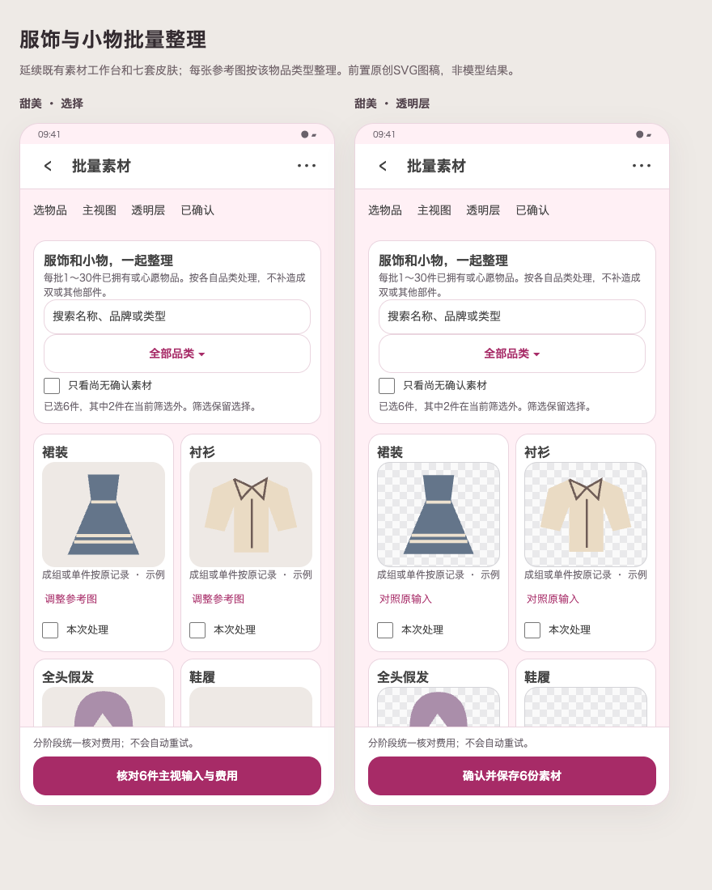

# 服饰和小物批量素材

用户要求解除腰饰限定，本轮仍只扩展素材整理，不新增批量融合。基于2.63.0，先绘制本次混合品类工作台及七皮肤浅暗，再实现与真实页面对照。

## 范围与流程

已拥有／心愿中的已确认服装、假发、袜装、鞋履、头饰配饰、包袋与手持小物均可混合选择，每批仍1～30件；全部品类默认零选择，可按品类筛选，搜索包含名称／品牌／类型，筛选保留隐藏选择。详情入口同步开放，已有素材管理继续可用。类型待确认时先在既有编辑页明确类型，不从名称静默猜测。

按物品实际类型和单件／成双／成组身份生成主展示图，再单独确认分层费用；一条物品记录及其已知附属部件作为完整前景，成双／成组不是混入其他物品。保留领袖下摆、裙撑层数、假发卷度和发片形态、鞋楦鞋跟、鞋袜数量、包带和伞骨等。单只不补成双，发片不变整顶，裙撑不补裙子，衬衫不补下装；服装移除人台，假发不带头模，鞋具保留必要侧向，不强行镜像或补造不可见背面。完整Fit和放大、浅深透明底、人工核对及统一费用边界沿用。

## 兼容与保护

新增素材专用请求v6冻结品类／角色／组合及提示词修订2，旧v1～5字段、快照和执行保持；旧腰饰分层继续使用原指引。新整理腰饰也沿用原v5接口语义，新其他品类用v6，不扩大既有“加腰饰”用途；其他素材可用于既有完整试衣，基础服装校验保留。素材保存及后续分层均复核当前类型，新v6再复核组合，变更不静默复用旧语义。

Room32／36实体不变，不增表列；备份13表达新增请求用途，旧1～12兼容，JSON／ZIP及预览保持现有图片和分组完整性。旧12不能夹带新v6协议。原照片、素材、订单、拥有状态、位置及历史不迁移、不改写。服务仍采用现有即梦；分阶段统一确认全部实际输入，失败不自动重试或继续计费。密钥和未选相册不进入请求与备份。

## 验收

定向验证所有确认语义的角色与组合、v5兼容／v6限制、混合批次准入→执行→集中核对→保存→ZIP恢复、类型或组合改变失败保护、筛选保留隐藏选择、详情和素材管理入口，以及受影响七皮肤浅暗／320dp两倍字／IME。需要真实调用时沿用本次独立100张额度的剩余94张，记录每次请求、输出和质量限制；受控图片只证明流程。按仓库规范提交推送、clean正式签名构建、覆盖升级与双平台发布。

## 最终状态

已按本方案实现，真实页面及验证见[实施记录](../material-categories-implementation-2026-10-21.md)。本轮真实调用4次，其中1次分层超时未重试；累计额度和未实测类别明确记录于评估摘要，不能把受控页面当作模型质量。
