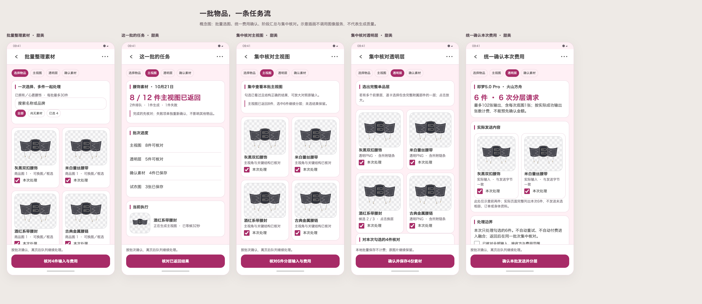

# 素材批量任务流

2026-10-21，用户纠正交互应为任务流与批量处理。基于2.62.0／133，先绘制本批流程与七皮肤浅暗，再实施。此方案取代素材创建以单件详情为主要入口的安排；原单件记录和已确认结果保留。

## 使用流程

任务中心新增“批量整理素材”，同一工作台在选择、主视图、透明层与确认素材之间切换。一次主动勾选1～30件已拥有／心愿腰饰，支持名称／品牌搜索、筛选保留隐藏选择，每件可换商品／详情图和框选。批量入口默认零选择；从物品详情进入只带入当前件，可继续增加其他物品。不自动把整套商品或全部衣橱送出。

按阶段统一预览全部实际输入、接收方、请求数与费用范围：N件主视图=N次请求／N张输出；N件分层=N次请求／最多17N张输出，含底图。一次确认后本阶段全部入队，可离页。集中展示已返回、排队、处理中、失败与缺失资料；完成结果可先处理，失败项不阻塞其余物品。重新处理失败项仍是明确新请求，不自动重试。

主视图集中核对后勾选正确结果，一次确认进入分层。透明结果集中完整预览，可放大和选择候选层；勾选所需物品并对本次选择声明三项人工核对后，批量保存。多项处理中每件仍有独立输入、状态、结果和来源，不把拼图当多物品传入。

用户已明确本轮只做批量整理素材，不新增批量融合。已确认素材可继续使用2.62.0既有试衣入口；本批工作台到确认素材结束。

## 数据与执行

Room31→32仅给`ImageTask`增可空批次ID、批次名称与位置索引，保留36个实体；不从标题推断身份。批次列表与分阶段状态来自真实任务，子阶段沿用同一批次和位置。原v1～5请求不改；分组元数据不发给服务。

批量提交在统一admission锁内验证全部源、状态、类别、当前素材和已冻结输入哈希，事务插入整批后才启动服务，不允许部分插入即付费。每个批量确认生成稳定操作标识与任务ID，重复提交可识别已有同一操作。批量保存同样整体先验证，失败不覆盖任何已确认素材；未选结果留待稍后核对。

图片仍走UUID ImageFileHelper、真实PNG准备和引用保护。准备实际输入是本地操作，不计费；页面退出取消准备并释放未入队副本，已经接受的整批提交属于应用作用域。取消本批只取消尚未完成任务；已保存素材、历史和原照片保留。批次不新增金额、订单、统计或位置写入。

备份12补三个任务字段、旧1～11默认空批次，ZIP继续保留全部冻结输入／透明层及进入分层后供批次回看的已接受主视图。无新实体或图片字段；CSV任务列追加批次元数据，预览任务数量仍按实际任务计数。恢复活动任务中断，不自动重发整批。

## 视觉与验收

前置[七皮肤浅色](../visuals/2026-10-21-material-batch-flow/skins-light.png)、[暗色](../visuals/2026-10-21-material-batch-flow/skins-dark.png)、[小屏大字](../visuals/2026-10-21-material-batch-flow/small.png)为原创矢量概念图，不是Compose或真实接口结果。实际实现复用标准顶栏、LolitaSection/Card、图片框／加载、现有图标和皮肤令牌，滚动均注册ObserveSkinScroll。大字采用单列结果与通栏按钮，图片Fit并可完整放大；键盘上方主操作可达。

定向验证覆盖批量事务与重复提交、混合成功失败、独立输入与原素材保全、集中选层／核对／保存、旧数据及旧备份、新ZIP分组恢复、取消／重启／缺图／分类变化／删除、七皮肤浅暗／320dp两倍字／真实键盘／实际导航，并按项目要求clean正式发布。无需为批量流程重复付费验证已核实的单图API；默认不消耗新的真实生成次数。

## 实现与完成检查

已完成[实施和定向验证](../material-batch-implementation-2026-10-21.md)。前置图稿、七套浅暗、真实页面对照、完整图片与放大、320dp两倍字体和真实键盘、批量原子性、旧数据与备份、隐私和费用边界均按本次范围完成；账本、统计、提醒及位置没有新写入。正式源码、原签名包和渠道结果记于发布回执。
