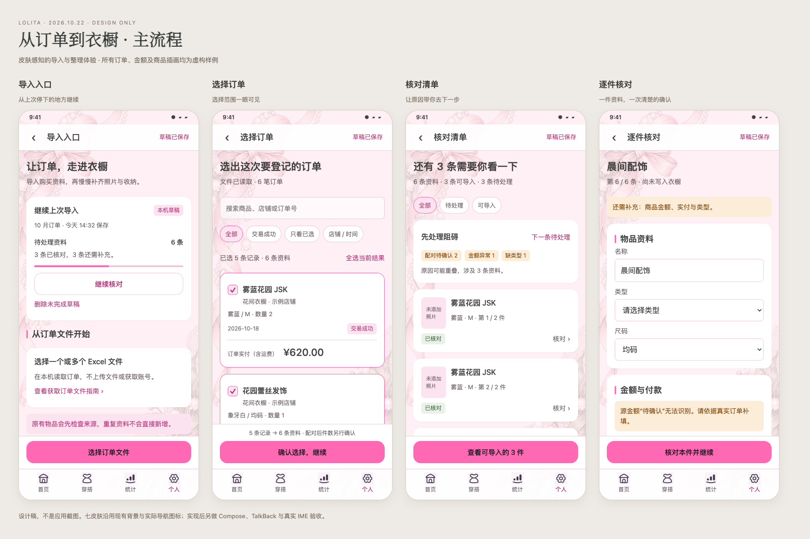
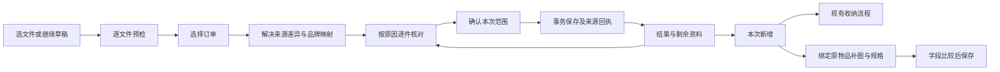

# 淘宝订单导入与后续整理完整设计

2026 年 10 月 22 日。**状态：设计完成，应用尚未实施。** 本方案包含用户确认有价值的全部导入优化，以及购买资料核对、导入后收纳和原物品补图，不限于淘宝选文件页。当前应用仍为 2.67.0 / 142，Room32 / 备份13。

目标是把“文件选进来”变成可放心完成的一段登记流程：来源可追溯、金额不猜测、退出可续办、重复不多记，导入之后能直接找到本次物品，继续整理位置和图片。既有四个底栏入口、首页四个 Tab、品牌与尺码组件、账本及收纳规则继续使用。

## 可查看的设计成果

- [14 页交互设计原型](../visuals/2026-10-22-order-import-design/prototype.html)：左侧切换页面、七皮肤、浅暗、小屏两倍字、金额隐藏及键盘布局示意。筛选选择、文件重试、来源比较、确认提示、结果续办和补图差异可体验。可从仓库根目录启动本地 HTTP 服务打开，不依赖外部服务。
- [主流程效果图](../visuals/2026-10-22-order-import-design/main.png)：入口、选择订单、核对清单、逐件核对。
- [来源与提交效果图](../visuals/2026-10-22-order-import-design/reliability.png)：文件预检、来源差异、定金尾款、确认导入。
- [细节效果图](../visuals/2026-10-22-order-import-design/details.png)：品牌映射、新增清单、财务区和图片差异。
- [关键状态效果图](../visuals/2026-10-22-order-import-design/states.png)：文件失败、已有来源、提交失败、原物品并发变更。
- [关联功能效果图](../visuals/2026-10-22-order-import-design/support.png)：结果、收纳、购买资料核对、补全本件。
- [七皮肤浅色](../visuals/2026-10-22-order-import-design/skins-light.png)、[七皮肤暗色](../visuals/2026-10-22-order-import-design/skins-dark.png)、[小屏大字与键盘布局](../visuals/2026-10-22-order-import-design/edge.png)。
- [前置艺术方向稿](../visuals/2026-10-22-order-import-design/art-direction.png)、[素材来源及边界](../visuals/2026-10-22-order-import-design/provenance.json)、[设计验证记录](../visuals/2026-10-22-order-import-design/verification.json)。

以上是前置设计资产，不是已实现的 Android 截图。原型采用固定虚构订单；复杂配对、账本计算、真实网页读取和数据迁移以本文规范为准，不能用原型中的演示跳转代替实现。键盘为占位示意，真实 IME、TalkBack 和原生性能留到实施验收。商品裙装图是虚构插画，只供设计评审。

## 完整范围与问题对应

现状证据与原始截图见[第三轮体验审查](2026-10-22-order-import-experience-review.md)。本轮不是重新开发已有配对、整数分分摊、单件/列表模式和房间多选移动，而是在这些能力上补足流程。

| 已确认问题或建议 | 本方案的确定行为 | 页面 |
| --- | --- | --- |
| 同一来源可以重复新增 | 跨会话来源回执、提交幂等、已导入默认关联原物品；历史不确定项人工判别 | 02、04、09 |
| 金额无法识别被变成0 | 保留原值，区分有效0、空白、格式异常；异常不得确认入账 | 02、07 |
| 同订单不同金额被去重 | 比较完整规范化快照；完全相同才合并，否则选择来源并保留两份证据 | 04 |
| 进程回收丢草稿 | Room 导入会话保存文件快照、输入、选择、配对、图片和当前页 | 01及全程 |
| 部分完成后无法续办 | 按提交回执展示新增ID；剩余项继续原会话，已提交项不重放 | 10、11 |
| 小屏金额竖排、底部过重 | 金额独立整行；计数与帮助进入滚动区；唯一主按钮；通栏财务输入 | 03、07、09 |
| 缺少搜索和筛选 | 商品/店铺/订单号搜索，店铺、下单区间、订单状态、仅已选；保留隐藏选择 | 03 |
| 行、件和配对数混用 | 分开呈现商品记录数、拆分资料数与最终新增物品数 | 03、06、09 |
| 不知道哪项阻止导入 | 结构化原因、多原因筛选、定位字段、下一条待处理 | 06、07 |
| “批量编辑”实际上只是列表 | 原开关改“逐件 / 列表”；另设多选后的品牌、类型操作 | 05、06 |
| 品牌只能创建或跳过 | 搜索现有、新建候选、未设置；展示匹配依据，拒绝歧义 | 05 |
| 下单时间被用作付款日期 | 区分日期来源；日期选择器；日期未知保留草稿 | 07 |
| 无追加或替换文件路径 | 文件级状态、追加、重选、移除前影响确认；不抹除已编辑资料 | 02 |
| 购买核对平铺、跳转过长 | 按问题筛选并直达相关订单；完成后下一条，保留共享订单语义 | 13 |
| 导入后重新寻找收纳对象 | 结果绑定本次新增ID，复用房间多选移动；校验已拥有 | 10—12 |
| 商品链接只能再创建物品 | 绑定原物品的补充模式，字段比较、选择追加图片，保留人工修改 | 11、14 |

范围不包含新电商平台、后台自动抓淘宝账号、退款自动记账、同款智能合并、AI自动识图、新的服装展示图生成、全应用皮肤重做和云同步。现有淘宝导出指南保留七步及四项注意事项；线上入口的当前可用性在实施接入时独立核验。

## 入口和流程

个人页原淘宝订单导入入口进入“导入入口”。若存在未完成会话，先显示可继续卡；多个会话按最后修改排序，每张显示文件摘要、已新增件数和剩余资料数。没有会话时直接突出选文件。恢复只读本机，绝不自动读取网页或继续提交。

导入以会话为长期单位，以一次明确确认的提交为原子单位。同一会话可分几次完成，但每次提交不得部分写入。一个单件核对动作只确认草稿；真正改变衣橱与账本的是“确认导入 N 件”。确认过的资料若金额、日期、来源或配对变动，必须重新核对受影响范围。

## 页面与交互规格

### 01 导入入口与会话管理

主操作“选择订单文件”；存在草稿时卡内显示“继续核对”，明确已新增与剩余的区别。新文件可加入现有未完成会话或另起会话，默认不合并不同会话的编辑内容。来源查重在会话之间仍然生效。

离开页面默认保存草稿并返回，无需每次询问放弃。主动“删除未完成草稿”才弹出具体后果：未提交输入与未引用图片会删除，已保存物品与账本不变。正在持久化时显示“正在保存草稿”；失败显示“尚未保存，请重试”，不能先显示已保存再后台失败。前台提交期间禁用返回并解释正在保存；切后台或进程终止由回执恢复。

### 02 文件预检与更新

每个文件显示文件名、读取状态、订单/行数量、问题和重试动作。预检顺序：大小和格式 → 工作表/表头 → 行与订单号 → 数量/金额字段 → 来源身份 → 文件之间差异 → 与已保存回执比较。

表头通过显式列名及已核验别名匹配，不按前11列位置猜测。必需列缺失阻止该文件读取；歧义列说明具体列名。解析期间骨架呈现文件卡，按钮使用现有内联spinner；完成后用结果替换，不把解析异常藏在通用提示中。

部分文件失败时不默认继续。按钮明确“使用已读文件继续”，同时常显失败文件名及未计入说明；也可重选失败文件。若没有成功文件，该按钮禁用，提供重新选择。追加相同字节文件显示已读取，不再解析出一组资料；不同字节仍按订单/商品快照比较。

替换或移除文件先列出受影响未提交资料：未编辑行可替换；已有人工编辑显示新旧差异，保留输入直到用户选择；已提交来源不可抹除，只可从会话列表移除文件入口。新来源改变已确认财务内容时清除相关确认并提示原因。原文件不可再次访问时，已保存的规范化快照仍可续办；重读必须由用户重新选文件。

实现默认防护边界：每次最多10个文件、单文件20MiB、单文件10,000行、每次会话最多2,000条展开资料，数量沿用每行1—100。超限整份文件明确拒绝，不静默截取前一部分。此限制只用于新导入，不限制已有衣橱或备份；实现前按解析库内存测量可调，并同步产品文案。异常XLSX解压比例/总解压量也需有界，公式单元格不得执行外部引用。

### 03 选择订单

搜索按商品名、店铺名及文本订单号匹配，不把长订单号转成浮点数。筛选包含店铺、下单日期区间、订单状态、只看已选；日期未知单独可选。默认保留现有交易成功及排除意向金规则；已确认导入、来源冲突、关闭/退款等需要人工核对的资料不自动加入可提交范围。

“全选当前结果 / 清除当前结果”只影响可选的筛选结果；隐藏已选继续保留，摘要显示“另有 N 条已选被筛选隐藏”，提供只看已选。清空全部选择是独立明确动作。离开搜索或切换皮肤不改选择。

卡片顺序为商品名、店铺、规格与数量、日期/状态、独立整行实付。长店铺换行，金额不与店铺争宽。缺金额显示“金额待核对”，真实0显示“¥0.00”；关闭状态不代表免费。每个整卡可选择但详情/链接独立操作不冒泡。TalkBack 读出名称、规格、原数量、选择状态与问题，不重复播报图片。

数量文案固定三层：

- 商品记录：文件原商品行，不因数量扩大。例如已选5条记录。
- 物品资料：数量展开后的核对单元，例如6条；每条保留“原行、件号”。定金/尾款此时仍各占一条。
- 新增物品：确认提交时的最终 Item 数；合法两条配对只计1件，已导入跳过不计新增。

### 04 来源差异与重复资料

预检四态为“新资料 / 已导入 / 来源有变化 / 无法确定”。“已导入”默认不新建，能查看原物品；若原物品已被用户删除，仍说明曾导入及删除状态，需要显式“重新登记已删除物品”才能产生新一代来源回执，不能从空外键误判全新。

多文件同一来源有差异时，逐字段并排或小屏纵向展示文件、商品/SKU、数量、订单状态、商品金额、运费、实付、日期来源。完全一致才折叠重复。选择来源版本只作用于未提交草稿，不把新版文件的付款静默覆盖旧订单。若影响已保存物品，入口改为“查看原订单并核对”。退款/关闭/价差以证据呈现，本轮不新增自动冲销机制。

“无法确定”保留人工判断路径：选择对应的历史物品，或者确认这是另一件并说明件号/来源差异。仅名称相同、店铺相似、历史描述相似不能自动认定重复，也不能自动认定新件。涉及多个完全相同商品行时展示整组数量及此前已登记件号，用户先建立规范单件对应关系，防止导出行序变化造成误配。

### 05 品牌类型映射与真正的批量属性

保留已核验别名解析。展示“匹配现有品牌”时附精确名称/核验别名依据；模糊匹配仅列候选且零预选。店铺不等于品牌；通用品牌参数不转真实品牌。支持搜索200+已有品牌、保持未设置、明确新建品牌。新建候选先保留会话，首次提交引用该候选时同事务创建；取消会话不留下空品牌。用户明确跳到品牌管理新建是另一个已保存动作，不随导入撤销。

列表模式命名“逐件 / 列表”，不再把多卡展示叫批量编辑。新增多选工具条只提供品牌、类型；逐项预览旧值→新值，显示隐藏已选和总影响范围。类型变更可能使配对或字段失效时，更新后保留原值但转待核对，不删除规格证据。不批量改金额、实付、付款日期、数量、拥有状态、整批勾选财务确认。颜色/尺码复用原控件；本轮不扩展不必要的全局批量字段。

### 06 按原因核对清单

摘要为“可导入 N 条 / 待处理 M 条”，并在提交按钮注明最终物品件数。原因来自统一校验结果，不由Composable重复推导。至少包括：来源冲突、来源身份待确认、金额缺失/格式异常、超额或分摊不平、缺品牌映射/类型、日期待确认、定金尾款待配对、财务未确认、图片尚未保存。

一条可有多个原因，原因数量不相加作为条数。点原因筛选，点卡片定位首个阻碍字段；“下一条待处理”按稳定原始顺序寻找，不按临时筛选下标修改数据。配对组视为一组，保持相邻展示；单条筛选命中时连同另一条显示并标注“关联资料”，不伪造筛选命中数。

全部未就绪时主按钮仍可定位阻碍，不只灰掉但没有解释；部分就绪时“查看可导入的 N 件”进入最终范围页。已完成会话进入结果，待办为0时不再显示继续剩余入口。

### 07 逐件核对与财务语义

原物品名称、品牌、类型、颜色、尺码、图片、付款角色、配对等能力保留。财务区通栏排列商品金额、运费、实付、付款日期；先展示问题，原字段可展开查看，但异常原值和直接后果常显。

金额解析结果为 Valid(cents)、Missing、Invalid(raw,reason)，保留人民币符号/千分位合法处理；负数、NaN、Infinity、不支持小数精度及文本有明确问题。仅经验证的十进制输入转换为整数分，运算和分摊都用分；显示两位小数，不通过Float动画。0与未知不同，但合法0不自动满足“总价大于0”的现行提交条件。本轮不新增赠品零价订单。

同单多件按完整源组先分摊再选择；只选第1件也不能把整单金额给第1件。余分按稳定件号分配；商品、运费、实付分别核算。已提交份额+本次拟提交份额不得超过源快照确认额度；未选份额仍可追溯，不被重新平均。人工更正实付须核对源总额差异；不能只放宽校验来满足单件输入。

**下单时间不是付款时间。** 文件包含已核验的真实付款列时标明来源并要求确认；只有下单时间时保留参考行，付款日期为空。用户可用日期选择器填写真实日期，或选择“暂留待核对”。对于本轮新订单导入，实付>0且日期未知时不允许提交该条，只保存草稿。现有 `recordHistoricalPayment` 仅对 `HISTORICAL_OWNED` 开放，已有历史物品可继续保留付款日期未知；不能拿该接口绕过新导入规则。

“已核对金额、运费与付款信息”确认范围包含本件当前财务版本和配对身份；任何相关字段变化即失效。输入错误后确认不会把状态强行变为可提交。保存本件核对后进入下一阻碍；全部完成则进入最终范围页。用户可稍后补图，未添加照片不阻止财务登记。

### 08 定金尾款与其他付款角色

现有自动候选匹配仅建议，不替用户确认。显示两笔原订单、明确SKU/颜色/尺码、各自实付/运费/付款日期、组合金额和匹配依据。选择候选支持搜索，并排除已提交或已配给另一条的来源。不同明确规格不得自动合并；一条来源不能参加两组。

确认属于同一实体后，两条资料→一个Item和对应订单阶段，两条永久来源证据都保留。解除、换对象、修改付款角色均重新验证两端，并清除原财务确认。未配对尾款阻止独立全款导入；单独定金保留已有手工尾款与到期日流程，尾款金额必须明确。本轮不改变既有“拥有”投影，不以交易成功/付款状态代替收货事实。

### 09 最终确认与原子保存

顶部显示本次来源资料条数、最终新增件数、跳过已导入数；主摘要显示商品合计、运费、实付，以及日期未知数（按本规则新实付应为0）。剩余资料按原因列出，不默认把它们作为失败或抛弃。金额隐私关闭时摘要隐藏，用户须主动进入核对编辑才能看本件必要值，不能因来到结果自动重开金额。

主按钮“确认导入 N 件”。点击后冻结会话revision、选定行、配对、财务确认和提交operationId；重新核对回执、源分摊余额、图片引用、外键和变更版本。一次Room事务写品牌候选、Item、价格/阶段/实付、永久来源、来源占用和提交回执；其中一项失败整批回滚。只有成功回执才展示新增成功。事务后调用现有拥有状态刷新及有范围的提醒协调；提醒权限失败与物品保存结果分开报告，不重放已成功事务。

保存失败页显示“本次尚未导入，N件均未写入，草稿保留”；重试先查询operationId，提交已成功但UI未收到时直接回放结果。无新增可提交时禁止空提交。保存中不允许第二次点击生成新operationId。

### 10 结果与继续剩余

主要信息是“新增 N 件”，不使用占满首屏的大成功插画。提供查看本次新增、继续剩余、安排收纳和完成返回；只显示适用动作。完全重复时显示“已关联原物品，没有新增”，不以0件失败表达。全部完成时提示草稿已完成，仍保留本次来源与新增清单入口。

删除未完成草稿与删除已保存物品是独立操作。导入结果不提供“一键撤销所有数据”：会话完成后物品可能已被编辑、关联或付款，若未来需要回滚必须另行设计依赖检查。本轮按既有物品删除流程执行。

### 11 本次新增清单

列表范围来自持久提交回执中的实际Item ID，不用创建时间区间或名称筛选模拟。支持按提交轮次或整个会话查看，标题明确范围。跳过原物品另列“已关联”，不混进新增数。后来删除的项显示已删除而非偷偷减少历史新增数；打开仅针对仍存在物品。

保留完整Fit缩略、名称、规格、拥有状态与位置；图缺失用现有失败/无照片展示，不用AI插画伪装真实商品。单件操作“查看物品 / 补全本件资料”，批量操作“安排收纳”。

### 12 导入后批量收纳

从结果或新增清单传入明确ID集合，进入现有位置多选移动组件，不新增另一套房间或位置表。当前OWNED且仍存在的项可选，待付款、心愿或状态待核对项显示原因；可以在选中清单去掉单件，筛选保持隐藏选择。选择房间/子位置前显示N件，确认前再次显示目标路径。

保存时按当前状态和版本重新校验。如果存在被删除、变为非拥有或已被其他操作移动的项，整次移动暂停，列出变化项，用户选择移除这些项或重新核对后再确认剩余；不静默部分移动。移动仅更新位置关系和必要修改时间，不改价格、来源或付款状态。无可移动项时显示“本次物品暂不满足收纳条件”，可查看其拥有状态。

### 13 购买资料核对清单

继续使用统一 `ItemPurchaseReview` 投影与原核对入口；按缺当前订单/金额、历史实付待补、付款日期未知、拥有/付款关系待核对分组。摘要按物品去重；原因计数可重叠，明示不可相加。多物品共享同一订单时形成一张订单处理卡，展开关联物品；金额不重复计算。

每种问题直达现有价格页、实付编辑或购买资料确认页。携带来源清单和待办顺序，保存返回后按最新投影剔除已解决项，提供下一条；刚删除或已被另一页解决的项跳过并说明。取消返回保留筛选和滚动，不写入推测值。日期未知继续允许历史资料未知，不用日期选择器默认今天直接保存；没有新信息时可跳过。不增加批量“已付清”或自动填付款行为。

### 14 绑定原物品补全商品资料

入口来自本次新增、物品详情来源区。先确认targetItemId、现有草稿与baselineUpdatedAt，再显示原公开商品链接；原订单无链接时用户手动填入，不凭商品名搜索后自动认定同款。参数只保留公开商品ID及必需公开SKU，不保存推广跟踪/授权参数、Cookie或登录凭据。

读取沿用已有淘宝商品解析、详情完整性和下载上限（最多50张、单张20MiB、累计80MiB）。解析不完整时不进入可保存的半成品详情；可保留已读临时会话供重试，但不能提示“全部读取完成”。SKU必须明确对应本件，颜色/尺码仍需确认。此入口不启用“按规格逐件新建”的队列。

差异列表区分名称、品牌、类型、颜色/尺码、规格/材质、商品照片、尺码/详情图；每项显示当前与网页候选以及来源。已有非空字段默认保留，候选补空项可预选但仍需最终保存；候选名称/类型与本件身份冲突时不得自动更新。图片默认追加、SHA去重、原封面保留，完整详情顺序保留。设封面是单独明确动作。缩略图可裁切识别，点开完整Fit和手势放大，超长图不以居中裁切替代完整查看。

保存只更新用户选择的登记字段及来源证据，不改Item ID、importToken、创建时间、订单、实付、拥有状态、收纳、搭配及历史穿搭引用。价格候选本轮仅保留网页证据，不在补图页写价格；如用户另行采用参考金额，跳现有设置价格流程主动确认，不能复用补图保存隐式建单。

已有ItemDraft时接入同一目标草稿，不打开第二个写入者。保存比较最新baseline；陈旧时给字段差异，允许重新合并选中项，禁止最后写入覆盖人工编辑。目标已删除时仅保留待处理提示，不自动转新建。取消只清理本次新增且无人引用的图片；已保存相册、草稿或任务引用不能清理。

## 视觉系统与可访问性

艺术方向采用“轻量档案册”：卡片承载资料，留白区提示下一步，状态用文字加浅色标记。前置生成稿确定构图和气质；确定性原型收敛了过大的成功符号，恢复个人入口选中和既有四底栏，所有正式文案及计数以原型/本文为准。

原型直接引用仓库七套背景、标题字体及实际原生导航图标矩阵，不生成仿制商标或替换既有图标。原型中颜色和暗色图像处理是浏览器近似效果，正式实现必须消费 `LolitaSkinConfig`、`Type.kt` 与真实provider，不能把CSS色值复制成局部硬编码。原型为浅色甜美/海军/田园强调色配置了较深的可读文字；实现优先使用既有可读onSurface/onPrimary组合，若必须新增语义令牌则同步7工厂和暗色变体。

| 皮肤 | 本设计的承载方式 | 暗色重点 |
| --- | --- | --- |
| DEFAULT 甜美 | 16dp卡片、柔粉状态与留白、饱满既有符号 | 粉色操作与深灰表面，文字不使用低对比白粉 |
| GOTHIC 哥特 | 8dp收束卡片、紫色边框、尖拱图标 | 亮紫边界与清楚正文层级 |
| CHINESE 中华 | 4dp方正卡片、朱红细线、衬线标题 | 暖墨背景，朱红只作强调 |
| CLASSIC 古典 | 12dp对称结构、酒红与暖纸 | 增亮细边，不加厚金框抢金额 |
| NAVY 海军 | 14dp卡片、蓝色秩序、航海主体图标 | 深蓝与可读浅蓝操作 |
| COUNTRY 田园 | 20dp柔和卡片、鼠尾草绿和自然插图 | 灰绿底与暖白文字，失败不依赖红绿辨别 |
| VICTORIAN 维多利亚 | 12dp层叠细框、莓红与既有金色细节 | 暖深棕、亮边与柔和莓红 |

文字规格沿Type.kt：主功能22/30，顶栏18/26 Medium，分区18/26 Semibold，行16/24 Medium，正文16/24，帮助14/22，说明13/20，按钮15/22，元数据与底栏12/18。普通内容不用分区大字。图标优先复用现有键，不为一个状态新增近似图标；若实现发现必须新增则补Base与7provider完整身份。

320dp / 2倍字下：店铺、日期与金额不并列抢宽；财务区永久通栏；筛选自然换行且随正文滚动；固定区只有可增长主按钮，不固定进度说明和上下件。金额货币符号与数字整体不拆字；极长合法金额采用单独可访问明细区域并允许横向阅读，禁止缩小系统字号或裁去尾数。单张卡可高于屏幕，但首个错误、字段和主操作均可滚动到达。

键盘：沿现有Scaffold insets消费与IME padding，保持当前输入及底部主操作可达。原型的数字键盘占位仅说明布局；正式实现沿NavHost当前底栏IME策略，不由新页面重复计算空间。顶部返回及帮助48dp以上触区；错误文字关联输入，焦点定位到首个错误并由TalkBack播报结果。颜色外同时有文字状态；选中数变化播报简短摘要，不逐条打断。

## 状态与失败恢复清单

| 情境 | 用户看到的反馈 | 恢复规则 |
| --- | --- | --- |
| 首次空态 | 选择文件、导出指南 | 不显示无意义空列表或“已保存草稿” |
| 解析中/取消选择 | 每个文件加载状态；取消返回原会话 | 临时文件可清理，已读快照不变 |
| 文件权限丢失 | 快照仍可核对；重新读取需重新选文件 | 不依赖失效URI恢复原内容 |
| 搜索无结果 | 没有匹配，已选保留；清除筛选 | 不清空选择 |
| 全部重复 | 已关联原物品，没有新增 | 查看来源或原物品 |
| 金额/日期未知 | 原值及明确阻碍；保存草稿 | 不转0，不造日期，不提交该条 |
| 会话保存失败 | 尚未保存、重试/复制当前输入 | 不谎称后台已保存；保留当前内存输入 |
| 提交前后台回收 | 回到最后持久页面，待确认 | 不自动提交 |
| 事务中进程终止 | 恢复后查operationId回执 | 无回执=未提交；有回执=结果重放 |
| 提交成功、提醒失败 | 物品已保存，提醒设置待处理 | 重试提醒，不重复账本 |
| 部分资料未就绪 | 本轮成功及剩余待核对并列 | 可继续原会话 |
| 补图失败/详情不完整 | 明确失败，重试读取 | 不提交部分详情，保留原物品 |
| 原物品并发变化 | 当前值与候选差异 | 重新确认，不覆盖最新资料 |
| 原物品删除/收纳条件变化 | 具体变化项和下一步 | 不自动新建/静默移动剩余 |
| 恢复备份含未完成会话 | 显示继续草稿 | 不自动网络请求/提交/计费 |

## 数据与实现设计

### 现有架构的接入点

保持 `Entity → DAO → Repository → ViewModel(StateFlow) → Composable`。复杂解析、来源身份、校验、配对、分摊和提交编排放domain usecase，Repository仍是薄封装。`AppModule`手动接线；新DAO进入Database、Repository、AppModule三处。SavedStateHandle只保存sessionId、当前rowId、筛选及轻量导航位置，不能把XLSX、原图和全量订单塞入Bundle。

建议拆分 `ParseOrderFiles`、`ResolveOrderSource`、`ValidateImportRow`、`PrepareOrderImportCommit`、`CommitOrderImport`、`MergeItemSourceData`。对现有 `TaobaoImportViewModel` 渐进抽取，现有整数分、配对和OrderLedger业务不能在新UI中另写一份。付款写入需要可参与同一事务的账本领域方法，不能通过UI循环调用多个各自提交的Repository破坏原子性。

导航继续 `Screen` 与 `LolitaNavHost`。导入主路由持sessionId，内部子步骤可采用状态路由；结果/新增列表带commitId或sessionId，收纳带既有选择入口所需ID，补充页带targetItemId及sourceRecordId。路由只传ID，不传可篡改金额快照作为可信事实。主卡使用LolitaCard，详情分区用LolitaSection/SectionHeader，图片用ImageFrame/LolitaShimmerImage，错误用uiErrorText，滚动注册ObserveSkinScroll。

### 持久化结构

当前36实体不变。本设计预计新增以下6个实体；若实施时基线仍为Room32，则升Room33，实体42个，迁移文件建议 `OrderImportSessionMigration.kt`。这是待实施设计，当前不能把版本或实体数量改写为已上线。

| 实体 | 关键字段与职责 | 关联/删除 |
| --- | --- | --- |
| OrderImportSession | UUID、state、schemaVersion、revision、created/updated、lastRowId、当前筛选/选择摘要、retainedStatus | 未提交草稿的根；完成后保留结果入口，不承载付款真相 |
| OrderImportFile | UUID、sessionId、displayName、sha256、parseState、parserVersion、规范化表头、问题摘要 | session CASCADE；不保存临时URI为唯一来源 |
| OrderImportRow | UUID、sessionId/fileId、原行与单位序号、sourceGroupKey、identityVersion、原始允许字段JSON、editedDraftJSON、rawInputs、selected、pairGroupId、validationCodes、confirmedRevision、显式图片路径列表 | 未提交编辑容器；session CASCADE；来源证据提交时复制进永久记录 |
| OrderImportReceipt | UUID、sourceIdentityKey、generation、canonicalGroupKey、unitOrdinal、sourceSnapshotJSON、commitId、nullable itemId、supersedesReceiptId、deletedItemAt | 持久幂等证据；Item删除SET_NULL保留墓碑，commit RESTRICT；会话清理不删除 |
| OrderImportCommit | UUID operationId、sessionId可空、frozenRevision、snapshotHash、committedAt、结果摘要及source IDs | 只将成功提交作为COMMITTED回执与业务同时写入；session删除SET_NULL；保留历史新增/原物品映射 |
| ItemSourceRecord | UUID、itemId、kind(ORDER_IMPORT/PRODUCT_SUPPLEMENT)、公开URL、来源快照、appliedFieldsJSON、revision、createdAt | Item CASCADE；不使用识图专用ItemEvidence枚举冒充网页证据；独立图片引用显式列出 |

`validationCodes`为可重算缓存，读取及提交都以当前校验为准。JSON仅存有版本的有限白名单字段，未知版本拒绝，不以Gson无限宽松吞未知协议；图片路径不能藏在自由文本/JSON导致备份漏掉。品牌ID/类型ID恢复后重新核验，不长期保存仅中文名称作为唯一引用。List字段复用现有TypeConverters，新增枚举同步converter和备份白名单。

来源身份不是简单 `orderId + rowIndex`：

1. 订单号保持文本；识别公开商品ID/规范URL及完整明确SKU或规格，以该订单内商品组为基础。文件名、导出时间、页面标题和行顺序不参与稳定身份。
2. 原订单内同组数量展开为规范件号。多条完全相同商品行先形成总量组，保留每行证据；映射需要人工明确时状态为AMBIGUOUS，不凭排序分配到旧物品。
3. 订单金额、运费、状态或数量变化生成不同快照校验值，不悄悄生成“全新来源”规避冲突。旧组已登记份额先被占用，只有明确新增单位可以追加。
4. 每个确定sourceIdentityKey的当前代只有一个有效占用。设计可用 `(sourceIdentityKey,generation)`唯一索引与同事务的当前代查询/写锁保护；显式删除后重新登记增加generation并引用旧回执。仍存在原物品时不允许单纯“忽略重复再导一次”。人工判定不同件必须形成新的规范单位身份与原因。
5. 定金/尾款两条来源回执共同指向一个Item；回执唯一性阻止任一来源再次参加另一件。`Item.importToken`可设置为本次明确导入组token作为第二道幂等保护，但不能替代两条源回执。
6. 历史Item没有结构化来源时不批量猜测迁移。旧描述只展示候选，用户确认关联后写回执；不改变历史Item.importToken、不自动删除重复项、不补造未知购买事实。

所有新来源身份、配对、原金额及人工覆盖依据必须随永久回执保存，清理会话不能清空证据。需要最少保留原公开商品URL时同时创建ItemSourceRecord，不把URL写入已有“来源渠道”字段。

### 会话保存与事务恢复

字段输入短防抖持久化，失焦/切条/返回立即flush；数字原始字符串也保存，输入一半的“小数点”重建后不能被转换成0。写入有递增revision，旧协程返回不覆盖新值。图片先通过ImageFileHelper落UUID文件，再同事务记录持久引用；写入失败按引用保护回收新增文件。

提交前先持久化冻结操作描述（session内含operationId及snapshotHash），再执行业务事务；成功回执与Item/付款同事务。重启查回执即可区分提交成功与未提交，不能只凭内存的IMPORTING判断成功。回执存在则校验结果并展示；回执不存在保留草稿待用户重试，不自动调用网络/账本。并发会话同源在唯一约束或提交前源占用检查处失败，整批返回“资料已在另一处导入”，允许重新查看范围。

取消会话先删除持久引用，再按全库引用保护清理孤立文件；活动ItemDraft、ImageTask、素材、相册及已保存物品仍引用的文件不删。无时间阈值自动清理用户未完成草稿；仅清理可证明没有持久引用的临时解析缓存。

### 升级与备份

采用只追加表/索引的迁移，保留36旧实体、原字段值、图片与历史账本。首次启动不主动解析旧描述或新建回执，也不重新计算已记实付。导入会话启动读取有版本门槛，损坏单会话可导出诊断摘要/删除草稿，不影响衣橱主数据。

若按上述结构实施，BackupFormat由13升14，schemaVersion同步33；BackupManager新增6表的导出、导入、预览和引用校验，继续排除本机RestoreJournal。旧1—13升级路径为新增集合空数组，不伪造来源或“已导入”状态；旧备份缺字段需显式容错。新版未知字段/版本的严格校验政策保留。

ZIP包含会话及补充草稿实际引用的原图，逐图SHA清单，恢复复制独立UUID文件再事务写入；JSON仍仅数据，缺图预览明确显示受影响草稿/物品，不因恢复失败破坏在线数据。临时原始XLSX无需进入备份：续办依赖白名单规范化原值、原商品行及文件SHA，重新解析需用户重选。清除未完成草稿不影响回执和ItemSourceRecord。

备份预览分别列“未完成导入会话 / 待核对资料 / 导入来源记录 / 商品补充来源”，详细数量默认收起；替换后果和缺图警示常显。恢复后IMPORTING统一重建为“需检查回执/待确认”，有成功回执只展示结果，无回执不自发提交。备份内operationId、sourceIdentity、代际关系、pair引用和图片路径有完整交叉校验，重复/悬空/非法枚举拒绝。

CSV只导出供人查看的可用公开来源链接及来源类型/日期（明确列名，公式注入转义），不导出内部导入token、receipt key、会话原始字段或调试路径；CSV不能恢复。共享多来源可作为独立“物品来源明细.csv”一行一条，主物品CSV保留现有列并追加“原商品链接”，避免不定长JSON塞入单元格。

## 图片和隐私边界

订单文件本地解析，只取白名单购买字段，不保存姓名、手机号、地址、聊天或支付账号等无关个人信息。错误提示显示安全文件名/字段/行与恢复动作，日志不记录原订单全行、内部路径、异常链或账号参数。设计与测试只用虚构文件；仓库不提交真实用户订单。

图片统一ImageFileHelper与UUID路径，列表缩略不覆盖原图；虚构设计插画不进入内置品牌或商品图库。实际商品缺照片即显示无照片；品牌图只用已核验来源。补图下载是用户单独发起的网络动作，显式绑定公开链接；草稿恢复、后台重建和结果页不自动访问淘宝，不采Cookie或扩大WebView桥接权限。

本轮功能不需要调用AI或付费生成。不得把“补图”接到自动识图/展示图接口；以后用户另开AI流程仍按既有上传预览、服务与费用确认。金额开关实时影响导入摘要、结果、新增列表及购买核对展示，编辑实际金额时只在用户主动编辑范围显示，不回写全局显示设置；导出遵守其独立的明确导出内容说明。

## 实施顺序与验收标准

| 阶段 | 交付范围 | 必须先满足的验收 |
| --- | --- | --- |
| A 可靠性基础 | 解析值类型、表头预检、来源模型、会话/回执、迁移与备份 | 冲突不丢证据；同源不重复；进程终止可恢复；旧备份兼容；金额不归零 |
| B 导入体验 | 14页中01—10、搜索数量、品牌映射、原因核对、通栏财务、最终确认 | 默认/小屏大字/键盘，合法配对与整数分，部分完成续办，七皮肤浅暗 |
| C 后续整理 | 本次新增/收纳、购买核对、绑定原物品补全 | 正确ID范围、状态变动拒绝陈旧操作、字段差异保存、图片保护 |
| D 原生对照与发布 | 真实页面、受影响回归、原签名升级和正式分发 | 图稿与Compose逐页对应；基于实际代码影响选例；用户资料保全 |

各阶段是实现依赖，不是再向用户索取分阶段许可。未经实现与下表验收，不把设计图或浏览器原型算作功能完成。

| 场景组 | 关键验收样本与断言 |
| --- | --- |
| 解析 | 列重排/缺列/歧义、长订单号、空值/合法0/非数字/负数/超精度、失败文件、超限文件，原值可追溯且不写错误0 |
| 来源 | 同文件再读、文件改名、行序变化、同款多码、数量2只选1、完全相同行、数量变更、金额变更、历史描述候选、原物品删除后显式重登 |
| 财务 | 源组余分、部分选择、跨次累计分摊、超额、定金尾款两个回执一Item、单尾款阻止、未知新付款日期阻止、历史未知仍保留 |
| 恢复与并发 | 每一步后台回收；草稿写盘失败；冻结前/事务内/提交后进程终止；两会话同源并发；无回执不自动提交；提醒失败不重复保存 |
| 列表操作 | 搜索隐藏选择、全选当前范围、取消/返回、列表与逐件、原因重叠计数、下一阻碍和配对相邻，所有操作对稳定ID |
| 购买核对 | 一个Item多问题、共享订单多Item、取消无写入、已解决/已删除时下一条、未知历史日期不自动今天 |
| 收纳 | 本次ID精确、选择隐藏不丢、非OWNED不可选、保存前状态/位置变化整批暂停、原关系与账本不变 |
| 补资料 | 已有草稿复用、SKU不一致、部分详情失败、原字段默认保留、追加/去重/封面、CAS冲突、目标删除、重复保存不新增Item |
| 图片 | 小缩略辨认、完整Fit、长详情放大、原图SHA保持；取消/失败/删草稿/删物品/备份恢复时共享引用不误删 |
| 升级备份 | 32→33只追加；旧1—13代表备份及13全量往返；14 ZIP/JSON/预览/CSV；来源重复/悬空拒绝；恢复不中途自动处理 |
| 原生视觉 | 7皮肤×浅暗×默认/320dp2倍字，重点覆盖选择、核对、冲突、结果、补图差异；真实IME、TalkBack焦点、金额隐私、错误与空态 |

仅实施应用代码时运行Debug及受影响定向测试，设备使用独立AVD；不清用户设备数据、不为了测试卸载旧包。后续正式交付按AGENTS.md执行clean Release、原签名覆盖、源码/素材校验、GitHub与Gitee发布及更新入口分别验证。本次纯设计不升版本、不构建APK、不创建Release。

## 本轮设计验证

浏览器检查通过392组页面布局（14页×7皮肤×浅暗×默认/小屏两倍字）、112组关键弹窗边界和14项关键交互。搜索隐藏选择、当前范围全选、文件重试、原始金额输入重载、未完成字段阻碍、结果续办、金额隐藏和原图预览均有检查记录。14种皮肤/模式的主按钮文字对比度计算最低为5.19；这只说明本原型该按钮的前景/背景组合，不等于整套应用无障碍认证。八组图板已逐张人工查看。

复核方式：仓库根目录运行 `python3 -m http.server 8765 --bind 127.0.0.1`，打开 `http://127.0.0.1:8765/docs/visuals/2026-10-22-order-import-design/prototype.html`。渲染与验证脚本在同目录 `render-design.cjs`、`verify-design.cjs`、`contrast-design.cjs`，需要Playwright和本机Chrome；可通过 `PLAYWRIGHT_MODULE` 指定已有Playwright模块。浏览器仅将虚构原型状态存入独立localStorage键，左侧提供重置。

## 设计完成检查

- [x] 以真实体验审查和相关数据流为依据，覆盖全部已确认建议及三项关联功能。
- [x] 前置艺术方向图先于实现；归档确定性页面稿、七套浅暗效果与交互源文件。
- [x] 明确小屏大字、键盘布局、原图展示、状态和失败处理。
- [x] 明确来源身份、事务与续办、迁移、备份、图片引用及隐私/费用边界。
- [x] 区分新导入日期核对与已有历史日期未知，保留账本、统计和提醒一致性。
- [x] 浏览器设计验证与素材核验见同目录 verification.json；具体原型模拟限制逐项标注。
- [ ] 后续实施应用代码、迁移和备份回归。
- [ ] 后续真实Compose、七皮肤、TalkBack与IME对照验收及正式发布。
