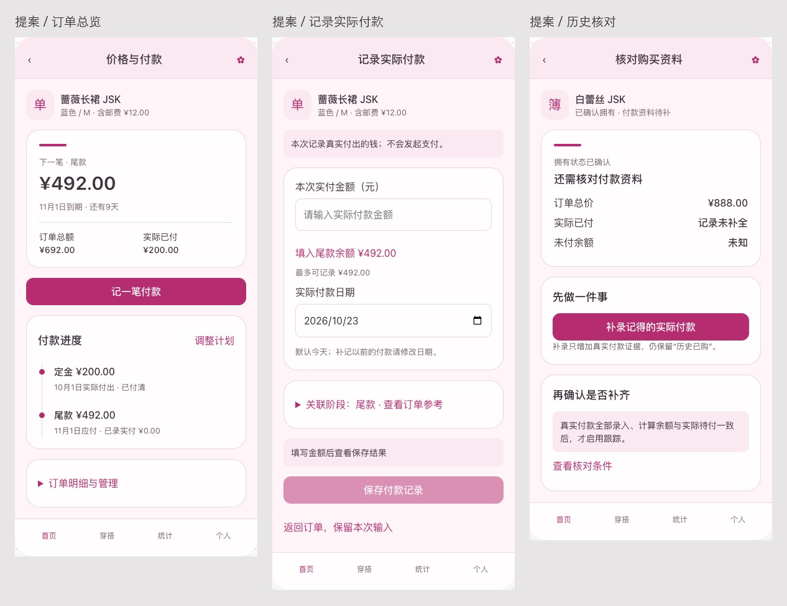

# 价格、付款与购买核对体验审查

日期：2026-10-23。体验版本：2.68.0／143；仓库基线 `435c3905`（应用发布源码 `fa7797c3`）。本轮按用户要求体验并提出优化建议，**没有修改应用代码，没有发布新版本**。以下问题分为真实页面复现、代码确认与设计建议，不把提案当成已实现功能。

## 结论与范围

价格模块已经具备比较完整的账本规则，但页面围绕“价格／阶段／付款记录”拆得较细，用户需要自己把任务串起来。最值得投入的是：先修复草稿和隐私问题，再把常用任务收敛为“看下一笔 → 记实付 → 看结果”，同时明确“心愿参考价”和“真实购买订单”的边界。视觉优化应帮助辨认物品、状态和下一步，不增加录价步骤。

本轮走查了物品详情、当前价格、创建价格、定金尾款、实际付款保存与撤销、历史已购补录入口、付款年历、金额设置及预算。阅读了 Entity/DAO → OrderRepository/OrderLedger → PriceViewModel → Compose，以及日历和预算的数据口径。沿用[产品与界面规范](../design-guidelines.md)和[已实施的价格表单改造](../creative-design-implementation-2026-10-22.md)，不重复建议已经落地的唯一底部保存、阶段折叠和真实实付分离。

测试在独立 `Lolita_Creative_Test_35`／`emulator-5602` 上进行，使用 Debug 2.68.0。保全原测试库后追加四个虚构样本：新建心愿、定金200＋尾款492的订单、历史已购888、共价小物。既有两个体验样本保留。页面上的操作为真实运行的应用；这些交易是受控夹具，不代表真实用户购买资料。结束后恢复原测试库并核对字节摘要，删除本轮首次创建的设置文件，恢复1080×2400／420dpi、fontScale 1、竖屏自动旋转和浅色系统外观。[夹具范围](../visuals/2026-10-23-price-review/fixture-manifest.json)、[操作后账本核对](../visuals/2026-10-23-price-review/native-results.json)、[恢复记录](../visuals/2026-10-23-price-review/restoration.json)。

## 实测问题与建议优先级

P1：影响输入成果、隐私或账本理解，建议先处理。P2：主要影响效率、反馈和视觉阅读。P3：需要独立业务设计的后续能力。

| 优先级 | 现象与证据 | 用户影响 | 建议 |
| --- | --- | --- | --- |
| P1 | **付款编辑旋转后丢失输入**。在余额492的订单输入500，旋转横屏再转回，金额变空。[输入前后](../visuals/2026-10-23-price-review/native-friction.jpg)，原图[输入500](../visuals/2026-10-23-price-review/native-10-overpayment-no-ime.png)、[转回竖屏](../visuals/2026-10-23-price-review/native-12-rotation-return.png) | 重复输入，已选日期与阶段也存在被重载覆盖的同类风险 | 按 priceId/paymentId 幂等初始化，恢复紧凑编辑草稿；读取失败不能变新建，保存期间保持同一提交身份。价格编辑有类似重复读取路径，实施时补定向复现，不将本轮付款结果外推为已测全部编辑器 |
| P1 | **关闭显示金额，付款年历仍显示金额**。设置Switch为false，消费总览和预算隐藏；年历仍有“已付510／待付492”和每月金额。[设置](../visuals/2026-10-23-price-review/native-32-settings-money.png)、[年历](../visuals/2026-10-23-price-review/native-30-calendar.png)、[预算隐藏](../visuals/2026-10-23-price-review/native-39-budget-hidden.png) | 同一隐私开关在相邻页效果不同 | 年历订阅同一设置，隐藏年度、月份、明细及无障碍金额语义。详情／价格摘要也需纳入一致性审查；用户主动编辑金额的临时显示边界另作明确设计，不修改账本 |
| P1 | **心愿“录入价格”实际创建购买订单**。心愿样本填商品金额680并保存，立刻成为待付款，心愿清单移除，预算出现未定日期待付680。[创建后](../visuals/2026-10-23-price-review/native-27-price-created.png)、[详情状态](../visuals/2026-10-23-price-review/native-28-wish-became-order.png) | 用户可能只是记下价格，却被登记为欠款 | 近期把入口写清“建立购买订单”，保存前说明将移出心愿并开始付款跟踪。后续独立设计“仅记参考价”，与OrderBinding、阶段、实付分离，不能把旧价格批量猜成参考价。这是当前规则的体验歧义，不是金额计算错误 |
| P1 | **年历快捷记账不显示实际日期**。确认框仅显示物品和492元；代码按`System.currentTimeMillis()`保存。[确认框](../visuals/2026-10-23-price-review/native-36-calendar-pay-confirm.png)。本轮点取消，未从此入口提交 | 补记以前付款时容易被归入今天，不能录部分付款 | 复用付款编辑页：预选对应阶段、主动填入剩余金额，默认今天并清楚显示可改日期；确认真实金额后保存。若保留快捷确认，至少把日期和“全额记录”写出并提供修改。本轮确认了界面与代码，未冒充实际记账验证 |
| P2 | **无效金额只有禁用，没有原因**。输入500超过492，保存禁用，没有“超出8元”等字段反馈。[原图](../visuals/2026-10-23-price-review/native-09-overpayment.png) | 不清楚哪里需要修改，误以为按钮失灵 | 金额旁即时展示可记录上限、超额差额或小数规则；阶段合计不符说明差多少和具体阶段。必要错误不藏进帮助 |
| P2 | **记付款需要重复穿过摘要**。详情→价格与付款→付款阶段与实付→记录实际付款，连续两页重复总额／已付／未付，前两页缺物品名称。[三页实拍](../visuals/2026-10-23-price-review/native-flow.jpg) | 操作链长，处理多件相近物品时缺上下文 | 订单总览保留名称／规格、下一笔、总额与实付，主动作直接“记一笔付款”；计划和历史账目仍可展开／进入，不丢原功能。完成后返回总览并显示本次结果 |
| P2 | **低频动作抢占主要区域**。正常待尾款订单上“历史已购，付款资料未补齐”“归档当前订单”常显且与日常操作使用同一强调色。[价格页](../visuals/2026-10-23-price-review/native-05-price.png) | 初次使用要先理解历史修复和归档，容易选错 | 收入“订单明细与管理”。需要核对的订单继续常显核对警示；归档后果在操作确认处完整保留，不隐藏必要提示 |
| P2 | **简单全款也呈现复杂表单**。新建首屏包含付款方式、重拆、两段解释、阶段卡；空计划也显示“重新拆分”。[新建价格](../visuals/2026-10-23-price-review/native-24-new-price.png) | 只想输入一个价格也要理解阶段模型 | 全款默认显示商品金额／邮费／合计和紧凑应付日期；阶段名称及提醒按需展开。定金尾款才展开两阶段，多段提供明确序号。切换方式需预览差异，保留人工金额，不静默重拆 |
| P2 | **历史补录说明重复且靠前**。价格页、付款管理页、补录页都呈现相近核对说明；320dp两倍字时补录页首屏只有说明和返回操作。[正常补录](../visuals/2026-10-23-price-review/native-49-history-edit.png)、[小屏首屏](../visuals/2026-10-23-price-review/native-50-small-history.png) | 到了填写页仍看不到输入，流程像循环 | 核对页采用“拥有已确认 → 补录真实付款 → 核对余额”明确步骤。补录页先物品及“余额未知”短提示，再金额／真实日期；完整解释折叠，原计划只读、未知日期规则常显 |
| P2 | **年历与预算的待付口径不够直观**。年历显示待付492，预算另列未定日期680，后者不进入年历；预算明细源码是只读卡片。[年历](../visuals/2026-10-23-price-review/native-30-calendar.png)、[预算](../visuals/2026-10-23-price-review/native-42-budget.png) | 用户可能把“本年有日期待付”理解成“全部还欠多少”；看见问题后还需回衣橱寻找物品 | 年度摘要明确日期范围，另列“日期待定”入口；预算的待付／未知日期条目直达对应订单或日期更正。保留已认可的紧凑月份布局，只增强摘要和明细衔接 |

实际付款保存492后，订单实付更新为692、余额0；撤销确认说明了状态影响，撤销后恢复实付200／待付492，账本只剩原定金记录。[付清实拍](../visuals/2026-10-23-price-review/native-15-paid.png)、[撤销确认](../visuals/2026-10-23-price-review/native-18-revoke-confirm.png)。这些应保留。历史已购888在本轮没有补录或启用跟踪，仍保持已拥有、实付未补全、余额未知；不因未知资料推算欠款。

## 界面提案：更像衣橱里的账簿

[三页主稿](../visuals/2026-10-23-price-review/concept-main.jpg)覆盖订单总览、记付款和历史核对；另有[设置订单价格](../visuals/2026-10-23-price-review/concept-price.png)。[交互稿源文件](../visuals/2026-10-23-price-review/price-concepts.html)可在对话内切换四种场景、七套皮肤、浅暗与两倍字体。它是方案预览，金额、日期和物品均为虚构示例，不写入应用。

1. **订单卡片**：物品名称和规格放在同一上下文条，下一笔待付为主金额，总价和已付为次级明细。新订单／付清／历史未知采用对应状态，不能所有状态都显示“下一笔”。日期待定就显示待定，不算倒计时；有多个阶段时按统一阶段余额计算，不拿阶段原额当未付余额。
2. **付款时间线**：一列区分“实际付出日期”与“应付日期”，每段保留文字状态。日期未知不放入虚构时间点；未指定阶段的实付用既有StageAccounting投影展示，不能为了时间线回写付款关联。已付清时强化最近付款及查看记录，不保留一个抢眼的禁用“记录付款”主按钮。
3. **填写与结果相接**：金额上方明确真实实付，主动点击余额建议才填入；金额／日期在主操作前，采购信息和阶段选择其次。就地反馈错误，保存前简短显示“累计已付、剩余待付、是否改变拥有状态”。唯一底部EditorSaveBar在真实应用继续处理IME；预览的自然文档流不冒充原生固定栏验收。
4. **历史核对**：拥有证据、付款完整性、日期完整性分开表达。完成补录后提供明确的下一步，而不是让用户找回前页；只有明确确认全部实付和实际余额一致才启用跟踪。无法确认时允许保持待核对。

原型“设置价格”的付款方式切换和阶段编辑只展示拟议交互规则，没有复刻完整账本编辑器；历史补录只展示展开与核对条件。付款演示支持超额反馈、部分付款和填入剩余余额，全部演示均只在浏览器内存运行。参考价分离属于后续业务方案，本轮没有绘制或实现新参考价存储页。

### 七套皮肤的具体方向

[浅暗对照板](../visuals/2026-10-23-price-review/concept-seven-skins.jpg)，各套完整原图在同目录 `concept-<skin>-<light|dark>.png`。

| 皮肤 | 构图与表面方向 | 装饰边界 |
| --- | --- | --- |
| 甜美 | 柔软手账、饱满卡面、短缎带般的分区标记 | 装饰不经过金额和输入，避免整屏动态碎片 |
| 哥特 | 拱顶账册、切角收束、细长分区笔势 | 明确层次，减少大面积暗花纹 |
| 中华 | 折页笺纸、侧边书脊、舒展横向笔势 | 主信息留白，沿用已降低强度的背景 |
| 古典 | 对称藏书、细线、端正的标题轴线 | 少量酒红强调，普通卡弱于主操作 |
| 海军 | 航行手册、舷窗提示、清楚的水平结构 | 蓝色用于选中与动作，不把未付都变成警报 |
| 田园 | 布面日记、围裙般的上缘、柔和叶片形笔势 | 保持暖纸底及读取对比，不铺密集格纹 |
| 维多利亚 | 拱形账簿、层叠细线、克制玫瑰色 | 仅重点卡有较精致轮廓，不给每条账目套重框 |

图稿负责表达构图方向，实施须映射现有皮肤令牌、标题字体和七套真实图标provider。图稿的文字导航与示意符号不是新图标系统，不替换已认可导航；如需新图标仍须Base＋七provider成套设计。暗色不简单反相，文字／状态与卡面单独配对。普通未到期余额可用正常文字或皮肤强调色，错误和逾期才使用错误色；不能只靠颜色表达状态。

新动效可采用付款成功后对应阶段短暂强调、折叠行平滑展开和原有导航过渡；不滚动累加金额、不做低精度数字动画、不对未知余额绘制进度环。滚动继续注册ObserveSkinScroll，装饰遵守原暂停策略。

### 小屏、字号与图片

实际测试包含常规1080×2400／420dpi，以及960×2100／480dpi（320dp）两倍字体。已实拍甜美浅暗和中华浅暗的相关状态、正常尺寸真实数字键盘；[真实键盘](../visuals/2026-10-23-price-review/native-62-history-keyboard-stable.png)。小屏金额上限文字已明显多行，首屏说明挤占主要操作。**本轮没有执行七套皮肤的全量原生回归，也没有完成小屏两倍字下的付款提交验收**。

原型112组布局检查（7皮肤×2浅暗×4场景×常规／320px两倍字体）无横向溢出，超额500、部分付款100、余额392补齐均按预期演示。[浏览器检查](../visuals/2026-10-23-price-review/prototype-qa.json)。这只证明浏览器原型，不证明Compose、TalkBack、Android IME或原生导航状态通过。

本轮未新增业务图片。示例没有照片，使用上下文符号，不画假商品或截图占位。若实施时在订单上下文增加缩略图，使用真实已存相册图、约48dp完整Fit、点开原详情放大；缺图用类型回退，保留原图与封面顺序，不为展示生成第二份业务原图。图片区不挤占金额与长名称。

## 业务流程与数据边界

- 日常购买：物品详情 → 建立订单并确认含邮费总额 → 按实际情况录实付 → 明确付清／尚欠及下一期 → 日历或预算回到同一订单。计划保存不自动创建付款，邮费只计一次，共价小物不重复消费。
- 心愿：近期仅澄清“建立购买订单”的结果。若增加参考价，必须另行设计字段、DAO投影、备份／CSV和迁移；旧Price的购买证据、付款和绑定保留，不按有无实付猜参考价，参考价不进入应付和提醒。
- 历史资料：已拥有证据保留；先补录能确认的付款，再核对余额与启用跟踪；未知付款日期不补今天。新普通付款仍要求真实日期，不能借历史补录放宽规则。
- 退款／优惠／取消：当前金额修改与撤销实付不能完整表达真实退款、已付款后的退差价或取消交易。建议作为P3独立设计：退款是新的资金事件，撤销是纠正误记，归档是改变当前订单范围；不能用删付款或负数普通付款替代。需单独明确净支出、月度归属、状态、备份与历史兼容，本轮不实施。
- 草稿、就地校验、页内动作排序、日历隐私和快捷记账复用原则上可先沿现有实体实现，仍须核对实际需要；如果新增跨进程持久草稿，显式选择SavedState或ItemDraft等合适边界，不能宣称无需任何数据设计。
- 现有Room33／42实体、备份14未变。纯提案不重跑迁移与备份往返；实现参考价或退款等新实体／字段时，必须升数据库／备份协议并同步JSON、ZIP、预览、CSV及旧备份容错。
- 本轮不调用AI服务、不上传用户资料、不操作真实支付、不写真实系统日历。通知到达、日历权限拒绝、后台提交并发和TalkBack人工朗读均未验证，后续按实际实现影响选例。

## 建议实施顺序与验收

第一批解决“放心使用”：付款草稿幂等读取／旋转恢复、显示金额跨年历一致、日历记账明确日期／金额、字段级错误提示。保留原账本的事务、精度和付款记录。

第二批解决“少找少点”：详情直达记付款，订单总览与计划历史分层，带物品上下文，普通全款简化，历史核对步骤化，预算问题条目能回到订单；将已批准图稿映射原生组件后验收七皮肤。

第三批独立讨论“业务扩展”：心愿参考价与订单分离、退款／退差价／取消购买。不能把这些建议与前两批简单布局修改混成一次隐式数据改造。

验收至少覆盖：

- 新订单全款／定金尾款／多段，阶段手动金额和日期保留；总额含邮费、分期合计不符明确定位。
- 付款超额、小数、部分付款、付清、撤销；共价小物状态同步，日期与原记录ID保全。
- 旋转／后台重建／底栏切换／返回，草稿保留或明确放弃；保存中防重复，失败保留输入。
- 金额开关实时覆盖年历摘要、月份、明细、详情及语义；主动输入金额的临时显示规则一致。
- 历史无实付、部分补录、日期未知、超付异常、归档再绑定；拥有证据与账本完整性分离。
- 320dp两倍字、长物品名／大金额、真实IME和唯一保存；受影响七皮肤浅暗；TalkBack单独人工核对。
- 年历应付日期与实付日期不同、跨月补记、日期未知和预算下钻；提醒权限拒绝／无日历可写要有可恢复结果。

## 代码定位与完成检查

- `ui/screen/price/PriceViewModel.kt`：`loadPayment`（363行起）每次重新载入并覆盖UiState；`isValid`（412行起）只返回布尔，界面无原因映射。价格`loadPrice`（187行起）同样需检查幂等与草稿。
- `ui/screen/price/PriceManageScreen.kt`：68行起当前订单摘要、112行归档常显；正常价格页面没有物品名称上下文。
- `ui/screen/price/PaymentManageScreen.kt`：余额摘要、阶段和实付分组均已存在，优化不删除原账目或混淆两者。
- `ui/screen/price/PaymentEditScreen.kt`：历史PurchaseRecordNotice先于输入；实际付款内容和唯一EditorSaveBar应保留。
- `ui/screen/calendar/PaymentCalendarScreen.kt`：201行起`markAsPaid`按当前时间记录，764行确认文案未展示日期；页面未订阅showTotalPrice。
- `domain/usecase/OrderLedger.kt`：86行起`createOrder`建立TRACKED绑定并刷新状态，解释心愿录价后的实际结果。
- `ui/screen/budget/BudgetScreen.kt`：未定日期区与日期口径已有说明，明细当前没有导航行为。

- [x] 阅读AGENTS与产品规范，检查现有数据流和工作区，保留既有未跟踪资料。
- [x] 用独立AVD和虚构数据实际走查，保存原图／UI树，区分实测与源码结论。
- [x] 先归档四场景提案和七皮肤浅暗效果；原型112组布局检查与关键金额交互通过。
- [x] 说明账本、隐私、图片、旧备份、参考价／退款边界及未验证范围。
- [x] 恢复专用AVD的原测试库和本轮临时显示设置。
- [ ] 原生实施、定向构建与测试、正式发布：本轮范围为审查与提案，未执行。

纯文档交付，按仓库约定核对差异后提交推送，不增加应用版本、不构建APK、不创建Release。AGENTS仅新增本轮审查入口，长期账本与设计约定没有改变。
