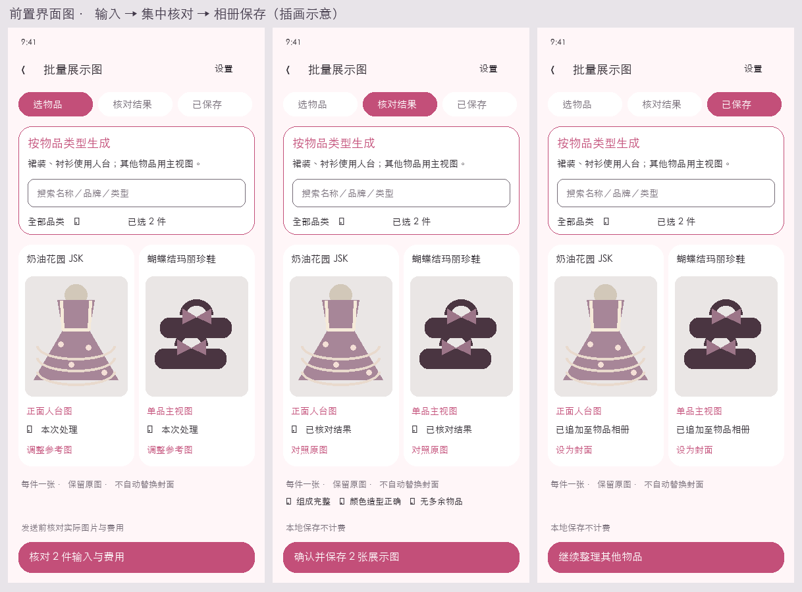
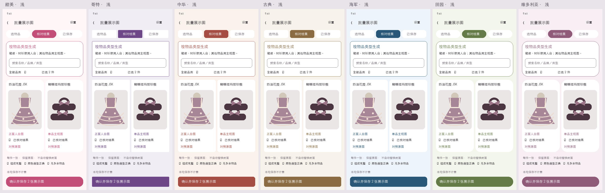
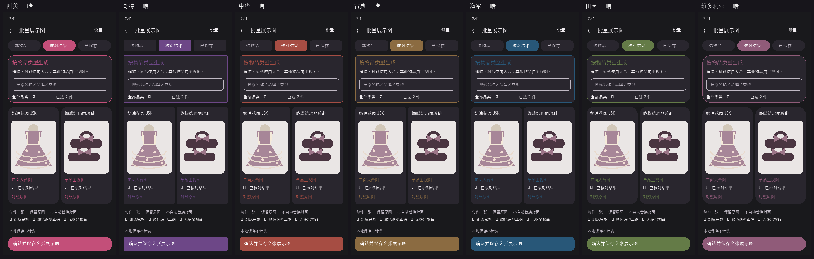

# 批量展示图收敛

2026-10-27，用户反馈透明图片组合效果不好，明确要求保留批量主视／人台生成，并选择按物品类型自动选用。此方案取代新建批次强制主视→透明分层的路径；旧素材、旧批次、旧冻结请求继续按原协议读取和处理。

## 前置界面设计

艺术构图采用完整商品图、紧凑类型标签和底部唯一主操作。生成输入、集中核对、相册保存三个阶段共享卡片与图片位置。

图中商品为程序绘制插画，只表达排布，非生成效果证据；图稿先于界面实现。实际复用七皮肤令牌、图标、LolitaSection、LolitaCard、ImageFrame。320dp或大字体改一列，自然增高；输入要求随内容滚动，底部操作处理IME。

## 采用范围

- 一次明确选择1—30件已拥有／心愿物品；保留搜索、品类、隐藏选择、逐件换图及框选。
- 稳定类型映射：现有正面人台支持的裙装、衬衫使用固定无杆人台；其他类型使用中性浅灰底主视图。全头假发本批次不带头模，独立选头模入口保留。发片不补成整顶；成双／成组保留可见组成，鞋具保留可辨结构的角度。
- 发送前逐件展示准备后的实际商品图片；人台项还展示实际固定模板。冻结服务、提示词、类型、组合、图片SHA及批次位置；每件一次请求、一张结果，不分层、不自动重试。
- 成功与失败分开处理，集中核对三项后只追加相册，记录AI来源，保留原相册及封面。已保存结果可主动设封面。保存原子提交、重复提交幂等，类型／组合／状态变化拒绝陈旧保存。失败重新确认输入和费用。

## 数据、备份、图片与费用

复用MANNEQUIN v4不可变请求及ImageTask既有批次列，放宽实体批次验证到这一明确组合，不增加Room字段或实体；Room34不变。JSON/ZIP沿现有任务和相册图片清单映射，备份15不变，旧1—14兼容不改。旧SINGLE_ITEM_MATERIAL v5/v6批次保持旧流程，已确认透明素材继续可用。

相册预览Fit并可全屏放大，缩略不改源图；结果仅明确保存后进入业务。模板及准备副本走ImageFileHelper与统一引用保护。失败、离页、舍弃和备份不误删原图／共享图；生成不改变订单、实付、拥有或位置。

仅发送勾选的商品图片／选区与所需模板至明确服务；不含未选相册或密钥。UI常显API单独计费与AI可能改绘。当前无本轮真实付费额度，不发真实服务请求，受控测试仅证明流程与保存保护。

## 验收计划

混合类型自动映射与真实模板快照；批次全有或全无、幂等、状态变化／坏图拒绝；集中保存、封面／原图保全；旧透明批次与新批次ZIP往返；受影响入口与任务中心导航；七皮肤浅暗、320dp两倍字号、真实IME及失败重试；Debug、提交源码clean正式包与发布按AGENTS执行。
