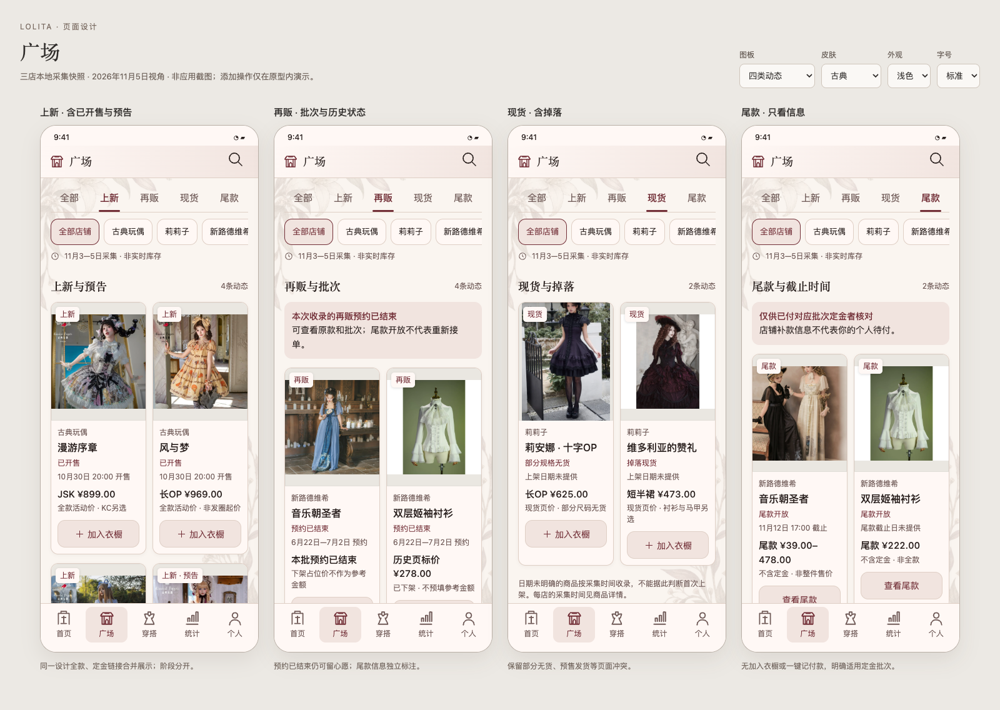
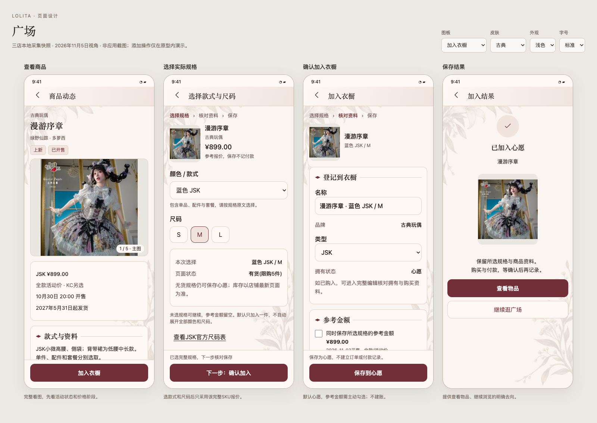

# 广场页面与商品加入衣橱设计

日期：2026-11-05。状态：前置设计与本地交互图稿，尚未接入 Android 应用。本方案以三店已采集的公开资料为样本；主助手只读取本地 JSON、报告和图片，未操作浏览器查看淘宝，也未重新采集店铺。

广场帮助用户了解 Lo 店近期的**上新、再贩、现货、尾款**，从前三类商品进入衣橱登记。活动类型、销售状态、价格阶段独立表达；保存默认进入心愿，购买、付款和拥有仍遵守现有衣橱与账本规则。

## 一、可直接审阅的图稿

- [交互预览](../visuals/2026-11-05-square-design/prototype.html)：分类、店铺筛选、搜索、商品详情、实际 SKU 选择、资料确认、模拟保存与重复提示均可操作；所有保存只发生在原型内存中。
- [四类动态](../visuals/2026-11-05-square-design/overview.png)：真实样本与按钮边界。
- [加入衣橱四步](../visuals/2026-11-05-square-design/flow.png)：详情 → 规格 → 确认 → 结果。
- [七皮肤浅色](../visuals/2026-11-05-square-design/skins-light.png)、[七皮肤暗色](../visuals/2026-11-05-square-design/skins-dark.png)。
- [关键状态](../visuals/2026-11-05-square-design/states.png)：加载、空结果、部分失败、重复登记、资料变化和图片失败。
- [小屏、大字、键盘示意及金额隐藏](../visuals/2026-11-05-square-design/edge.png)。

这些是 HTML/CSS 绘制的产品效果图，使用真实商品照片和现有皮肤背景。图稿先于应用实现；不以 HTML 截图冒充 Compose、真实系统字号、IME 或设备验收。

## 二、三个店铺实际说明了什么

样本来自 `~/Downloads/puppets-and-doll-latest-2026-11-03/`、`~/Downloads/lilizi-neoludwig-latest-2026-11-05/lilizi/` 与同级 `neo-ludwig/`。只使用公开商品字段和已落地原图；不把买家身份、订单或登录态带入原型。

| 店铺 | 可核实资料 | 广场表达 |
| --- | --- | --- |
| 古典玩偶 | 10月30日多萝西三组设计，每组全款、定金各一链接；褪色相片11月11日20:00预告 | 3条已开售上新 + 1条上新预告；同设计全款、定金合并卡片，报价分别保留 |
| 莉莉子 | 官方主店明确跳转哥特二店；莉安娜现货页、维多利亚的赞礼掉落页 | 2条现货；无新首发日期证据，不标“今日上新”；部分规格无货，标题现货与预售发货说明同时保留 |
| 新路德维希 | 音乐朝圣者第二批裙装与衬衫/小物、双层姬袖衬衫第二批预约已结束；另有两条第一批尾款 | 2条历史再贩动态 + 2条尾款动态；按批次区分，不把下架占位金额当全款 |

**归并结果：10条动态、14个商品/补款链接、542条 SKU。** 上新4条、现货2条、历史再贩2条、尾款2条是去重后的主类型计数；尾款也可带“再贩”标签，所以再贩筛选显示4条，不能将筛选结果数相加当总数。设计数、动态数与链接数分别统计，不将10条动态当作10件独立裙子。

关键实例：

- 漫游序章卡片显示“JSK ¥899.00 / 全款活动价”，而不是 KC 起价 ¥310.40；选择蓝色 JSK / M 后才可采用对应报价。定金 ¥170–270 不变成整件金额。
- 风与梦长 OP 为 ¥969.00，发圈 ¥134.40 不用于裙装主报价；纯色短 JSK 为 ¥739.00。
- 褪色相片为预告，正腰 OP 页示 ¥3,110.40；报价保留为证据，正式开售前默认不预填参考金额。
- 莉安娜长 OP ¥625.00，袖套 ¥175.00；维多利亚的赞礼短半裙 ¥473.00，马甲 ¥253.00，不以配件价表示全套。
- 音乐朝圣者第二批页的 ¥1000/¥500 是下架页面记录，不是各单品全款；姬袖衬衫 ¥278 仅标历史页价。历史预约价可查看，默认不自动采用。
- 音乐朝圣者第一批尾款 ¥39–478，截止11月12日17:00；双层姬袖衬衫第一批尾款 ¥222，截止时间未知。后者不能套用前者日期，也不能把第二批11月25日—12月24日套到第一批。
- 莉莉子旧图仅写2月26日、3月18日，没有年份。原采集 JSON 部分字段带推断年份；本次图稿明确不采用这些推断作上架时间，不改写原始档案。

公开资料仍是采集时的快照。“采集于11月3日/5日”不是商家上架时间或实时库存承诺；新路德维希这组资料也不足以断言全店最新首发。

## 三、入口与信息结构

### 导航

已核对当前 `BottomNavItems`：首页、穿搭、统计、个人四项。新增后为 **首页 / 广场 / 穿搭 / 统计 / 个人**，保留原四项身份和首页四个 Tab。广场是独立一级页面，不把店铺动态混入私人衣橱库存。

新增 `Screen.Square`、`Screen.SquareProduct(eventId)`、`Screen.SquareRegistration(draftId)`，在 `Screen` 与 `LolitaNavHost` 同时注册。尾款说明属于商品详情的只读分区，不另起一套付款系统。后续查看已保存物品回到原详情；返回广场保留类型、店铺、搜索、滚动位置和未保存选择。

新增 `IconKey.Square`，采用“店铺门面/集市”语义，七 provider 和 Base 同步补齐。五入口底栏按实际行高增加高度，26dp图标和12/18sp标签，不缩字号或侵占系统导航区域；既有导航图标造型沿用，图稿中的旧图标仅为位置示意。

### 列表

1. 紧凑标准顶栏“广场”与搜索入口；搜索可找店名、系列、款式。
2. `全部 / 上新 / 再贩 / 现货 / 尾款` 分类；下方独立店铺筛选。类型与店铺相交，切换不清空其他输入；小屏和大字采用可横向滚动行。
3. 显示资料采集范围与“非实时库存”。本轮无在线目录服务，不绘制“刚刚同步成功”。
4. 双列图文卡片：完整商品展示 → 店铺 → 名称 → 当前状态 → 活动日期/未知 → 有明确对象的报价 → 操作。无匹配图片时给真实失败状态，不用无关裙图填充。
5. 再贩筛选常显“本次收录的再贩预约已结束”，尾款筛选常显适用定金批次说明。历史动态可以浏览和存心愿，不能以可点击按钮暗示仍接单。

正式数据排序：先分“即将开始 / 当前活动 / 已结束”，各组按有证据的活动时间倒序；缺日期的现货按收录时间进入“日期未提供”组，不伪造时间。全量页同一事件只出现一次，跨分类检索可重复命中同一事件。本轮原型按固定样本顺序展示各类，重点验证信息结构与交互；正式排序及分组待实施。

### 详情

顶部先显示店名、系列、类型与当前状态，再完整展示主图；价格总是带对象与阶段。接着是开售/结束/发货、所含单品、材质工艺、官方尺码与洗护、来源链接和采集时间。使用 `ImageFrame`、`LolitaSection`、`SectionHeader`，低频来源证据可展开；未知日期、售罄/预约结束、定金尾款身份不能折叠隐藏。

同款全款和定金是两个购买入口，不重复变成两件裙子；详情保留独立报价与对应链接。批次不是备注中的一段文字，而是事件和价格归属的一部分。预告作为上新状态，掉落归入现货；不再增加更多顶层分类。

## 四、加入衣橱的完整流程

**查看动态 → 选款式/颜色与尺码 → 核对物品 → 保存心愿 → 查看物品或继续浏览。** 前三类提供“加入衣橱”；尾款链接始终没有新建物品或直接记付款操作。

| 阶段 | 行为与边界 |
| --- | --- |
| 选择规格 | 只列实际公开组合，零预选。颜色分类可能含整裙、配件、套餐，保留原文。选完整 SKU 后才显示它的精确报价；无货仍可存心愿，并保留无货文字 |
| 暂不选规格 | 允许继续编辑，尺寸及参考金额留空；类型仍需主动补齐。未明确的鞋码/尺码不猜测 |
| 核对资料 | 名称、核验品牌候选、类型、所选规格、图片与来源可纠正。默认心愿。品牌只精确匹配既有已核验别名；无匹配不静默新建，用户可选择品牌或现有未设置品牌 |
| 保存参考价 | 默认为不勾选；只允许所选完整 SKU、有效全款/现货报价。定金、尾款、占位价、预告价、已结束页面价不直接写入参考金额。没有可靠价可以手填或留空 |
| 套餐与多件 | 默认一件，不自动展开全店/全部颜色尺码。套餐不能将总价重复记到各部件；需要分别登记时进入现有明确拆分及逐件核对流程。图稿仅演示单件选择 |
| 保存 | 复用现有 `ItemDraft → ItemEditViewModel → ItemDraftRepository.commit` 思路；只在用户最终确认时写 Item、来源与可选独立参考价。不得创建 Price、Payment、退款、取消、付款日期、尾款提醒或收纳位置 |
| 成功与重试 | 显示保存结果及真实物品入口。回传丢失可按操作回执找到已保存物品；重复来源与完整规格先给查看原物品/明确另记选项，不按相似名称自动合并 |
| 退出 | 保留草稿或明确放弃；暂存资源由草稿持有，清理只处理本次无引用副本。中途失败不出现半件正式 Item |

现有 `ItemEditViewModel` 已把淘宝导入草稿设为 `ItemStatus.WISHED`，并要求类型有效；本设计延续这些约束。广场确认页是现有编辑能力的精简入口，进入完整编辑保留输入，最终只保留一个保存按钮。用户若确实已购，去原编辑/价格页核对，不把浏览或加入心愿当作购买。

尾款页显示适用批次、报价阶段、截止及未知项。首版不做按名称自动匹配个人订单、代付或个性化提醒；需要记真实付款仍去已有物品价格/实付流程。尾款商品若有有效的新购/再贩全款入口，以另一活动入口出现，不给当前尾款链接开放新建。

## 五、艺术方向、七皮肤与图片

以真实服饰照片为主，顶栏和卡片提供稳定的阅读秩序。卡片不叠加宣传大字、店铺粉丝数或虚构折扣；用足够留白区分状态、报价和动作。商品正文采用现有16/24、紧凑说明14/22、元数据12/18，顶栏18/26sp、分区18/26sp，按钮15/22sp。标题消费各皮肤现有字体，数值与阅读内容沿用统一阅读字体。

| 皮肤 | 页面与广场图标方向 |
| --- | --- |
| 甜美 | 饱满卡片、柔粉层次，圆弧棚沿与柔和店门 |
| 哥特 | 尖拱/切角的照片入口，折线棚顶和尖拱门洞 |
| 中华 | 克制的朱红、交领分区笔势，飞檐店铺屋顶 |
| 古典 | 对称留白与收束分区，柱式门面和克制酒红 |
| 海军 | 完整画框与蓝色层次，灯塔式屋顶和舷窗构件 |
| 田园 | 围裙感宽弧、柔和草木背景，宽檐棚沿与自然门面 |
| 维多利亚 | 拱形门洞和内外画框层次，酒红与低对比金色细线 |

原型使用现有七张背景的保留透明通道预览，不生成仿制商标；店铺以文字表达。七套广场图标主体路径各异。原型的可读文字/按钮使用经过加深或提亮的配色方案；这些是本功能的对比度设计方向，不声称与现有 Compose 令牌逐像素一致。实施时优先复用已有皮肤令牌，若不足需同步七套令牌及暗色变体，不能在单页硬编码私有配色。

| 场景 | 图片处理 |
| --- | --- |
| 双列卡片 | 0.8宽高比容器、完整Fit、中性底；小图可辨认裙摆，不用大幅裁切换取满屏 |
| 详情主图 | 完整Fit，受屏幕合理高度限制，可进入完整查看；主图、SKU图和详情图按角色分组 |
| 官方尺码与长图 | 保留全部行列、单位、适用款式和成衣/人体身份；完整Fit后可放大滚动，不能只给缩略裁切 |
| 编辑预览 | 清楚显示本次要登记的规格与商品图；缩略不改变原图/封面，只有用户明确设置才替换封面 |
| 保存副本 | 官方原图保持顺序、URL、SHA和来源，图片由ImageFileHelper复制到独立UUID路径。目录缓存清除不影响已登记物品；删除Item不误删他人引用 |

图稿的 JSK 尺码图来自漫游序章官方原图，已直接读图核对：S胸围80–90/腰围62–72/裙长93，M为85–95/67–77/94，L为90–100/72–82/95，摆围均246cm；成衣平铺测量、误差约2cm。该表不能套到背带裙、内搭或其他店商品。图稿展示用副本、原图来源和SHA见 [asset-sources.json](../visuals/2026-11-05-square-design/asset-sources.json)，不将960px预览副本当正式导入原图。

320dp及两倍字时，卡片改为单列，按钮和底栏自然增高，筛选行可滚动；金额与长名允许换行。输入内容随焦点滚动，消费Scaffold Insets后使用IME padding，让唯一保存栏位于真实键盘上方。本轮键盘是排布示意，真实IME与TalkBack待原生实现验收。

## 六、内容供给与数据实施设计

### 公开目录与私人衣橱分离

维护者沿已建立的流程委派本机 dsh/DeepSeek 采集，审核后生成公开目录：`catalog.json + 原图清单 + 缩略图/原图资源`。App读取这个经过核对的目录，不要求用户登录淘宝采集，不在进入页面时上传衣橱或买家信息。**主助手仍不操作淘宝浏览器。**

本轮生成的是仅供设计的 `data.js` 和图片预览，不是已上线目录服务或可完整恢复的广场资料包。正式实现采用可版本化的静态目录资源，先提供与三店档案对应的本地目录，再接入实际可用的公开分发地址；目录地址、更新频率及生产发布尚未部署，不能在产品里承诺实时上新。旧快照离线可读，更新失败保留上个完整版本及其真实采集时间。

| 模型 | 必需内容 |
| --- | --- |
| Shop | 稳定公开shopId、店名、核验别名、官方关系证据、采集时间；主店和二店关系分别记录 |
| Design | 核实的设计身份、名称及部件身份；不以标题字符串当全局唯一键 |
| Event | eventId、designId、shopId、batchId、tags、primaryKind、销售状态、开售/结束时间及证据；未知为null，不用采集日补 |
| Offer/SKU | 淘宝itemId、skuId、完整props、明确款式/颜色/尺码、报价分、priceType、批次、库存原文、capturedAt、sourceURL |
| Image | 归属、main/sku/detail/promo角色、顺序、真实URL、SHA、字节数、尺寸；推广图和推荐商品不混入物品相册 |

金额沿现有整数分规则规范化。全款与定金链接的设计归并必须有官方同设计证据，完整SKU映射必须明确；不同前缀或无法核实的套餐不靠类别猜同款。所有推导保留字段级证据及未知身份。

公开目录是可重取缓存，首次可来自随安装/本地提供的目录资源；原图按实际选中商品准备，不把745份历史图片副本全部塞进APK。业务数据流为 `SquareCatalogSource → SquareRepository → SquareViewModel(StateFlow) → Composable`；Repository做轻封装，事件分组、SKU选择、报价准入和登记校验放domain usecase，通过AppModule接线。后台更新不得覆盖用户正在编辑的冻结快照。

本机现有 `shop-updates/README.md` 所述采集目录（位于另两笔尚未推送的既有提交），输出兼容现有25字段 `TaobaoProductDraft` 的 `feed.json`，并保存逐店检查记录；它目前是 `listing_only`，不含完整详情/SKU，`newObservedAt`也不是官方上新时间。后续可复用其列表候选与检查结果，经过dsh补全、分类和人工核对后才进入广场已核实目录。不得把现有“首次观察到”直接映射为本方案“上新”，也不能拿listing_only直接开放完整资料保存。本轮没有执行其浏览器collect、启用监测或修改采集代码，主助手禁操作淘宝浏览器的要求继续适用。

### 个人登记与迁移提案

当前源码为2.71.1/147、Room34、备份15。本轮不改变这些版本。拟实施方案：

- 新增 `SquareItemOrigin`：UUID主键、Item外键CASCADE、唯一operationId、event/design/batch/component身份、完整公开itemId/skuId、选择快照、目录revision、来源URL、采集时间和创建时间。它记录私人登记来源，不代表购买。明确“另记一件”生成新operationId，来源组合本身不设绝对唯一，允许真实重复拥有。
- `ItemDraft`追加可空 `square_candidate_json`，记录冻结候选、operationId、用户选择、是否采用参考价及基准revision；JSON内不存本地图片路径，图片复用现有显式imagePaths/sizeChartImagePaths/evidenceImagePaths列。
- `Item + SquareItemOrigin + 可选ItemReferencePrice + 草稿移除`在同一事务提交。先暂存校验图片，事务内重读草稿/目录版本与已有回执；相同operationId只能保存一次。返回丢失按回执恢复。绝不把公目录JSON直接送进网页解析器执行。
- `SquareItemOrigin`不冒用 `PRODUCT_SUPPLEMENT`。当前 `OrderImportBackupValidation`只允许两类既有ItemSourceRecord，需保持其真实语义，不能仅扩枚举掩盖不同业务。
- Room34→35拟新增一表一列并注册迁移、导出Schema；新DAO接入数据库、Repository、AppModule。原45表/实体的数据、账本、价格、图片及现有草稿完整保留，不做历史自动匹配。
- 备份15→16拟新增 `squareItemOrigins`，补新草稿字段的导出、导入、预览、校验。旧1—15缺失字段补空集合/null；新格式照现有规则拒绝未知/非法字段。CSV仅增加可读商品来源/规格/批次，不输出内部操作标识。未登记的公共目录缓存不进私人备份；已登记的物品、来源与完整本地引用图片仍进ZIP，JSON/CSV边界不变。
- 删除Item级联来源，图片继续按引用保护清理；清空广场缓存不删Item、草稿或备份引用。已有数据不变更品牌、位置、拥有状态、价格或个人提醒。

保存前准备选中商品的完整原图及详情；SKU独立图没有就明确没有，不能拿主图充数。沿现有每图20MiB、单商品80MiB的资源边界预检，失败停在准备阶段并允许重试/放弃，不静默截断图片。目录读取不沿用网页解析“详情最多50张”的截取逻辑：例如漫游序章有54张详情，需要全部保留；超出正式导入预算须明确失败，而不是把部分图报告为完整。缩略解码、磁盘缓存与原图副本分开，进程重建不重复产生无引用大文件。

## 七、隐私、费用与失败

- 公开目录里只保留商品与官方店数据，不落地买家字段、Cookie、Token、私人订单；此次图稿未导入用户衣橱备份。
- 加入状态与个人来源回执只保留在本机；不向内容端发送库存、拥有、预算或付款。详情与只读参考金额遵守“显示金额”及无障碍语义；主动编辑临时显示应预告，返回不改设置。原图印刷价格本身不能由文字隐私开关消除，保留用户主动看图的行为。
- 浏览、选择、加入心愿不调用付费AI，不采购、不加购、不代付，也不后台生成素材。本轮未新增模型调用或付费服务。
- 全店更新失败、单店失败和单张图片失败分开显示；完整目录校验失败不替换可用旧版，仍标旧采集日期。未完成图片不开放最终保存。
- 陈旧草稿或目录报价变化时保留输入，显示重新核对动作；网络重试不自动记Item或付款。已保存物品不因广场活动结束、下架或目录清理而消失。

## 八、验收与本轮完成情况

| 场景 | 原生实施时必须验证 |
| --- | --- |
| 分类与时间 | 四类型、多标签去重、预告、历史预约结束、无首发日期、无年份旧图、尾款截止未知，以及设备时区下的准确日期 |
| 价格 | 配件起价/全款/定金/尾款/占位价隔离；全款与定金映射不串SKU，跨批不能相加；非可靠价不预填 |
| 加入与保存 | 默认心愿、类型必填、规格零预选、无货仍可留心愿、套餐价格不重复、完整编辑返回保全；参考价勾选才落库，账本/收纳/提醒完全不新增 |
| 一致性 | 双击、并发、崩溃后回执恢复、重复组合提示/明确第二件；旧Item删除、目录更新和编辑期间冲突不覆盖 |
| 图片 | 原图与长图完整、跨角色顺序、54张详情不截断、缺图/超限阻止完整保存；丢弃/缓存清理/删除不伤现有图片 |
| 升级备份 | Room34→35保全，旧1—15缺字段，16的JSON/ZIP/预览/CSV一致，草稿和来源恢复后幂等；引用非法和失败不半恢复 |
| 界面 | 七皮肤浅暗、五入口导航、320dp两倍字、真实IME、TalkBack、金额隐私与图稿对照；新增53键图标矩阵保留原52键 |

已完成：读现状与规范、归并真实样本、绘制四类列表及登记流程、七皮肤浅暗、关键状态、小屏大字/键盘示意、图片规则、数据/备份/隐私/价格边界。已对本地原型执行资源加载、面板边界和关键交互检查，结果见 [review.json](../visuals/2026-11-05-square-design/review.json)。检查脚本只打开本地设计文件，并阻断HTTP(S)，不访问淘宝。

尚未实施或验证：Android页面、目录生产分发、全图资料包接入、Room/备份迁移、真实Item写入、原生排序分组、多规格批量登记、原生字体/IME/TalkBack和正式发布。图稿中的添加与重复检测只发生在内存，不修改真实衣橱。本轮按纯设计交付，不构建APK、不增加版本号。

完成检查：

- [x] 设计图先于应用实现，并归档到稳定路径。
- [x] 七皮肤浅暗与关键状态、小屏、大字、键盘示意可查看。
- [x] 原图保全、完整查看和角色/规格归属有明确规则；尺码原图已直接核对。
- [x] 数据升级、旧备份、事务、图片引用、隐私与付费边界已设计。
- [x] 明确心愿、参考价、订单/实付、再贩/尾款及收纳边界。
- [x] 本地HTML交互与资源检查；不冒充原生验收。
- [ ] 应用实现、迁移、真实Compose与生产目录验证：留待实施任务。
