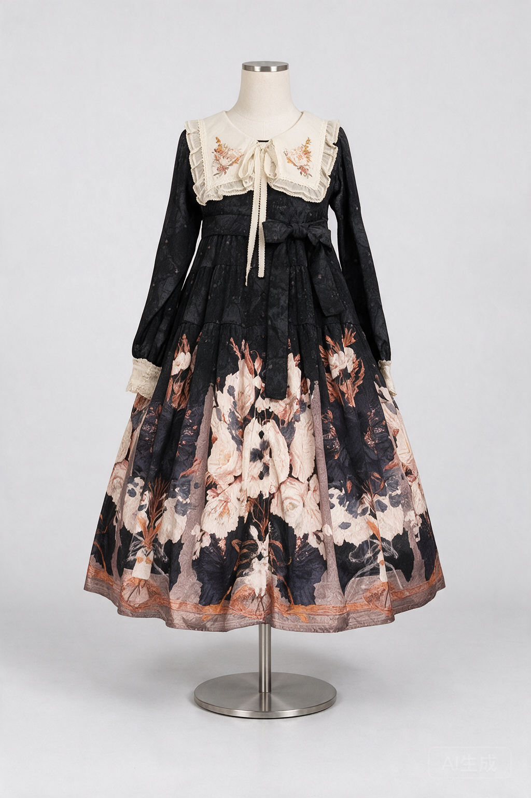

# 即梦 5.0 Pro 接入

用户选择即梦，应用通过火山方舟官方 Seedream 5.0 Pro API 调用。虚拟试衣与裙子正面人台图增加服务切换，保留原GPT接口；两家Key分开加密。新安装默认即梦，已有旧GPT密钥保留原选择。生成与保存流程不变：人台结果先预览，再明确追加到原图片末尾。

接口：https://ark.cn-beijing.volces.com/api/v3/images/generations；型号 `doubao-seedream-5-0-pro-260628`。参考图在本机归一化为JPEG，以有序Data URL上传。输出1024×1536、PNG、b64_json，关闭流式，保留官方AI水印。不会额外抓取服务返回的URL，也不自动重试付费请求。

设置通过changes通知两个页面，生成原子捕获provider/key；若页面显示的服务已经改变，上传前拒绝请求。历史结果保存实际模型。Key、服务选择均为本机配置，业务备份与数据库结构不变。

## 真实服务验证

首次请求被账号安全体验模式的用量上限拦截（HTTP429 SetLimitExceeded），没有返回图片。用户自行调整限制并明确允许再测后，第二次请求HTTP200，76.29秒返回1024×1536 PNG；2张输入、1张输出。没有自动重试。请求使用现有人台模板和测试资料113号虞美人OP，与先前探索相同提示词；详细参数、来源SHA与结果SHA见[验证记录](seedream-live-verification-2026-10-16.json)。实际金额以火山账单为准，未读取用户账单。

样片保留黑色长袖、奶油领片、侧腰结和大花裙摆，完整人台与底座可见；印花和刺绣细节仍有重绘，继续作为需人工确认的实验效果图。只测这一张，未宣称所有服饰或小物已验证。

## 验证范围

JVM覆盖官方请求字段、有序参考图、错误/重定向/空数据/URL-only拒绝、取消及零自动重试；生成器覆盖不可变服务/Key、实际模型入历史、页面服务变更上传前拒绝。独立AVD覆盖真实Keystore双Key隔离与旧GPT保全、双VM同步、生成/预览期间配置禁止、原试衣/人台/导航行为。七皮肤浅暗320dp/两倍字体服务选择截图来自实际Compose，受控Key不是用户密钥。

官方文档：[图像API](https://docs.volcengine.com/docs/ark/image-generation-api?lang=zh)、[模型说明](https://docs.volcengine.com/docs/ark/seedream-5-0-pro?lang=zh)、[模型价格](https://docs.volcengine.com/docs/ark/model-pricing?lang=zh)。
