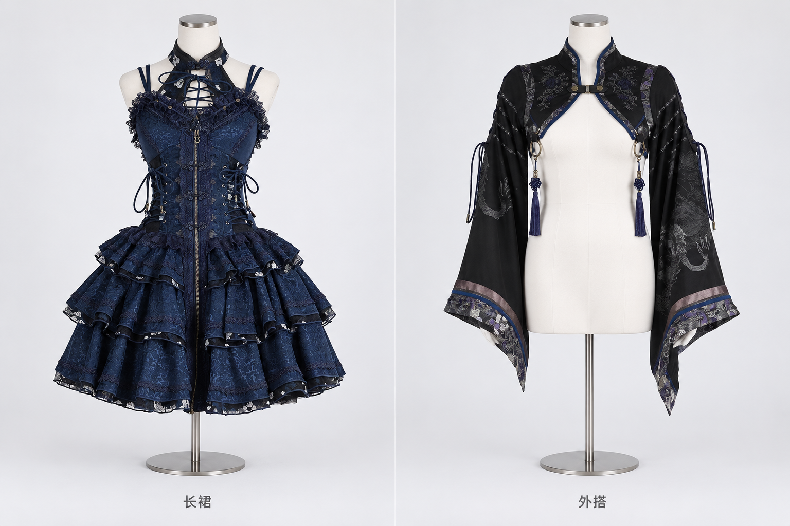
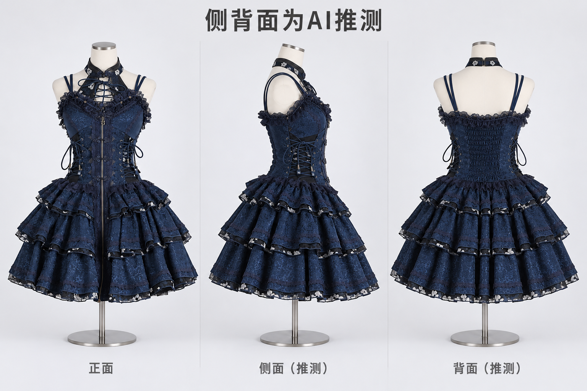

# 统一服装人台与三视图探索（2026-10-15）

## 结论

两次内置图生图已得到可审阅的真实样片。不同来源、原人台不同的绀色裙装和黑色短外搭，可以转成统一正面、灰白摄影棚、白色无头无臂人台。主要轮廓和高频服饰构件保留较好，但腰线、比例和细图案仍会被重绘，不能声称精确复刻。

建议先落地单正面人台预览，并保留原图用于核对。三视图在只有正面资料时只能展示 AI 概念：本次背面自动生成了输入没有提供的松紧褶皱。真实三视图应要求同一件衣物的正、侧、背照片，或者明确、持续标注推测来源，不作为商品真实结构或版型证据。

## 执行范围与工具

- 仅新增本文档与 `docs/visuals/2026-10-15-mannequin-*.png`；未改动应用源码、数据或其他代理文件。
- 使用 [imagegen 技能](/Users/dengtong/.codex/skills/.system/imagegen/SKILL.md) 的默认内置 `image_gen.imagegen` 流程，使用 `referenced_image_paths` 提交参考图。
- 原图与生成图均通过 `view_image` 实际查看；两张结果原样复制到工作区，未进行手工后期、裁切或图片重绘。
- 共 2 次生成调用，无迭代。未调用外部收费 API，未请求 API key、注册或充值。
- 内置工具没有报告具体模型名称或版本，本文不推测为任何命名模型。
- 内置调用不提供逐次费用数据，不能据此证明应用接入后的单次成本、API 可用性或延迟 SLA。工具调用的实际墙钟时间约为 34 秒和 68 秒，仅是本次记录。
- 本次为图片探索，无应用实现变更，未执行 Android 构建或设备测试。

## 输入资料及证据

先逐张查看了以下 5 张图片。文件名沿用素材名，“长裙”沿用用户讨论中的名称；原图实际是多层膝上蓬裙，不把它擅改为及踝长裙。

| 输入绝对路径 | SHA256 | 实际观察与用途 |
|---|---|---|
| `/tmp/lolita-vton-exploration-20261015/items-33-0.jpg` | `e11b4d7978965b4b99f2c2366af95d75da885517680e820989d15636db3f2a71` | 绀蓝裙正面人台商品照。实验 A 的左栏与实验 B 的唯一服装依据。可见挂脖领、交叉系带、双肩带、胸蕾丝、前拉链、扣袢、腰两侧系带和三层裙摆。 |
| `/tmp/lolita-vton-exploration-20261015/items-19-0.png` | `a206b9c86dbe97d1ecadc151701002bd60121e3276a475033b044ed5f40fcf0c` | 黑短外搭的前侧人台照。实验 A 的右栏依据。可见立领、胸前连接扣、原有圆环和流苏、长喇叭袖、袖臂斜系带、灰银暗龙纹、织锦袖口。 |
| `/tmp/lolita-vton-exploration-20261015/coordinates-2-0.png` | `e6c28f1660cd778e129b7e0dd11df8d12ea87d65f0d29c480e4484340b8aac2e` | 红配色套装的真人正面姿态图，无绀色裙背面证据。仅检查，未传入生成调用。 |
| `/tmp/lolita-vton-exploration-20261015/coordinates-3-0.png` | `3a36a2105545356d12a02b9c4b4af4dd0e987d90f4b6e0a985248902c67d791a` | 相同绀色套装的真人前侧姿态图，叠穿外搭且姿态复杂，看不到背面。仅检查，未传入生成调用。 |
| `/tmp/lolita-vton-exploration-20261015/coordinates-4-0.jpg` | `3c0afef022f7da96b3706b31acbaec4d9aec5f148cfb5f4ff77c042f5ab8726c` | 白蓝配色且结构有差异的真人正面照，不能作为绀色裙背面依据。仅检查，未传入生成调用。 |

上述素材没有真实侧背照片。没有以不同款或不同颜色的套装图补造证据。

## 实验 A：不同服装统一正面人台



- 工作区文件：`docs/visuals/2026-10-15-mannequin-front-comparison.png`
- 像素尺寸：1536 × 1024。
- SHA256：`5744780ea2e2d9b5f9ac336a925f1c496d8c1938e8e909eec8949836f82b0e32`
- 内置原始输出：`/Users/dengtong/.codex/generated_images/01a13e61-f918-7b92-bbfe-89ed709f7663/exec-a1e08a0a-ee1a-4b25-938f-7da0402efdb6.png`
- 工具参数：`transparent_background=false`；参考图依次为 `items-33-0.jpg`、`items-19-0.png`。

### 视觉核对

| 核对项 | 观察 |
|---|---|
| 人台与构图统一 | 两栏均为正面、白色无头无臂人台，使用相同灰白背景、颈部高度、细支撑杆和圆盘；两个服装完整入画，中文标签正确。白人台更接近有轻微布面纹理的裁缝人台，并非严格的纯白塑料表面。 |
| 裙装轮廓 | 保留深绀蓝色、挂脖交叉系带、双肩带、胸蕾丝、前中拉链与扣袢、腰两侧系带和三层荷叶裙摆，辨识度较高。 |
| 裙装偏差 | 相比原图，腰下移、上身略被拉长，层叠裙摆开幅及折褶改变；织锦暗纹和黑底银白滚边图形发生重绘，不能逐个花鸟纹样精确对应。 |
| 外搭轮廓 | 保留立领、单条胸扣、圆弧下摆、双侧圆环与流苏、长喇叭袖、袖部斜系带及织锦袖口。原有人台的手消失，未额外生成真人或内搭。 |
| 外搭偏差 | 侧前角度变成正面后两袖更趋对称，袖褶、龙纹、流苏长度与袖口纹样位置发生变化。无法仅凭正面转换验证未见部位的真实做法。 |
| 混搭与新增物 | 两件衣物没有叠穿，右侧没有复制左裙，也没有新增头饰、武器、手袋或鞋。原衣上的圆环与流苏按服装结构保留。 |

### 完整提示词

```text
Use case: compositing
Asset type:服饰统一人台图的探索样片，一张双栏产品图
Primary request:将两张参考照片中两件不同衣服分别转移到同一种标准服装人台，做可直接比较的两栏工作室产品照。左栏只有图1的绀蓝色裙装；右栏只有图2的黑色短外搭。两栏各一件，彼此不叠穿。
Input images: 图1 /tmp/lolita-vton-exploration-20261015/items-33-0.jpg 是左栏衣服的唯一结构与图案来源；图2 /tmp/lolita-vton-exploration-20261015/items-19-0.png 是右栏衣服的唯一结构与图案来源。原照片仅作为服饰参考，不保留原人台、logo文字、装饰边框及背景。
Scene/backdrop:统一浅灰白无缝摄影棚背景，同一柔和漫射光，几乎无地面道具。
Subject:每栏相同的白色哑光女式服装展示人台，无头、无脸、无手臂、无手、无腿，平滑肩颈到髋部的非真人服装打版人台，底部仅简洁细金属支撑杆和相同圆盘。外搭袖子保留真实自然下垂体积，但不生成手臂或手。
Composition/framing:横向双栏，约3:2画幅；两个展示位在同一相机高度、完全正面、相同正交式产品摄影角度、同一人台真实尺寸、同一图像比例与相同人台颈部高度；全衣完整Fit在各栏，全部裙摆和外搭最长袖口都不可裁切。为了共享真实尺度，左侧裙装延伸至膝上蓬裙轮廓，右侧短外搭停在胸下且长喇叭袖下垂，右栏人台胸腹白色裸露。保持栏间呼吸空间。
Materials/textures:绀蓝裙准确保留高领挂脖式交叉系带开口、双细肩带、胸口蕾丝、前中金属拉链与中国结式扣袢、两侧腰部穿绳束身、多层不规则荷叶裙摆、深蓝暗纹织锦以及黑底银白花鸟滚边。黑外搭准确保留短立领、胸前单扣皮带连接、胸下开口弧线、双侧金属圆环与原有深蓝长流苏、宽大长喇叭袖、袖臂斜向系带与灰银暗龙纹、灰紫银色织锦袖口及蓝色包边。这些流苏和圆环是原衣结构，要保留；不要添任何额外配饰。
Text (verbatim):左栏下方小号深灰中文“长裙”，右栏下方小号深灰中文“外搭”。图中不加其它文字。
Constraints:优先忠实于每件原图，不重新设计服装。衣服颜色、主轮廓、领口、肩带、扣子、拉链、蕾丝、层数、图案位置、袖口及已有装饰尽量与对应参考一致。两个衣服独立，禁止把左裙放到右侧外搭下面。禁止生成真人皮肤、脸、头、头发、手、手套、鞋、裤子、内搭、衬衫、包、武器、帽子或花。禁止从一件衣服迁移花纹到另一件。无水印，无品牌文字，无花边外框。
```

## 实验 B：同一裙装正 / 侧 / 背三视图



- 工作区文件：`docs/visuals/2026-10-15-mannequin-three-views.png`
- 像素尺寸：1536 × 1024。
- SHA256：`ba35b9eb34649a3ddb06c231f86df7dbcd66218d2e3d59a5e81c0f01d2e5e301`
- 内置原始输出：`/Users/dengtong/.codex/generated_images/01a13e61-f918-7b92-bbfe-89ed709f7663/exec-02349888-a267-45c1-8cff-e616dcfe550a.png`
- 工具参数：`transparent_background=false`；参考图依次为 `items-33-0.jpg`、实验 A 的工作区输出。
- 实验 A 只提供统一人台和摄影风格，不能作为真实背面资料。

### 视觉核对

| 核对项 | 观察 |
|---|---|
| 推测标记 | 顶部醒目、准确显示“侧背面为AI推测”，侧面和背面各自也带“（推测）”标签。 |
| 统一性 | 三栏使用同一类白色无头无臂人台、灰白背景、金属底座，深绀蓝色、主织锦质感和三层滚边裙摆大体一致。没有带入实验 A 右侧黑外搭。 |
| 正面保真 | 主要领口、系带、蕾丝、前拉链、扣袢和层数保留，但腰线和裙体比例仍与原图有可见差异。 |
| 侧面局限 | 能读作侧向人台，但人台颈部倾斜，胸腰与裙体比例不是严格的几何旋转；侧腰系带结构由模型延伸，无法用输入验证。不能作为打版侧视图。 |
| 背面臆造 | 明确新增了背部大面积松紧褶皱、背领闭合和肩带落点。正面照没有这些结构证据，即使看起来合理也不能当作真实款式。 |
| 跨视图纹样 | 颜色和织锦密度接近，但花鸟滚边、暗纹的具体排布并非同一纹理贴图连续旋转，不能保证花纹、蕾丝、接缝在三视图逐处一致。 |
| 完整性 | 三件展示均完整入画，无手臂、真人、额外小物。画面可用于构想交流，不能称为真实三维重建。 |

本次没有做第三次修图，因为主要问题来自缺失侧背资料与生成机制，不是可以通过局部修正证明真实的结构错误。追加生成可能只是得到另一种同样没有证据的背部做法。

### 完整提示词

```text
Use case: compositing
Asset type:同一服装标准人台正/侧/背三视图概念探索，非商品事实图
Primary request:将图1的同一件绀蓝色裙装做一张横向三栏、正面/右侧面/背面的标准服装人台产品图。正面忠实原图，侧面和背面因为没有照片，只作为清楚标注的AI结构推测。图中醒目写“侧背面为AI推测”。
Input images:图1 /tmp/lolita-vton-exploration-20261015/items-33-0.jpg 是唯一服装依据，正面商品照。图2 /Users/dengtong/.codex/worktrees/virtual-try-on/lolita/docs/visuals/2026-10-15-mannequin-front-comparison.png 只取左栏白色无头无臂人台、摄影风格、背景和相机尺度作为统一标准；不要复制右栏黑色外搭，不取图2作为背面证据。
Scene/backdrop:统一浅灰白无缝studio，三个展示位相同柔和漫射光，无道具。
Subject:三个人台必须是同一白色哑光无头无臂女式服装人台的三个角度，平滑肩颈到髋部，无脸、无手臂、无腿，下方相同细金属支撑杆和圆盘。各穿同一件绀蓝色多层蓬裙；相同真实尺寸和裙长。
Composition/framing:横向约3:2画幅，三个等宽栏，同一地平线，同一人台颈部高度，统一相机高度、相同正交式尺度。左栏严格正面，中栏严格右侧90度，右栏严格后背180度。保持裙装全部完整Fit，包括所有层裙摆与底座，不能裁切。每栏简洁标签分别为“正面”“侧面（推测）”“背面（推测）”。顶部留空一行，以清晰醒目的深灰中文写“侧背面为AI推测”，必须完全准确可读。
Materials/textures:正面严格沿图1：高领挂脖式交叉系带开口、双细肩带、胸口蕾丝、前中金属拉链和中国结式扣袢、两侧腰部穿绳束身、深绀蓝暗花织锦、三层荷叶蓬裙、黑底银白花鸟滚边；不擅改领口与裙身比例。侧背面推测采用与正面相同的织锦、绀蓝色、层叠裙摆位置与长度、蕾丝以及细肩带的结构延续。保持同一件衣服在转动，不生成三个新设计。侧面与背面花纹的材质、大小、织密和各层滚边纹样要一致，但不要把前拉链和胸口开口错误复制到后背。无背面实拍，因此任何背部接缝/闭合方式都只是一种简约概念推测。
Constraints:三栏服装颜色、衣料、领口、肩带、腰线、裙长和层数保持一致。禁止真人、头、头发、皮肤、手、鞋、腿、武器、外搭、衬衫、头饰、包或配件。禁止把图2的黑色长袖外搭带入任何栏。无logo，无水印，无装饰画框。只生成一张图。
```

## 对产品落地的建议

1. 先提供“生成正面人台预览”，保存原始商品图与生成结果的独立来源。导入后预览完整衣物，允许与原图并排核对领口、腰线、袖口、层数、印花和装饰。
2. 统一人台模板应固定人台比例、相机正面、照明、背景和画幅，采用同一模板参考，减少衣橱里每件图的尺度漂移。固定提示词本身不能保证严格一致，仍需验证输出。
3. 将人台预览定义为 AI 效果图。不要直接替换原商品图，不把生成的花纹、背部结构、材质或比例写回服饰事实字段。
4. 三视图优先要求同一件服饰真实多角度照片；缺失视角时像本次一样显著写明推测，不能用虚构背面反过来推断商品信息。
5. 当前样片说明“视觉归一化”可行，尚未验证多件批量稳定性、真人遮挡图的服装提取、不同尺码/体型、复杂印花文字、小物、透明面料和正式 API 集成能力。这些需要独立评估。

