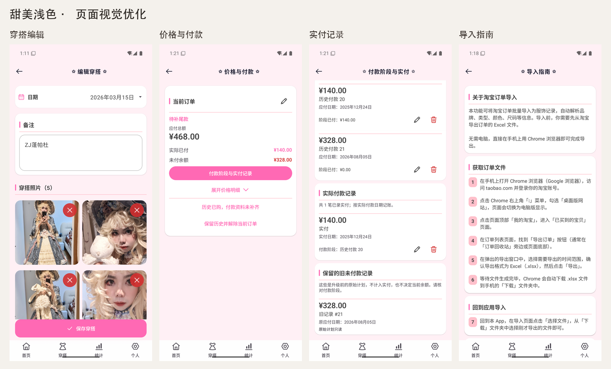
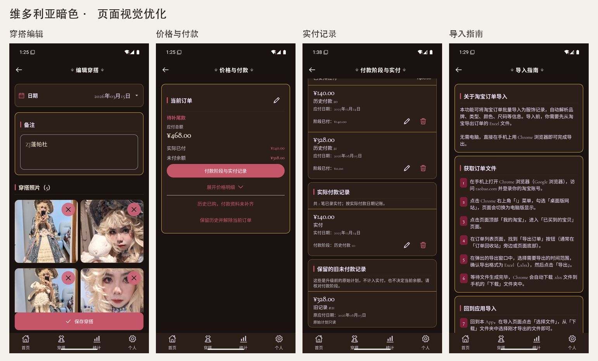
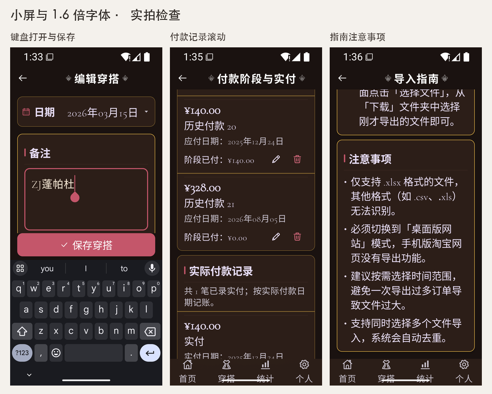

# 第一轮页面视觉优化与验证

基线：`92cd06b50626ded5e27a8ca01fe0337bfad63275`。本轮整理穿搭编辑、价格付款和淘宝导入指南；月份的紧凑设计按用户意图保留。随后按用户授权完成发布收尾，版本为 2.40.3 / 88。

## 变更

- 穿搭的日期、备注与关联服饰通栏，照片保留两列，去除重复内边距；底部唯一“保存穿搭”按钮在键盘上方可达。保存、照片选择删除、日期、关联和放弃更改继续走原逻辑。
- 价格付款首先显示状态、总价、实付和余额。价格明细与解释可展开；历史未知余额、只读和日期缺失提示常显。付款计划、真实实付与旧未付计划采用紧凑分组，每条继续独立虚拟化；七套皮肤复用现有令牌。有边框的分组连接不再重复绘制内部横线。
- 导入指南移除六块灰色截图占位，按获取文件与应用导入分组，原七步和四项注意正文逐字保留。

## 验证结果

- 独立工作区 `assembleDebug testDebugUnitTest assembleDebugAndroidTest` 通过；86 项单元测试，零失败。最终边框修正后再次编译通过。
- 独立 API 35 AVD：`Lolita_Visual_First_Pass_API35` / `emulator-5560`。安装前验证签名一致，全部安装使用 `install -r`。主 5554 及已有 5556/5558 未操作。
- 45 项既有设备回归通过：`PriceManageScreenReviewTest` 7、`PaymentManageScreenTest` 1、`PurchaseReviewConsistencyTest` 2、`QuickOutfitLogViewModelTest` 2、`HistoricalPurchaseTest` 13、`OrderBusinessTest` 12、`DataIntegrityTest` 8。最终边框调整后价格/付款两套 8 项再次通过。
- 使用库中的旧 ZIP 经官方恢复入口恢复 140 件服饰、3 条穿搭、139 笔当前订单与 144 条原付款。实拍核对正常待补尾款、历史未知余额、只读阶段、补录页、真实日期、旧未付记录；键盘保存和修改后放弃返回均可用。未在实拍中提交价格或付款变更。
- DEFAULT 浅色、VICTORIAN 暗色实拍通过；900×2000、420 dpi、1.6 倍字体下，日期和金额完整，保存仍在键盘上方，付款记录与指南四项注意可滚动到达。此项是两套皮肤实拍，不代表七套逐一设备截图。
- 独立代理完成各任务规格、质量与四文件整体静态审查，最终边框修正再次通过。

## 数据比对与创建时间修复

对恢复后基线与实拍保存后的 24 个业务/缓存表逐字段比较：服饰、价格、阶段、付款、订单证据、穿搭照片、日期、备注、关联及其他业务字段一致。实拍发现基线完整穿搭编辑会把该记录的 `created_at` 和 `updated_at` 都改为当前时间。发布收尾时补充 `OutfitLogEditViewModelTest` 的四项真实 Room 回归，先在未修复实现上观察到两项失败（创建时间重写、原记录未读完仍能保存），再保留原实体并复制可编辑字段；创建时间保持，修改时间继续由 Repository 更新。读取期间按钮禁用，ViewModel 也拒绝原实体未加载的提交；正常新建与已删除记录保护继续通过。照片文件字节、日期、历史关联和服饰记录均纳入断言。

指南中原有淘宝网站入口说明未在本轮重新核实；本轮未改写这些内容或新增网站能力。

## 实拍

本轮本机原始日志、UI 树、截图、签名、数据比较及独立审查保存在 `/tmp/lolita-visual-first-pass-verification/`。此记录不替代 USB 测试套件、七套皮肤完整截图或实际系统通知/日历权限交互验收。

## 发布收尾验证

- 最终 2.40.3 / 88 源码通过 `assembleDebug testDebugUnitTest assembleDebugAndroidTest`，86 项单元测试无失败。
- 独立 AVD `Lolita_Release_2403_Debug_Test` / `emulator-5560`，49 项设备回归通过（前述 45 项加完整穿搭编辑 4 项），未操作 5554/5556/5558。
- 独立代理复审创建时间、原实体复制、读取中保存保护与四项真实 Room 测试，通过。
- 最终源码 `clean assembleRelease` 通过；APK 为 2.40.3 / 88，与线上 2.40.2 的证书 SHA256 一致。独立 AVD `Lolita_Release_2403_Upgrade_Test` 使用线上旧包，经官方入口恢复库中 ZIP 后 `install -r` 升级；24 个业务/缓存表逐字段一致，190 张图片 SHA256 一致，schema 23，外键检查通过。
- 在升级后的签名 Release 中实际打开原穿搭并保存，原创建时间、日期、备注、5 张照片与 4 项关联保持；只有该记录的修改时间更新。其他表与图片均不变。
- 发布 APK SHA256：`7171ba87b6cfaef355af566f8a416ac5a68fddeed835e8a1ea54c7a2305b88c1`，用于核对线上上传资产。本次发布本机原始日志保存在 `/tmp/lolita-release-2.40.3/`；发布状态以 `v2.40.3` 的 GitHub Release 为准。
